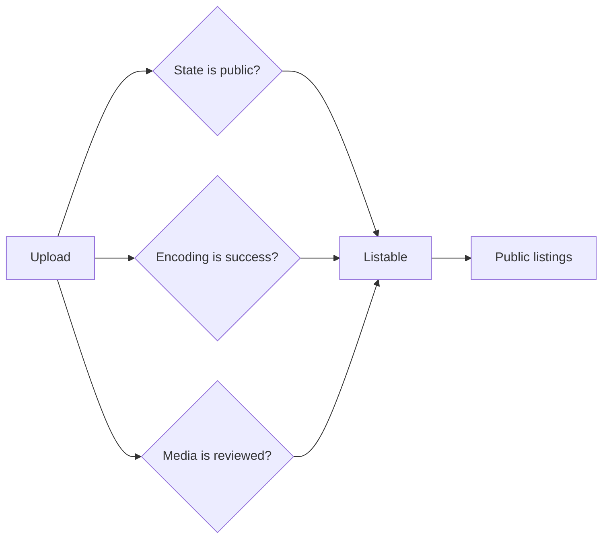

# Concepts

Use this page to learn the words that MediaCMS uses. The [glossary](../contributing/glossary.md) lists all terms.

## Media

A **media** item is one uploaded video, audio, image, or PDF file. Each media item has a title, a description, a state, and an owner. Users can group media in playlists, categories, and tags.

## State: public, private, and unlisted

Every media item has one state.

| State | Who can find it | Who can open it |
|-------|-----------------|-----------------|
| public | Everyone, in listings, when the media is listable | Everyone |
| private | The owner, editors, managers, and superusers | The owner, editors, managers, superusers, and people with a direct share |
| unlisted | Nobody, in listings | Anyone who has the URL |

The setting `PORTAL_WORKFLOW` sets the state of new uploads. Its values are `public`, `private`, and `unlisted`.

## Encoding

MediaCMS encodes each video into the profiles that an administrator turned on. A long video is split into chunks. Celery workers encode the chunks and join them. MediaCMS then creates an HLS version.

The encoding status of a video is `pending`, `running`, `fail`, or `success`. Images, audio, and PDF files do not wait for video encoding.

## Listable

A media item is **listable** when all three conditions are true:

1. The state is public.
2. The encoding status is `success`.
3. The media is reviewed.

Only listable media appears in public listings, such as the home page and search results.

## Review

The setting `MEDIA_IS_REVIEWED` controls review. The default is `True`. All media counts as reviewed. If you set it to `False`, an editor, a manager, or a superuser must mark each new media item as reviewed. Until then, the media is not listable.

## Roles

MediaCMS has six roles in addition to the pending state. See [Roles](../roles/index.md) for the full list and the [role comparison](../roles/compare.md).

## Manage pages and the admin portal

MediaCMS has two work surfaces. Do not mix them.

| Surface | Address | Who uses it |
|---------|---------|-------------|
| Manage pages | `/manage/media`, `/manage/users`, `/manage/comments` | Editors, managers, and superusers |
| Admin portal | `/admin/` | Staff and superusers |

- **Manage pages** are part of the portal. They list media, users, and comments with filters and bulk actions.
- The **admin portal** is the Django administration interface. It shows a dashboard and the data tables.

A staff user can open the admin portal. A staff user cannot open the Manage pages unless the user is also an editor, a manager, or a superuser.

## Two upgrade words

- **Content migration** imports media from another platform, for example Kaltura, YouTube, or Panopto.
- **Site upgrade** moves an existing MediaCMS install to a new MediaCMS version.

## MediaCMS Architecture

Django decides the `listable` value each time it saves a media item. Celery updates the encoding status. Reviewers set the reviewed flag.

## Next step

Open [Update](update.md) or go to [Roles](../roles/index.md).
