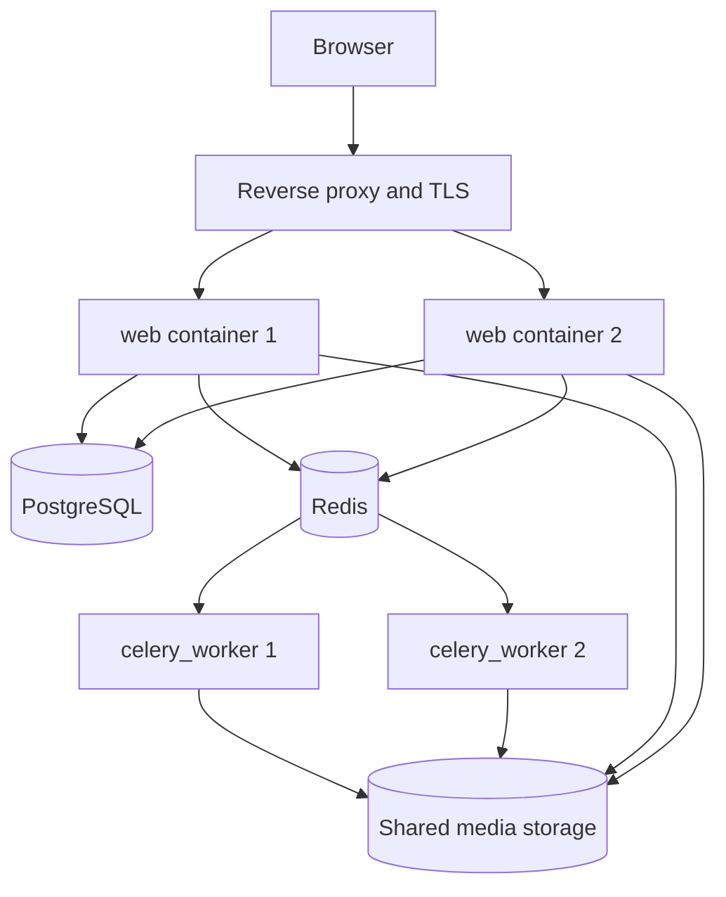

# Deploy

Use this page to choose how people reach your MediaCMS portal.

The MediaCMS image uses supervisord. Supervisord runs one or more services in a container. You turn each service on or off with an environment variable set to `yes` or `no`:

- `ENABLE_UWSGI`
- `ENABLE_NGINX`
- `ENABLE_CELERY_BEAT`
- `ENABLE_CELERY_SHORT`
- `ENABLE_CELERY_LONG`
- `ENABLE_MIGRATIONS`

All services are on by default. To scale the portal, split the services into separate containers.

## Choose a pattern

| Pattern | Address | Compose file |
|---------|---------|--------------|
| Localhost | `http://localhost` | `docker-compose.yaml` |
| Port 8000 | `http://localhost:8000` | `docker-compose.yaml` with a port in `FRONTEND_HOST` |
| TLS with Let's Encrypt | `https://my_domain.com` | `docker-compose/docker-compose-letsencrypt.yaml` |
| Reverse proxy, HTTP | `http://mediacms.io` | `docker-compose/docker-compose-http-proxy.yaml` |
| Reverse proxy, HTTPS | `https://mediacms.io` | `docker-compose/docker-compose-https-proxy.yaml` |
| Scalable | Your own address | Your own orchestration |

!!! note
    After you change a setting, restart the services: `docker compose restart web celery_worker celery_beat`.

## Deploy on localhost

Use this pattern for tests. The main container runs migrations, the web service, `celery_beat`, and the Celery workers. It uses port 80.

1. Open `deploy/docker/local_settings.py`.
2. Set `FRONTEND_HOST` to `http://localhost`.
3. Run `docker compose up`.

## Deploy with TLS and Let's Encrypt

Before you start, make sure the DNS record of `my_domain.com` points to your server.

1. Open `docker-compose/docker-compose-letsencrypt.yaml`.
2. Set `VIRTUAL_HOST` to `my_domain.com`.
3. Set `LETSENCRYPT_HOST` to `my_domain.com`.
4. Set `LETSENCRYPT_EMAIL` to your email address.
5. Open `deploy/docker/local_settings.py`.
6. Set `FRONTEND_HOST` to `https://my_domain.com`.
7. Run `docker compose -f docker-compose/docker-compose-letsencrypt.yaml up`.
8. Open `https://my_domain.com`. The browser shows a valid certificate.

## Deploy behind a reverse proxy

A reverse proxy receives browser requests and sends them to one or more web containers. The `jwilder/nginx-proxy` image can end TLS with self-signed, Let's Encrypt, or CA-signed certificates.

1. Open `deploy/docker/local_settings.py`.
2. Set `FRONTEND_HOST` to the public address, for example `https://mediacms.io`.
3. Set `TRUSTED_PROXIES` to the proxy IP or CIDR list, and set `PROXY_AWARE_MIDDLEWARE_ENABLED = True` so auth and failed-login logs use the real client IP.
4. When the proxy ends HTTPS, set `USE_X_FORWARDED_HOST = True` and `SECURE_PROXY_SSL_HEADER = ('HTTP_X_FORWARDED_PROTO', 'https')`.
5. Start the proxy Compose file that matches the address scheme.
6. Check that DNS or your hosts file points the name to the proxy.
7. Restart web, celery_worker, and celery_beat after the settings change.

See the [Settings catalog](../guides/admin/settings.md) for the full proxy and logging table. Leave `TRUSTED_PROXIES` empty when nothing sits in front of the app.

If you use your own proxy, send the media authorization requests to Django. See **Use your own nginx configuration** in [Install with Docker](install.md).

## Scale the deployment

For a large portal, run these parts separately:

- Many web containers.
- One `celery_beat` container.
- Many `celery_worker` containers.
- A managed PostgreSQL database, a managed Redis service, and shared storage.

All web and worker containers must use the same media file system, for example NFS or EFS.

## MediaCMS Architecture

## Next step

Open [First sign-in](first-sign-in.md).
