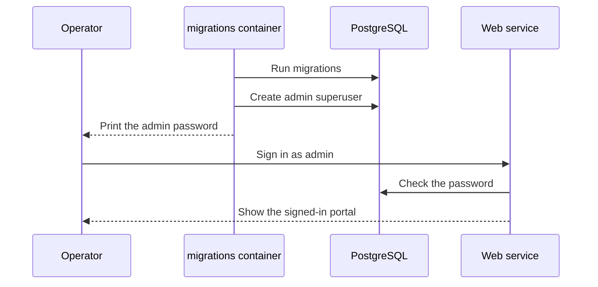

# First sign-in

Use this page to sign in to MediaCMS for the first time.

The user name of the first administrator is `admin`. The password depends on the Compose file.

| Installation | User name | Password |
|--------------|-----------|----------|
| Development (`docker-compose-dev.yaml`) | `admin` | `admin` |
| Production (`docker-compose.yaml`) | `admin` | Random, unless you set `ADMIN_PASSWORD` |

!!! warning
    Never use `admin`/`admin` on a portal that people can reach from the internet.

## Sign in on a development portal

1. Run `docker compose -f docker-compose-dev.yaml up`.
2. Open `http://localhost` in a browser.
3. Select **Sign in**.
4. Enter `admin` in the user name field.
5. Enter `admin` in the password field.
6. Select **Sign in**.

The webpack development server also runs on `http://localhost:8088`. It shows the same pages with live frontend code.

## Sign in on a production portal

1. Read the `migrations` container output. Find the line `Created admin user with password: ...`.
2. Open your portal address in a browser.
3. Select **Sign in**.
4. Enter `admin` and the password from step 1.
5. Select **Sign in**.
6. Open your user menu. Select **Change password**. Enter a new password.

If you set `ADMIN_PASSWORD` in the Compose file, use that value in step 4.

## Check the result

After you sign in, the header shows your user menu. The `admin` user is a superuser. It can open the Manage pages and the admin portal at `/admin/`.

## MediaCMS Architecture

The `migrations` container creates the `admin` user when the database has no such user. The script `deploy/docker/prestart.sh` reads `ADMIN_USER`, `ADMIN_EMAIL`, and `ADMIN_PASSWORD`. If no password is set, it makes a random one and prints it.

## Next step

Read [Concepts](concepts.md).
