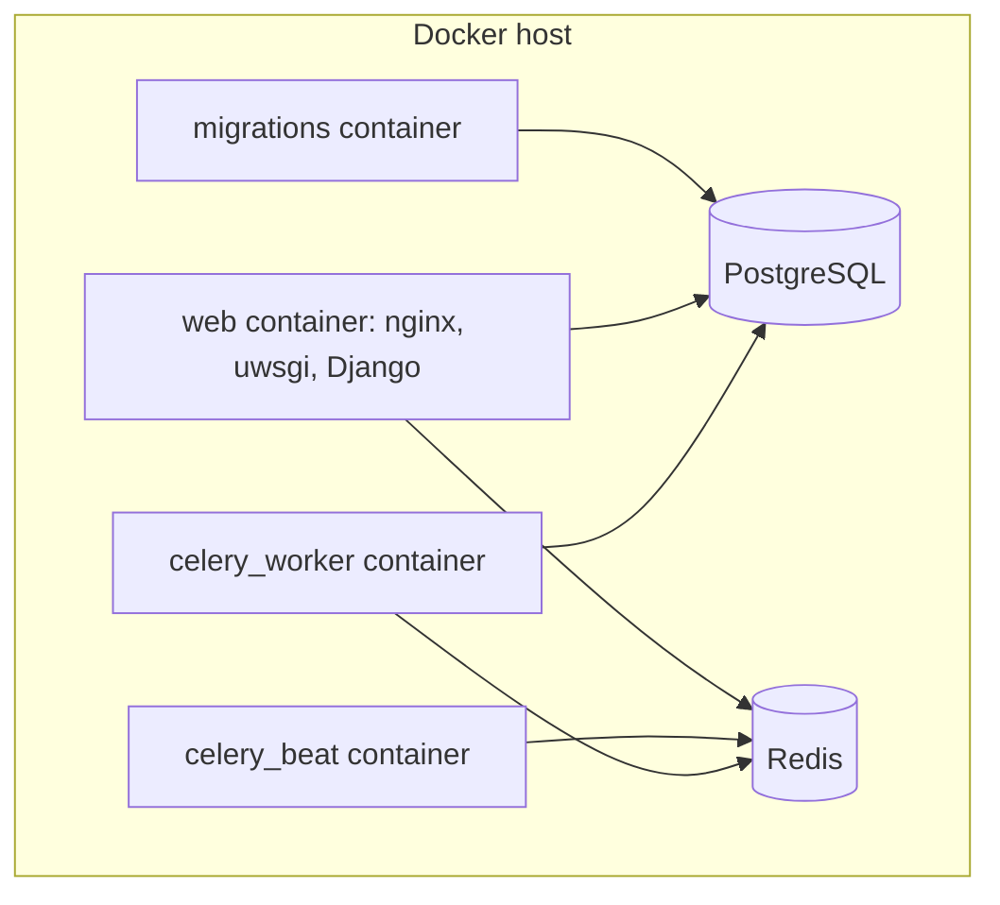

# Getting started

This section shows the path from a new server to a working MediaCMS portal.

## The path

1. [Install with Docker](install.md). Download the code and start the containers.
2. [Deploy](deploy.md). Choose how people reach the portal: localhost, TLS, or a reverse proxy.
3. [First sign-in](first-sign-in.md). Find the administrator password and sign in.
4. [Concepts](concepts.md). Learn the words that MediaCMS uses for media, states, and roles.
5. [Update](update.md). Keep MediaCMS current.

## Before you start

- You need a server with Docker and Docker Compose.
- You need a user account that can run `docker` commands.
- You need about 4 GB of free memory for a small portal.

!!! note
    For a first test, use the default `docker-compose.yaml` file. You can change the deployment later.

## MediaCMS Architecture

The Docker image starts several services. The `migrations` service prepares the database and creates the first administrator. The web service answers browser requests. Celery services encode video.

## Next step

Open [Install with Docker](install.md).
