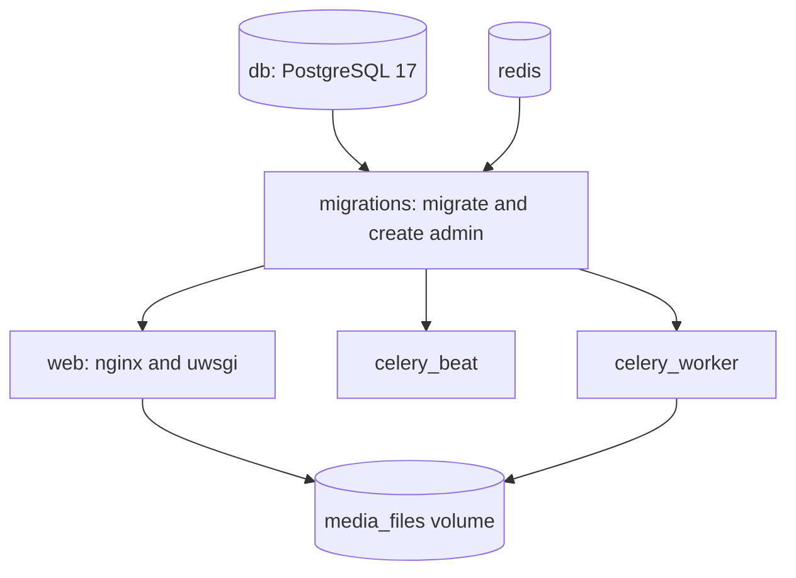

# Install with Docker

Use this page to install MediaCMS on one server with Docker Compose.

## Before you start

- Install a recent version of [Docker](https://docs.docker.com/get-docker/) and [Docker Compose](https://docs.docker.com/compose/install/).
- Use PostgreSQL 15 or later. The development file `docker-compose-dev.yaml` and the default `docker-compose.yaml` use PostgreSQL 17.
- Run the commands as a user that can use Docker.

!!! warning
    MediaCMS version 3 and later needs PostgreSQL 15 or later. A data directory from PostgreSQL 13 does not start with a newer image. Migrate the database first. Read [Update](update.md) and [Site upgrade](../guides/admin/site-upgrade.md).

## Install MediaCMS

1. Open a terminal on the server.
2. Download the code.

    ```bash
    git clone https://github.com/mediacms-io/mediacms
    cd mediacms
    ```

3. Start the containers.

    ```bash
    docker compose up
    ```

4. Wait until the output stops. Docker downloads the images and starts all containers.
5. Open `http://localhost` in a browser. On a remote server, open `http://` followed by the server IP address.

## Find the administrator password

The `migrations` container creates an `admin` user. It sets a random password unless you set `ADMIN_PASSWORD` in the Compose file.

1. Read the end of the `migrations` container output.
2. Find the line that starts with `Created admin user with password:`.
3. Copy the password.

```text
migrations_1     | Created admin user with password: gwg1clfkwf
```

To set your own password, remove the comment mark from `ADMIN_PASSWORD` in `docker-compose.yaml` before you run `docker compose up`.

See [First sign-in](first-sign-in.md) to use the password.

## Enable Whisper transcription (optional)

Whisper creates subtitles automatically. It works only in the Docker installation. It needs the `mediacms/mediacms:full` image.

1. Use one of these methods.
    - Run `docker compose -f docker-compose.yaml -f docker-compose.full.yaml up`.
    - Edit `docker-compose.yaml`. Set the image of the `celery_worker` service to `mediacms/mediacms:full`.
2. Open `deploy/docker/local_settings.py`.
3. Set `USE_WHISPER_TRANSCRIBE = True`.
4. Restart the services.

    ```bash
    docker compose restart web celery_worker celery_beat
    ```

## Use your own nginx configuration (optional)

MediaCMS uses nginx to protect media files. nginx asks Django if a user may open a file. If you use your own nginx configuration instead of `deploy/docker/nginx_http_only.conf`, copy these blocks from that file:

- `location = /_media_auth` and `location ~ ^/media/(encoded|hls)/(.*)$`. They check access to encoded and HLS files.
- `location ~ ^/media/original/(.*)$`. It checks access to original files. It sends unknown file types as downloads.
- `location ^~ /_protected_pdf/`. Django uses it to serve PDF files. Without it, PDF files do not show.

## MediaCMS Architecture

`docker compose up` starts the services in this order. The database and Redis start first. The `migrations` container runs the database migrations and creates the administrator. The web and Celery containers start next.



Workers and web containers must use the same media file system.

## Next step

Choose a deployment pattern in [Deploy](deploy.md). To update an installed portal, read [Update](update.md).
