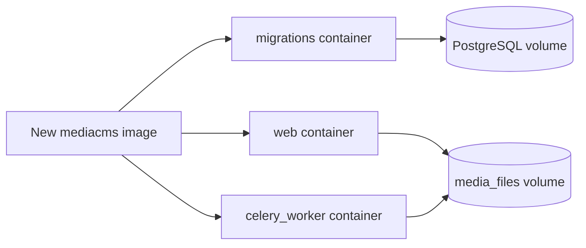

# Update

Use this page to update a MediaCMS Docker installation to the latest image.

!!! warning
    Back up the database and the `media_files` directory before you update.
    The default Docker layout stores PostgreSQL data in `../postgres_data/` and
    uploaded media in `media_files/`. Back up both locations, and verify a restore
    before you remove the old copy. A PostgreSQL major-version change may need a
    separate database migration; changing only the image tag can leave the data
    directory unusable.

## Update the image

1. Open a terminal on the server.
2. Go to the MediaCMS installation directory.

    ```bash
    cd /path/to/mediacms/installation
    ```

3. Download the latest image.

    ```bash
    docker pull mediacms/mediacms
    ```

4. Stop the containers.

    ```bash
    docker compose down
    ```

5. Start the containers.

    ```bash
    docker compose up
    ```

6. Read the `migrations` container output. Check that the migrations finish without errors.
7. Open the portal. Check that you can sign in.

## Check your custom nginx configuration

If you use your own nginx configuration, compare it with `deploy/docker/nginx_http_only.conf` after each update. See **Use your own nginx configuration** in [Install with Docker](install.md).


## Checklist before you change the image

Treat the database and the uploaded media as separate data sets.

1. Stop the old services. Make a restorable PostgreSQL backup. Keep the original database version available until you test the backup.
2. Back up the complete `media_files/` directory, including encoded files, thumbnails, subtitles, and HLS output.
3. Keep the old `deploy/docker/local_settings.py`, domain settings, and any reverse-proxy configuration.
4. Test the update on copies of the database and the media directory first.

After you restore the copies into the Docker layout, start the database and Redis, run the migrations service, and only then start the web and Celery services. Check existing users, media, permissions, thumbnails, subtitles, and the encoding queue before you switch production traffic.

Do not load fixtures into an existing database. Do not delete the old PostgreSQL data or the media backup until the updated instance works.

## Update from version 2 to version 3

Version 3 uses Python 3.11 and PostgreSQL 15 or later. A data directory from PostgreSQL 13 does not start with a newer image. The PostgreSQL container shows this error:

```text
FATAL:  database files are incompatible with server
DETAIL:  The data directory was initialized by PostgreSQL version 13, which is not compatible with this version 15.2.
```

Use one of these options:

- Edit the Compose file. Use the `postgres:13` image.
- Migrate the database from PostgreSQL 13 to a newer version.

## Move to a new MediaCMS version with existing data

A site upgrade moves an existing install to a new MediaCMS version. Only a superuser can run it. Read the [Site upgrade guide](../guides/admin/site-upgrade.md).

## MediaCMS Architecture

An update replaces the application image. The database and the media files stay in volumes. The `migrations` container applies new database migrations on start.



## Next step

Read the [Site upgrade guide](../guides/admin/site-upgrade.md) or go to [Roles](../roles/index.md).
