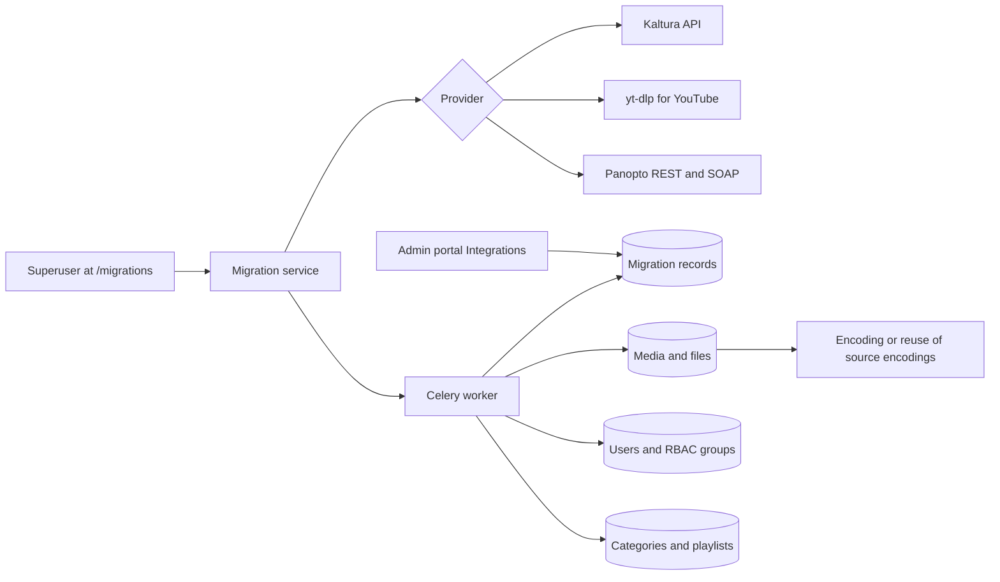

# Content migration

Use this page to import media from another platform into MediaCMS. Supported sources are Kaltura, YouTube, and Panopto.

!!! warning
    Content migration is not a site upgrade. Content migration imports media from **another platform**. A site upgrade moves an **existing MediaCMS install** to a new MediaCMS version. For a site upgrade, read [Site upgrade](site-upgrade.md).

Only a superuser can use content migration. The entry point is **Migrations** in the top right menu.

## Pages and URLs

| Page | URL |
|------|-----|
| List of migrations | `/migrations` |
| Choose a source | `/migrations/new` |
| New migration for one source | `/migrations/new/<source>` where `<source>` is `kaltura`, `youtube`, or `panopto` |
| One migration | `/migrations/<id>` |
| Edit a migration | `/migrations/<id>/edit` |
| REST API | `/api/v1/migrations` |

The source of a saved migration cannot change. To use another source, create a new migration.

## Compare the sources

| | Kaltura | YouTube | Panopto |
|--|---------|---------|---------|
| Needs | App token (service URL, partner ID, token ID, token value) | `yt-dlp`. Cookies on servers | API client and a local service account with admin rights |
| What you give it | Categories to migrate | Video, playlist, or channel URLs | Folders to migrate |
| Owners | Accounts are created or matched | One MediaCMS user owns all media | Accounts are created or matched |
| Captions | WebVTT, optional | English only, if the uploader gave one | If Panopto offers a caption file |
| Reuse of existing encodings | Yes, with **Migrate media flavors / encodings** | Yes, with **Attempt to skip transcoding** | No. One mp4 per recording. MediaCMS encodes |
| RBAC groups | Yes, with `USE_RBAC` | No | Yes, with `USE_RBAC` |
| Full guide | [Kaltura migration](https://github.com/mediacms-io/mediacms/blob/main/docs/kaltura_migration.md) | [YouTube migration](https://github.com/mediacms-io/mediacms/blob/main/docs/youtube_migration.md) | [Panopto migration](https://github.com/mediacms-io/mediacms/blob/main/docs/panopto_migration.md) |

## Run a migration

1. Open `/migrations`.
2. Select **New migration**.
3. Select the source.
4. Enter the connection values for the source.
5. Select **Test connection**. This reads counts and loads the choices. It imports nothing.
6. Select the categories, folders, or URLs to migrate.
7. Set the options.
8. Select **Save draft** or **Save and start**. Nothing is imported until you start.
9. Open `/migrations/<id>`. Watch the progress, the live log, and the ID mapping table.

Credentials are encrypted at rest. The API never returns a secret. **Test connection** makes the server contact the address in the form. For this reason only a superuser can use it.

## Before you start

1. Back up the database and the `media_files` directory.
2. Check the active encode profiles at `/admin/files/encodeprofile/`. They decide which encodings can be attached.
3. Check the settings that change the result:

| Setting | Why it matters |
|---------|----------------|
| `USE_RBAC` | Without it, private categories have no groups. Media still arrives private |
| `USE_LTI` | Needed to wire LMS courses to an LTI platform (Kaltura and Panopto) |
| `PORTAL_WORKFLOW` and `MEDIA_IS_REVIEWED` | See the listing rules in [Library and engagement](library.md) |
| `MIGRATION_PAGE_SIZE`, `MIGRATION_API_TIMEOUT`, `MIGRATION_DOWNLOAD_TIMEOUT`, `MIGRATION_MAX_RETRIES` | Tune a large run |

## Control a running migration

| Button | Result |
|--------|--------|
| **Pause** | Stops after the items in progress. Keeps the position |
| **Resume** | Continues from the saved position |
| **Abort** | Stops for good. Keeps what was imported. You can still restart it |
| **Run again** | Sweeps the source once more on a finished migration |

Nothing is imported twice. MediaCMS stores a record for each imported object. A repeat run skips records that succeeded. It retries records that failed. It also picks up new items at the source.

Migration statuses: `pending`, `running`, `paused`, `success`, `error`, `aborted`. Record statuses: `success`, `failed`, `skipped`.

For Kaltura, **Do not run between** holds a run inside a window of hours. The time zone is the portal time zone. A page in progress is finished first.

### If a migration is stuck in running

1. Open the list. Read **Last activity**.
2. If the time is old, a worker may have stopped.
3. Select **Pause**.
4. Select **Resume**.

Replaying a page is safe. Each importer checks the mapping table before it writes.

## Kaltura

- Create an app token with `sessionType=2` (admin rights). A long `expiry` stops the token from ending a long run.
- Enter **Service URL**, **Partner ID**, **App token ID**, and **App token value**. Do not add `/api_v3` to the service URL.
- Select at least one top-level category. Each top-level category is one site. Media that is only in other top-level categories is not migrated. Media in no category is migrated and arrives private.
- Choose one user option: **Migrate all users**, **Only migrate below listed users**, or **Only migrate users that own media**.
- Check the **Global role mapping** tab before you start. **Super user and staff** creates a Django superuser. A role is applied only to accounts that the migration creates.
- Visibility comes from the categories of the entry. An entry in no category is private.

Kaltura groups can become RBAC groups with **Migrate groups**. A group gives no access until you attach it to a category.

## YouTube

- Install `yt-dlp` with `pip install -r requirements.txt`. Update it with `pip install -U yt-dlp` when extraction fails.
- Enter one URL, playlist, channel, or video ID on each line.
- Select the **Owner**. All media belongs to this one user.
- From a server, YouTube can show a bot check. Paste a cookies file into **Cookies file contents**. Export it from a separate browser profile. Do not use that profile again.
- YouTube never serves the original file. MediaCMS imports the best rendition that YouTube gives.

!!! note
    Download only video that you own or that the licence allows.

## Panopto

- Create an API client of type **User-Based Server Application**.
- Create a local Panopto service account with admin rights. SSO-only accounts do not work.
- Select the folders to migrate. **My Folder** and **Remote Recorders** do not become categories.
- Check **downloads** in the **Test connection** result first. If downloads are off, there is no file to import.
- A public folder becomes a plain category. Other folders become RBAC categories when `USE_RBAC` is on.
- Folders for LMS assignments become no category. Each submission stays with its student.

## After the run

1. Open `/migrations/<id>`. Check the counts for each object type.
2. Open **Integrations** > **Migration records**. Filter by status `failed`.
3. Search users for `email-conflict.invalid`. See [People](people.md).
4. Run **Run again** to retry failed items.
5. Open **Site** > **Health**. Check the migration checks.

## MediaCMS Architecture

A migration is a Celery job. It reads from the source, writes records, and creates media, users, and categories.

