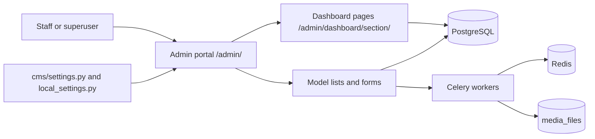

# Admin guides

Use these guides to run a MediaCMS portal from the admin portal at `/admin/`.

The guides are for staff and superusers. Use the [glossary](../../contributing/glossary.md) for the words in these pages.

!!! note
    Editors and managers use **Manage pages** (`/manage/media`, `/manage/users`, `/manage/comments`). These guides cover the **admin portal** only.

## Who can do what

| Task | Staff | Superuser |
|------|-------|-----------|
| Open the admin portal and the dashboard pages | Yes | Yes |
| Change data in a list (only with the model permission) | Yes | Yes |
| Read `/api/v1/tasks` | Yes | Yes |
| Download a database backup | No | Yes |
| Restore a database backup | No | Yes |
| Use **Migrations** (`/migrations`) for content migration | No | Yes |
| Run `upgrade_site` and other commands on the server | Server access needed | Server access needed |

A staff user sees only the models that the account has permission to use. A group in the sidebar is hidden when it has no models for that account.

## Read in this order

| Step | Guide | Use it to |
|------|-------|-----------|
| 1 | [Admin portal map](portal-map.md) | Find a page in the sidebar |
| 2 | [Settings catalog](settings.md) | Find the setting that controls a behavior |
| 3 | [Moderation](moderation.md) | Handle reports, reviews, and comments |
| 4 | [Library and engagement](library.md) | Manage media, categories, tags, playlists, and channels |
| 5 | [Processing](processing.md) | Manage encoding, captions, and FFmpeg settings |
| 6 | [People](people.md) | Approve users and manage RBAC groups |
| 7 | [Integrations](integrations.md) | Check identity providers, LTI, and migration records |
| 8 | [Site health and database](site.md) | Check health, back up the database, read the task list |
| 9 | [Custom pages and appearance](pages-appearance.md) | Add pages, change the logo, add translations |
| 10 | [Content migration](content-migration.md) | Import media from Kaltura, YouTube, or Panopto |
| 11 | [Site upgrade](site-upgrade.md) | Move an existing install to a new MediaCMS version |
| 12 | [Moodle and LTI](moodle.md) | Connect Moodle |
| 13 | [SAML and identity providers](saml.md) | Connect Microsoft Entra ID |

## Two words for two jobs

- **Content migration** imports media from another platform (Kaltura, YouTube, Panopto). See [Content migration](content-migration.md).
- **Site upgrade** moves an existing MediaCMS install to a new MediaCMS version. See [Site upgrade](site-upgrade.md).

Do not use one guide for the other job.

## MediaCMS Architecture

The admin portal is a Django admin with a workflow sidebar. Settings come from files. Data comes from PostgreSQL. Background work runs in Celery workers.

- **Settings files** are not in the admin portal. A change to a setting needs a restart. See the [Settings catalog](settings.md).
- **Celery workers** run encoding, captions, and trim jobs. See [Processing](processing.md).
