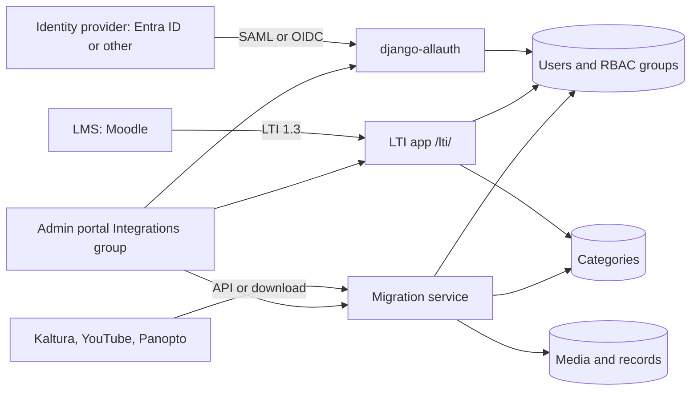

# Integrations

Use this page to check identity providers, SAML, LTI, and content migration records in the admin portal.

Open **Integrations** > **Overview** (`/admin/dashboard/integrations/`).

## Turn integrations on

Each integration has a switch in `local_settings.py`. A change needs a restart.

| Setting | Turns on | Guide |
|---------|----------|-------|
| `USE_IDENTITY_PROVIDERS` | Identity provider items, login options, user logs | [SAML and identity providers](saml.md) |
| `USE_SAML` | SAML configurations | [SAML and identity providers](saml.md) |
| `USE_RBAC` | Category groups. SAML and LTI use them | [People](people.md) |
| `USE_LTI` | LTI 1.3 items | [Moodle and LTI](moodle.md) |

Migration services and records are always in the group. See [Content migration](content-migration.md).

!!! warning
    `USE_LTI = True` sets `SESSION_COOKIE_SAMESITE` and `CSRF_COOKIE_SAMESITE` to `None`. It sets `SESSION_COOKIE_SECURE` and `CSRF_COOKIE_SECURE` to `True`. Use HTTPS. It also sets `RELATED_MEDIA_STRATEGY` to `no_related`.

## The Integrations overview

| Part | What it shows |
|------|---------------|
| Identity Providers | Counts for ID providers and login options (when `USE_IDENTITY_PROVIDERS` is on) |
| SAML Configurations | Count of configurations (when `USE_SAML` is on) |
| LTI | Counts for platforms, tool keys, and launches (when `USE_LTI` is on) |
| Migrations | Counts of migrations by status: pending, running, paused, success, error, aborted |
| Migration records | Counts by status: success, failed, skipped |
| Health checks | Status of each integration check |

## Health checks for integrations

| Check | Warns when |
|-------|-----------|
| Migration errors | A migration is in the `error` status |
| Migration record failures | A migration record is `failed` |
| Identity Providers | `USE_IDENTITY_PROVIDERS` is on and no ID provider exists |
| Active login options | `USE_IDENTITY_PROVIDERS` is on and no login option is active |
| SAML Configurations | `USE_SAML` is on and no configuration exists |
| LTI Platforms | `USE_LTI` is on and no platform exists |
| LTI Tool Keys | `USE_LTI` is on and no tool key exists |
| Failed LTI launches | A launch log has `success` off |

Select a check name to open the filtered list.

## Identity providers

When `USE_IDENTITY_PROVIDERS = True`, the group shows:

| Item | Use it to |
|------|-----------|
| ID Providers | Add an identity provider and its mappings |
| User Accounts | See accounts linked to an identity provider |
| Login options | Set the buttons on the sign-in page |
| User Logs | Read the SAML response logs |

See [SAML and identity providers](saml.md).

## SAML configurations

When `USE_SAML = True`, the **SAML configurations** item holds the SAML settings and group mappings for an ID provider. See [SAML and identity providers](saml.md).

## LTI

When `USE_LTI = True`, the group shows:

| Item | Use it to |
|------|-----------|
| LTI platforms | Add an LMS, for example Moodle |
| LTI resource links | See links between LMS resources and categories |
| LTI user mappings | See how LMS users map to MediaCMS users |
| LTI role mappings | Map LMS roles to MediaCMS roles |
| LTI launch logs | Read launches. Filter `success` off to find failures |
| LTI tool keys | Manage the keys that MediaCMS publishes |

The LTI endpoints are under `/lti/`:

| Endpoint | Path |
|----------|------|
| Login start | `/lti/oidc/login/` |
| Launch | `/lti/launch/` |
| Public key set | `/lti/jwks/` |
| Select media | `/lti/select-media/` |

See [Moodle and LTI](moodle.md).

## Migration services and records

A superuser opens `/migrations` to start a content migration. The admin portal shows the stored data:

| Item | Use it to |
|------|-----------|
| Migration services | See each migration, its source, and its status |
| Migration records | Search, filter, and export the mapping of source IDs to MediaCMS IDs |

Each imported object has one record. The status is `success`, `failed`, or `skipped`. A repeat run skips records that succeeded and retries records that failed.

Credentials are encrypted at rest with a key derived from `SECRET_KEY`. The API never returns a secret.

## MediaCMS Architecture

Integrations connect MediaCMS to other systems. The settings decide which parts exist.

