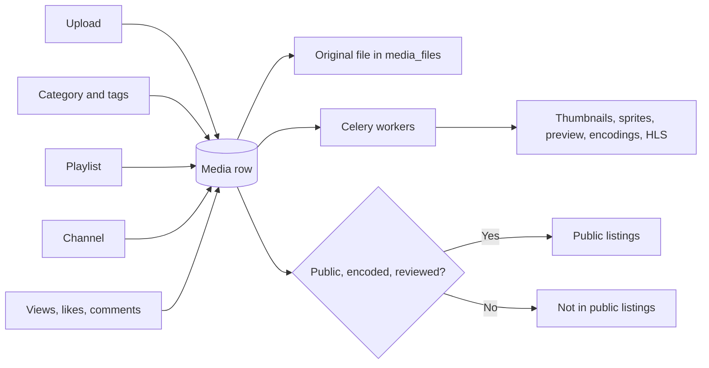

# Library and engagement

Use this page to manage media, categories, tags, playlists, and channels. Use the engagement page to see views, likes, dislikes, and comments.

## Open the library pages

| Page | URL |
|------|-----|
| Library overview | `/admin/dashboard/library/` |
| Engagement overview | `/admin/dashboard/engagement/` |
| Media list | `/admin/files/media/` |

## The Library overview

| Card or table | What it shows |
|---------------|---------------|
| Total media | All media rows |
| Media by state | **Public**, **Private**, **Unlisted** |
| Media by type | **Video**, **Audio**, **Image**, **PDF** |
| New media (7 days) | Media added in the last 7 days |
| Featured | Media with the featured switch on |
| Duplicate md5sum, Duplicate names | Possible duplicates |
| Categories, Tags, Playlists, Channels | Totals. Each card opens a list |
| Recent uploads | One table for each type: video, audio, image, PDF |

!!! note
    **Duplicate md5sum** ignores media that has no md5sum value. **Duplicate names** and **Duplicate md5sum** are also health checks. See [Site health and database](site.md).

## The Engagement overview

The page shows total views, likes, dislikes, and comments. It also shows four top lists: most viewed, most liked, most disliked, and most commented media. Select a row to open the media.

## Media states

| State | Meaning |
|-------|---------|
| public | Can show in listings when it is listable |
| private | Shown only to the owner, editors, managers, shared users, and RBAC members |
| unlisted | Reachable by URL. Not shown in public listings |

Media is **listable** when it is public, its encoding succeeded, and it is reviewed. `PORTAL_WORKFLOW` sets the state of new uploads. See the [Settings catalog](settings.md).

For image, audio, and PDF media, the public item shows at once. A video shows after one encoding succeeds.

## Work in the media list

1. Open **Library** > **Media**.
2. Use the filters, the search box, or the date bar.
3. Select the rows.
4. Choose an action from the **Action** list.
5. Select **Go**.

You can filter by state, review, encoding, reports, media type, downloads, comments, category, channel, and user. You can search by title, uploader username, or friendly token.

For the action names, see [Moderation](moderation.md) and [Processing](processing.md).

### Open related objects

The media change page links to comments, encodings, actions, trim requests, caption requests, and playlists for that media. The **Reports** tab shows `reported_times` and the report actions.

## Categories and tags

1. Open **Library** > **Categories** or **Tags**.
2. Select **Add** to create one. Select a row to edit it.

A category thumbnail is the first item that exists in this list:

1. An image uploaded for the category.
2. A tile from its most viewed media.
3. `static/images/category_default.jpg`.

Replace `static/images/category_default.jpg` to change the default for the whole portal.

A portal manager can also edit a category title, description, and thumbnail on the category page. For an RBAC category, a manager of its group can do the same.

`INCLUDE_LISTING_NUMBERS = False` hides the media counts on `/categories` and `/tags`.

## Playlists and channels

- Open **Library** > **Playlists** to see playlists. The media in a playlist is edited in an inline table with order and media.
- `MAX_MEDIA_PER_PLAYLIST` sets the limit for one playlist. The default is 70.
- Open **Library** > **Channels** to see channels. A channel links to the media of its user.

## Upload limits

| Setting | Effect |
|---------|--------|
| `UPLOAD_MAX_SIZE` | Maximum size of one file in bytes |
| `UPLOAD_MAX_FILES_NUMBER` | Number of files in one upload |
| `NUMBER_OF_MEDIA_USER_CAN_UPLOAD` | Number of media one user may own. The default is 100 |
| `ALLOWED_MEDIA_UPLOAD_TYPES` | Allowed types. `all` turns the check off |

MediaCMS removes a file that is not an allowed type.

## Share one media item

Media permissions are direct shares on one media item: viewer, editor, or owner. Open **Site** > **Media permissions** to see them.

## MediaCMS Architecture

An upload creates a media row. Celery workers then create the files that the portal shows.

