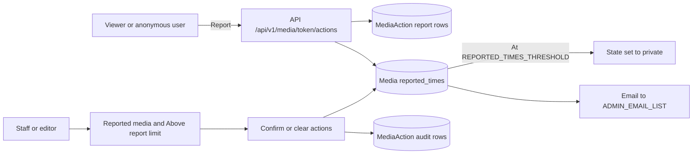

# Moderation

Use this page to review media, handle reports, and manage comments in the admin portal.

Open **Moderation** > **Overview** (`/admin/dashboard/moderation/`).

## The Moderation overview

The page has two parts.

| Part | What it shows |
|------|---------------|
| Media approval | Media not reviewed, media approved in the last 7 days, recent media pending review, recently approved media |
| Reports | Reported media, media above the report limit, reports confirmed and cleared in the last 7 days, recent reports, recent report actions |

Each card has an **Open** link. The link opens a filtered media list.

## Settings that change moderation

| Setting | Effect |
|---------|--------|
| `MEDIA_IS_REVIEWED` | `False` means new media must be reviewed before it shows in listings. The sidebar then shows **Needs review**. |
| `REPORTED_TIMES_THRESHOLD` | The number of reports that sets media to private. The default is 10. |
| `CAN_REPORT_MEDIA` | `False` hides the report button. |
| `ALLOW_ANONYMOUS_ACTIONS` | Includes `report` by default. An anonymous user can then report media. |
| `ADMINS_NOTIFICATIONS` | `MEDIA_REPORTED` and `MEDIA_ADDED` send email to `ADMIN_EMAIL_LIST`. |

See the [Settings catalog](settings.md) for all values.

## Review new media

Do these steps when `MEDIA_IS_REVIEWED = False`.

1. Open **Moderation** > **Needs review**.
2. Select the media rows to approve.
3. Open the **Action** list.
4. Select **Mark as reviewed**.
5. Select **Go**.

Media is listable only when it is public, its encoding succeeded, and it is reviewed.

You can also change **Is reviewed** inline in the list. After the change, select **Save**.

## Handle a report

A user report adds a `report` action to the media and increases `reported_times`. At the threshold, MediaCMS sets the media to private.

1. Open **Moderation** > **Reported media**.
2. Open the media. Select the **Reports** tab.
3. Read the reason in **Extra info**.
4. Go back to the list. Select the media row.
5. Choose one action from the **Action** list.

| Action | Result |
|--------|--------|
| **Confirm reports and set private** | Hides the media from public listings. Keeps the reports as evidence. |
| **Clear reports and keep private** | Deletes the reports. The media stays private. |
| **Clear reports and set public** | Deletes the reports. The media becomes public. |
| **Clear reports** | Deletes the reports. Does not change the state. |

6. Select **Go**.

!!! note
    Private media can still be opened by the owner, editors, shared users, and RBAC members. Delete the media object to remove it fully.

Editors, managers, and superusers can clear reports from the admin portal.

### Reports above the limit

Open **Moderation** > **Above report limit** to see media that reached `REPORTED_TIMES_THRESHOLD`. Use the same actions.

## Other media actions

The **Action** list in the media list has more actions. They need the change permission.

| Group | Actions |
|-------|---------|
| Review | **Mark as reviewed**, **Mark as not reviewed** |
| State | **Set public**, **Set private**, **Set unlisted** |
| Switches | **Enable download**, **Disable download**, **Enable comments**, **Disable comments** |
| Feature | **Feature**, **Unfeature** |
| Owner | **Change owner** (enter the new username) |
| Files | **Delete original file** |

Encoding actions are in [Processing](processing.md).

These fields can be changed inline: **Is reviewed**, **Featured**, **Allow download**, **Enable comments**. Media state can be changed only with an action. This keeps the `listable` value correct.

### Delete the original file

This action removes the uploaded source file from disk. The media row and the encodings stay.

Before you start, check these conditions:

- The media type is video or audio.
- The original file exists on disk.
- The encoding status is `success`.
- At least one successful encoding exists that is not a preview.
- No encoding that is not a preview is `pending`, `running`, or `fail`.

1. Select the media rows.
2. Select **Delete original file** in the **Action** list.
3. Select **Go**.
4. Read the page. It lists media that are allowed and media that are blocked.
5. Type `I am sure`.
6. Confirm.

!!! warning
    New thumbnails, sprites, trim, re-encode, and captions need the original file. They fail until the file is uploaded again.

## Manage comments

1. Open **Moderation** > **Comments**.
2. Search by text, uploader username, or media title.
3. Select the comments to remove.
4. Select **Delete selected** in the **Action** list.

Comments are also on the media change page as an inline table.

## Audit events

Moderator work writes `MediaAction` rows. Open **Moderation** > media actions to read them.

| Action | When it is written |
|--------|--------------------|
| `report_cleared` | Reports are cleared |
| `report_confirmed` | Reports are confirmed |
| `media_reviewed` | Media is marked as reviewed |
| `media_unreviewed` | Media is marked as not reviewed |
| `original_deleted` | The original file is deleted |

The list is an audit log. You can view and delete rows. You cannot edit them.

## MediaCMS Architecture

A report starts on the public site. Staff then finish the work in the admin portal.

