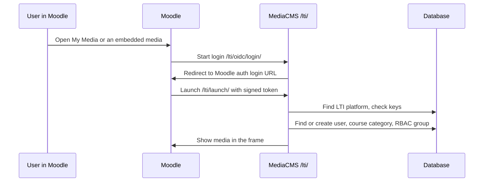

# Moodle and LTI

Use this page to connect Moodle to MediaCMS with LTI 1.3 and the MediaCMS Moodle plugins. Lecturers and students then use **My Media** and embed media inside Moodle.

The full source guide is [MediaCMS plugin for Moodle](https://github.com/mediacms-io/mediacms/blob/main/docs/moodle_plugin.md).

## Before you start

- Use the same domain for Moodle and MediaCMS. For example, use `moodle.organisation.org` and `mediacms.organisation.org`. Browsers block cross-site content more and more. A shared parent domain avoids limits on embedded media.
- Use HTTPS. With `USE_LTI = True`, MediaCMS sets secure cookies with `SameSite=None`.
- You need admin access to Moodle and to MediaCMS.

## Step 1: Turn on the MediaCMS settings

1. Open `local_settings.py` (`deploy/docker/local_settings.py` for Docker Compose).
2. Add these lines.

   ```python
   USE_IDENTITY_PROVIDERS = True
   USE_RBAC = True
   USE_LTI = True
   ```

3. Restart the services.

   ```bash
   docker compose restart web celery_worker celery_beat
   ```

The **Integrations** group now shows the LTI items. See [Integrations](integrations.md).

## Step 2: Add MediaCMS as an external tool in Moodle

Open Moodle: **Site Administration** > **Plugins** > **Activity Modules** > **External tools** > **Manage Tools** > **Configure a Tool Manually**.

Replace `https://mediacms.organisation.org` with your MediaCMS URL.

| Field | Value |
|-------|-------|
| **Name** | `MediaCMS` |
| **Tool URL** | `https://mediacms.organisation.org/lti/launch/` |
| **LTI version** | `LTI 1.3` |
| **Client ID** | Moodle gives it after you save |
| **Public key type** | `Keyset URL` |
| **Public keyset** | `https://mediacms.organisation.org/lti/jwks/` |
| **Initiate login URL** | `https://mediacms.organisation.org/lti/oidc/login/` |
| **Redirection URI(s)** | `https://mediacms.organisation.org/lti/launch/` |
| **Tool configuration usage** | Show in activity chooser and as a preconfigured tool |
| **Default launch container** | Embed, without blocks. Supports Deep Linking |

Set the services:

| Service | Value |
|---------|-------|
| **IMS LTI Assignment and Grade Services** | Do not use this service |
| **IMS LTI Names and Role Provisioning** | Use this service to retrieve members' information as per privacy settings |
| **Tool Settings** | Use this service |

Set the privacy:

| Field | Value |
|-------|-------|
| **Share launcher's name with tool** | Always |
| **Share launcher's email with tool** | Always |
| **Accept grades from the tool** | As specified in Deep Linking definition, or Delegate to teacher |

Select **Save changes**.

## Step 3: Install the Moodle plugins

The integration uses two plugins:

| Plugin | Purpose |
|--------|---------|
| `filter_mediacms` | The filter. It has the shared settings (MediaCMS URL, LTI tool). It embeds media with LTI 1.3 |
| `tiny_mediacms` | The TinyMCE button that inserts media. It needs `filter_mediacms` |

The ZIP files are in `lms-plugins/mediacms-moodle/dist/` in the MediaCMS repository. Use the newest version in that folder.

1. Open Moodle: **Site Administration** > **Install plugins**.
2. Upload the `filter_mediacms` ZIP. Finish the install.
3. Upload the `tiny_mediacms` ZIP. Finish the install.

Install `filter_mediacms` first. Moodle does not install `tiny_mediacms` without it.

You can also unzip `filter_mediacms` into the `filter/` directory. Unzip `tiny_mediacms` into `lib/editor/tiny/plugins/`. Then open Moodle. This method can be automated.

## Step 4: Configure the plugins in Moodle

1. Open **Plugins** > **Filters** > **Manage Filters**.
2. Set **MediaCMS** to **Enable**. Move it to the top of the list.
3. Open **Plugins** > **Filters** > **MediaCMS**.
4. Set **My Media link placement** to **Top Navigation** or **User Navigation**.
5. Enter **MediaCMS URL**. For example, `mediacms.organisation.org`.
6. Enter **LTI Tool**. For example, `mediacms.organisation.org/lti/launch/`.
7. Set **Share Embedded Media**. See the next section.
8. Open **Plugins** > **Text editors** > **TinyMCE** > **MediaCMS**.
9. Set the default embed options: **Show video title**, **Link video title**, **Show user avatar**.

### Share Embedded Media

| Value | Result |
|-------|--------|
| True | A user who opened embedded media can find it in **My Media** > **Shared with Me** |
| False | A user cannot find embedded media in **Shared with Me**. Use this for strict access control |

MediaCMS sets embedded media to **Shared** (private and shared). Users who open the Moodle activity become sharing partners. Their permission is not removed when Moodle access is removed. A lecturer or administrator removes these permissions with **My Media** > **Bulk Actions** > **Course Cleanup**.

## Step 5: Add Moodle as an LTI platform in MediaCMS

1. Open the admin portal. Open **Integrations** > **LTI platforms**.
2. Select **Add LTI platform**.
3. Enter the values.

| Section | Field | Value |
|---------|-------|-------|
| Basic Information | **Name** | A name for your use |
| Basic Information | **Platform ID** | The Moodle issuer URL. For example, `https://moodle.organisation.org` |
| Basic Information | **Client ID** | From Moodle: **External tools** > **Manage Tools** > **MediaCMS** > **Edit** |
| OIDC Endpoints | **Auth login URL** | `https://moodle.organisation.org/filter/mediacms/lti_auth.php` |
| OIDC Endpoints | **Auth token URL** | `https://moodle.organisation.org/mod/lti/token.php` |
| OIDC Endpoints | **Auth audience** | `https://moodle.organisation.org/mod/lti/certs.php` |
| JWK Configuration | **Key set URL** | `https://moodle.organisation.org/mod/lti/certs.php` |
| Deployment & Features | **Deployment IDs** | From Moodle: **Manage Tools** > **MediaCMS** > **View configuration details** |
| Deployment & Features | **Enable NRPS** | On |
| Deployment & Features | **Enable deep linking** | On |
| Auto-Provisioning Settings | **Remove from groups on unenroll** | On |

4. Select **Save**.

## Step 6: Test

1. Sign in to Moodle as an administrator, a lecturer, and a student.
2. Open **My Media** for each account.
3. In MediaCMS, open **Integrations** > **LTI launch logs**. Check that launches show `success`.
4. Open **Site** > **Health**. Check the LTI checks.

## How courses and roles map

A Moodle course is a category in MediaCMS. A course category is created when:

- A lecturer shares media with course members.
- A lecturer publishes media to a course.
- A lecturer inserts MediaCMS media in a course element with the TinyMCE button.

| Moodle role | MediaCMS category role |
|-------------|------------------------|
| Student | Viewer (member) |
| Teacher | Manager |

MediaCMS adds a user to the course group when that user opens **My Media** or opens embedded media in Moodle. Roles are synchronized at the same time. There is no continuous synchronization with NRPS yet. A user who leaves a course is removed from the course group only when that user, or a course member, opens **My Media** in Moodle again. Set **Remove from groups on unenroll** for this.

## Course cleanup

A lecturer or administrator can use **My Media** > **Bulk Actions** > **Course Cleanup**:

- **Remove present course permissions for all course members** removes users as sharing partners. It does not remove their access when they still have access in Moodle.
- **Remove Comments** deletes comments on the embedded course media.

Students cannot use **Course Cleanup**.

## MediaCMS Architecture

Moodle starts an LTI launch. MediaCMS checks the platform, finds or creates the course category and group, and shows the media.


