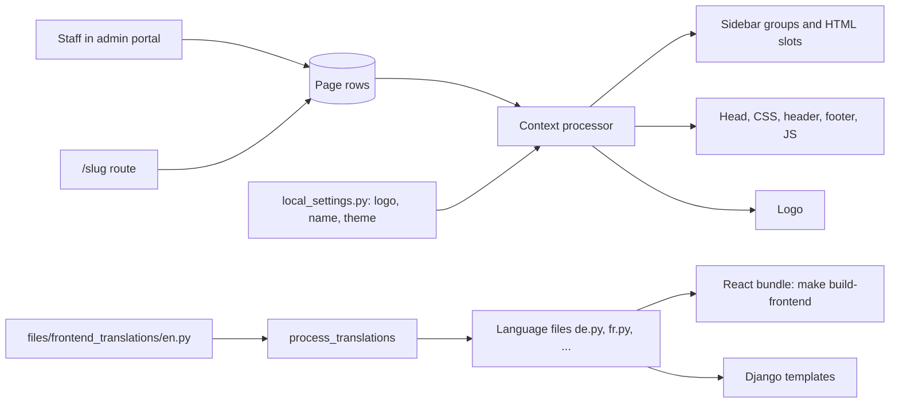

# Custom pages and appearance

Use this page to add custom pages, add links to the sidebar, add code to every page, change the logo, and add translations.

## Custom pages

A custom page is a `Page` row. You edit it in the admin portal with a rich text editor.

### Create a page

1. Open the admin portal.
2. Open **Site** > **Pages**.
3. Select **Add page**.
4. Enter the **Title**. The **Slug** is filled from the title.
5. Check the **Slug**. See the rules below.
6. Enter the content in the editor.
7. Select **Save**.

After you save, the list shows the public address in **Page URL**. Select it to open the page.

!!! note
    MediaCMS adds `sandbox="allow-scripts allow-same-origin allow-presentation"` to each `iframe` in the content.

### Slug rules

The slug decides the address and the place of the page.

| Rule | Detail |
|------|--------|
| Characters | Lowercase letters and digits. Words are joined by one hyphen. For example, `staff-handbook` |
| Not allowed | Uppercase, underscores, double hyphens, a hyphen at the start or end |
| Reserved names | See the next list |
| Result of a wrong slug | The page is not saved. The form shows a message |

Messages:

| Message | Cause |
|---------|-------|
| That address is reserved. | The slug or the page name is a reserved name |
| The page name is not a valid address. | The slug does not follow the character rules |
| That sidebar link is already built in. | A sidebar link uses a built-in name |

### Protected slugs

These names are used by MediaCMS routes. You cannot use them as a slug, or as a page name after `sidebar-<section>--`.

`accounts`, `login`, `logout`, `signup`, `password`, `saml`, `approval_required`, `api`, `api-auth`, `swagger`, `docs`, `admin`, `lti`, `tinymce`, `fu`, `manage`, `user`, `channel`

A page that has a protected slug is not served as a public page. This matters for a [site upgrade](site-upgrade.md).

### Built-in pages

| Slug | Result |
|------|--------|
| `about` | Replaces the default **About** page |
| `tos` | Replaces the placeholder terms of service page |

The names `about`, `tos`, `contact`, and `setlanguage` are built in. You cannot use them as the name of a sidebar link.

### Public address

| Slug | Address |
|------|---------|
| `staff-handbook` | `/staff-handbook` |
| `sidebar-info--staff-handbook` | `/staff-handbook` (and a link in the sidebar) |

MediaCMS looks for an exact slug first. Then it looks for a sidebar page with that name.

## Add a link to the sidebar

Start the slug with `sidebar-<section>--`. Use two hyphens before the page name. The title of the page is the text of the link.

| Section | Slug starts with | Who sees the link |
|---------|------------------|-------------------|
| Browse | `sidebar-browse--` | Everyone |
| Library | `sidebar-library--` | Signed-in users |
| Personal | `sidebar-personal--` | Signed-in users |
| Info | `sidebar-info--` | Everyone |
| Manage | `sidebar-manage--` | Editors, managers, and superusers |

Example: the slug `sidebar-info--staff-handbook` makes a link in the info section of the sidebar. The link opens `/staff-handbook`.

Pages are listed in alphabetical order of the title.

## Add HTML to the sidebar

A page with one of these slugs is not a public page. MediaCMS puts its content in a slot.

| Slug starts with | Slot |
|------------------|------|
| `sidebar-below--` | Below the navigation menu |
| `sidebar-after-theme--` | Below the theme switcher |
| `sidebar-footer--` | In the sidebar footer |

Example: `sidebar-footer--contact-block`.

For plain text in the footer, set `SIDEBAR_FOOTER_TEXT` in `local_settings.py`.

## Add code to every page

A page with one of these slugs adds its content to every page. These pages are not public pages.

| Slug | Where the content goes |
|------|------------------------|
| `inject-head` | In the `head` element |
| `inject-css` | In a `style` element |
| `inject-header` | In the page header |
| `inject-footer` | In the page footer |
| `inject-js` | In a `script` element at the end of the page |

!!! warning
    Content of these pages is not escaped. Anyone who can edit a page can run code on every page. Give the page permission only to people that you trust.

For CSS files, you can also set `EXTRA_CSS_PATHS` in `local_settings.py`. Put the file in `static/css/`. For example, `EXTRA_CSS_PATHS = ["/static/css/custom.css"]`.

## Change the logo

The portal has one logo for the light theme and one for the dark theme. `PORTAL_LOGO_DARK_*` is the logo for the light theme. It is a dark logo on a light page. `PORTAL_LOGO_LIGHT_*` is the logo for the dark theme.

| Setting | Default |
|---------|---------|
| `PORTAL_LOGO_DARK_SVG` | `/static/images/logo_dark.svg` |
| `PORTAL_LOGO_DARK_PNG` | `/static/images/logo_dark.png` |
| `PORTAL_LOGO_LIGHT_SVG` | `/static/images/logo_light.svg` |
| `PORTAL_LOGO_LIGHT_PNG` | `/static/images/logo_dark.png` |

1. Put the new files in `static/images/`.
2. Open `local_settings.py`.
3. Set the paths. For example:

   ```python
   PORTAL_LOGO_DARK_SVG = "/static/images/my_logo_dark.svg"
   PORTAL_LOGO_LIGHT_SVG = "/static/images/my_logo_light.svg"
   ```

4. To use PNG files only, set the SVG settings to empty strings. Set the PNG settings.
5. Restart the services.

An SVG file has priority over a PNG file when both are set.

Other appearance settings: `PORTAL_NAME`, `PORTAL_DESCRIPTION`, `DEFAULT_THEME`, `USE_ROUNDED_CORNERS`. See the [Settings catalog](settings.md).

## Translations

MediaCMS has two kinds of text:

| Kind | Where it lives | Rebuild needed |
|------|----------------|----------------|
| Django template text | `templates/` | No |
| React text | `frontend/` | Yes. Run `make build-frontend` |

!!! warning
    This workflow is required. A change that skips it is not accepted.

### Add a translatable string

1. Mark the string as translatable in the code.
   - Django templates: see how `templates/cms/about.html` does it.
   - React: see how `translateString` is used in `frontend/`.
2. Add the string to `files/frontend_translations/en.py` **first**.
3. Run the command that copies the new string into all language files.

   ```bash
   python manage.py process_translations
   ```

   With the development stack:

   ```bash
   docker compose -f docker-compose-dev.yaml exec -T web python manage.py process_translations
   ```

4. Open the file of your language in `files/frontend_translations/`. For example, `de.py`.
5. Translate the string.
6. For React text, run the build.

   ```bash
   make build-frontend
   ```

The command `process_translations` adds missing keys to every language file except `en.py`. The new key gets the English text until someone translates it. It also sorts the keys. You do not need to translate into all languages. You must run the command.

Do not change the key text of an existing string. Keep setting names, tokens, and placeholders unchanged.

### Improve an existing translation

1. Find the language code in `files/frontend_translations/`.
2. Edit the matching file. For example, `fr.py`.
3. For React text, run `make build-frontend`.

### Set the default language

1. Open `local_settings.py`.
2. Set `LANGUAGE_CODE` to a code from `LANGUAGES`. For example, `LANGUAGE_CODE = "de"`.
3. Restart the services.

To remove a language from the list, remove it from `LANGUAGES`. To change the language for one browser, use the globe icon in the admin navbar, or `/setlanguage` on the public site. Both set the `django_language` cookie.

### Add a new language

1. Add the language to `LANGUAGES` in `local_settings.py`.
2. Copy `files/frontend_translations/en.py` to a new file in the same folder.
3. Translate the strings.
4. Run `python manage.py process_translations`.
5. Run `make build-frontend`.

**Site** > **Languages** lists caption languages. It is not the list of interface languages.

## MediaCMS Architecture

Pages and settings are read on each request and passed to the templates. Translations are files in the code.


