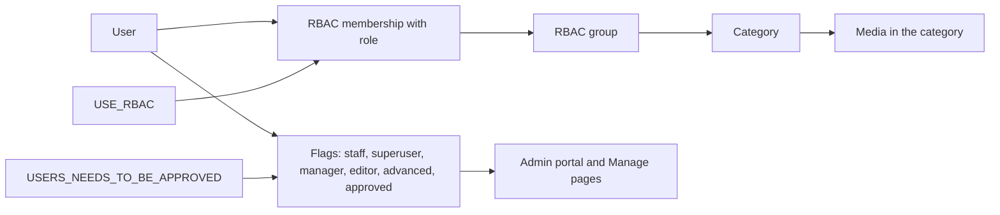

# People

Use this page to manage user accounts, approval, roles, and RBAC groups in the admin portal.

Open **People** > **Overview** (`/admin/dashboard/people/`).

## The People overview

| Part | What it shows |
|------|---------------|
| Totals | Total users, approved users, users waiting for approval, inactive users |
| Roles | Superusers, staff users, managers, editors, regular users |
| Activity | New users (7 days), active users (30 days), recently registered users |
| Top lists | Top uploaders by count and by size, top commenters, top likers, top dislikers, top reporters |
| Approval | Recent users waiting for approval (when approval is on) |

Select a user name to open the user.

## User roles

Set these fields on the user change page.

| Field | Result |
|-------|--------|
| **Is active** | Off blocks sign-in. The account is inactive |
| **Is staff** | Opens the admin portal |
| **Is superuser** | Full access to the portal and the admin portal |
| **MediaCMS Manager** (`is_manager`) | Can manage users in **Manage pages**. Not Django staff by itself |
| **MediaCMS Editor** (`is_editor`) | Can open Manage media and comments |
| **advanced user** (`advancedUser`) | Can add media or comment when `CAN_ADD_MEDIA` or `CAN_COMMENT` is `advancedUser` |
| **Is approved** | Shows only when `USERS_NEEDS_TO_BE_APPROVED = True` |

You can filter the list by active, superuser, staff, editor, manager, regular user, recently joined, and active uploader.

## Actions for users

1. Open **People** > users.
2. Select the user rows.
3. Choose an action in the **Action** list.
4. Select **Go**.

| Action | Result |
|--------|--------|
| **Approve users** | Sets **Is approved** |
| **Unapprove users** | Clears **Is approved** |
| **Deactivate users** | Sets **Is active** off |
| **Reactivate users** | Sets **Is active** on |

## Approve new users

Do these steps when `USERS_NEEDS_TO_BE_APPROVED = True`.

1. Open **People** > **Waiting for approval**.
2. Select the user rows.
3. Select **Approve users** in the **Action** list.
4. Select **Go**.

You can also select **Is approved** in the list and then select **Save**.

A pending user can sign in. The pending user can browse. Upload, edit, and Manage pages are refused until approval.

## Control registration

| Setting | Effect |
|---------|--------|
| `USERS_CAN_SELF_REGISTER` | `False` closes sign-up. This is the server rule |
| `REGISTER_ALLOWED` | `False` hides the register button only |
| `LOGIN_ALLOWED` | `False` hides the sign-in button only. The sign-in page still works |
| `ALLOWED_DOMAINS_FOR_USER_REGISTRATION` | Only these email domains can register. An empty list turns the check off |
| `RESTRICTED_DOMAINS_FOR_USER_REGISTRATION` | These email domains cannot register |
| `ACCOUNT_EMAIL_VERIFICATION` | `optional`, `mandatory`, or `none` |
| `GLOBAL_LOGIN_REQUIRED` | `True` makes the whole portal available only to signed-in users |

See the [Settings catalog](settings.md).

## Email addresses

Open **People** > email addresses to see the email addresses that django-allauth stores. Use it to check if an address is verified.

## RBAC groups

RBAC adds category access for groups. It shows in the sidebar only when `USE_RBAC = True`.

1. Create a group.
2. Attach one or more categories to the group.
3. Add users to the group with a role.

| Role | What it allows in the attached categories |
|------|------------------------------------------|
| member | See all media, also private media |
| contributor | All of member, and edit media and add media to the category |
| manager | All of contributor, and owner-level access to every media in the category |

To create a group:

1. Open **People** > RBAC groups.
2. Select **Add**.
3. Enter the name. Select the categories.
4. Select **Save**.

To add a user:

1. Open **People** > RBAC memberships.
2. Select **Add**.
3. Select the user, the group, and the role.
4. Select **Save**.

An RBAC category is hidden from the public category list for people outside the group.

!!! note
    A Kaltura or Panopto content migration can create RBAC groups. It adds members and never changes them on a later run. See [Content migration](content-migration.md).

## Find accounts that need a decision

A content migration can create accounts with an email on the `email-conflict.invalid` domain. Search users for `email-conflict.invalid`. Set a real email or merge the accounts by hand.

## MediaCMS Architecture

A user has flags for portal roles. RBAC adds access through a group.

