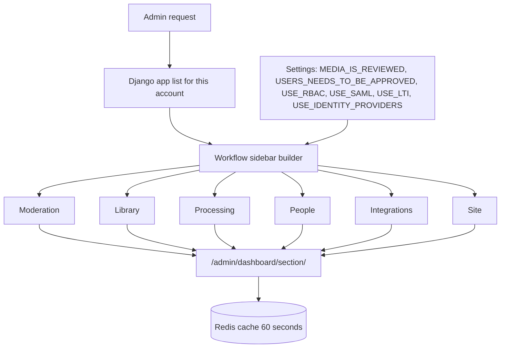

# Admin portal map

Use this page to find an item in the admin portal sidebar. The sidebar has six groups. Each group has an overview page at `/admin/dashboard/<section>/`.

## Sidebar groups

| Group | Overview page | Guide |
|-------|---------------|-------|
| Moderation | `/admin/dashboard/moderation/` | [Moderation](moderation.md) |
| Library | `/admin/dashboard/library/` and `/admin/dashboard/engagement/` | [Library and engagement](library.md) |
| Processing | `/admin/dashboard/processing/` | [Processing](processing.md) |
| People | `/admin/dashboard/people/` | [People](people.md) |
| Integrations | `/admin/dashboard/integrations/` | [Integrations](integrations.md) |
| Site | `/admin/dashboard/health/`, `configuration/`, `system/`, and `database/` | [Site health and database](site.md) |

The first item in each group opens the overview page. The Library group also has **Engagement**. The Site group has four pages: **Health**, **Configuration**, **System**, and **Database**.

## Items in each group

Some items show only when a setting is on or a model permission is present.

| Group | Items | Condition |
|-------|-------|-----------|
| Moderation | **Overview**, **Reported media**, **Above report limit**, media actions, comments | Media permissions needed for the queue links |
| Moderation | **Needs review** | `MEDIA_IS_REVIEWED = False` |
| Library | **Overview**, **Engagement**, media, categories, tags, playlists, channels | None |
| Processing | **Overview**, **Encoding queue**, **Failed encodings**, encodings, captions, caption requests, trim requests | None |
| People | **Overview**, users, email addresses | None |
| People | **Waiting for approval** | `USERS_NEEDS_TO_BE_APPROVED = True` |
| People | RBAC groups, RBAC memberships | `USE_RBAC = True` |
| Integrations | **Overview**, migration services, migration records | None |
| Integrations | ID providers, user accounts, login options, user logs | `USE_IDENTITY_PROVIDERS = True` |
| Integrations | SAML configurations | `USE_SAML = True` |
| Integrations | LTI platforms, resource links, user mappings, role mappings, launch logs, tool keys | `USE_LTI = True` |
| Site | **Health**, **Configuration**, **System**, **Database** | None |
| Site | Pages, licenses, encode profiles, languages, media permissions, sites | None |

## Pages outside the sidebar groups

| Page | URL | Use it to |
|------|-----|-----------|
| Dashboard | `/admin/` | See totals and open an overview page |
| Get Support | `/admin/dashboard/support/` | Download a redacted support bundle |
| Database backup | `/admin/dashboard/database/backup/` | Download a backup (superuser) |
| Database restore | `/admin/dashboard/database/restore/` | Upload a backup on an initial install (superuser) |

All dashboard URLs end with a slash. An unknown section gives a 404 page.

## Refresh the numbers

Dashboard numbers are cached for 60 seconds.

1. Open any dashboard page.
2. Select **Refresh stats**.

The page reloads with `?refresh_stats=1`. Only a staff user can force a refresh.

## Change the language

1. Select the globe icon in the admin navbar.
2. Select a language.

The choice is stored in the `django_language` cookie. It also applies to the public site.

## MediaCMS Architecture

The sidebar is built on each request from the models that the signed-in account may use. A setting can add or remove an item.

!!! note
    The real app indexes such as `/admin/files/` still work for bookmarks.
