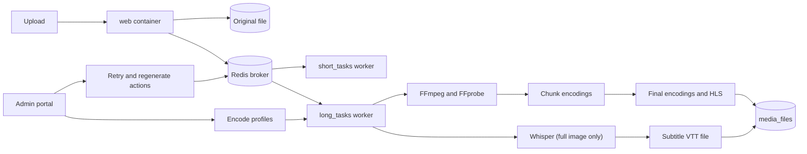

# Processing

Use this page to manage encoding, encode profiles, FFmpeg settings, Whisper captions, and trim requests.

Open **Processing** > **Overview** (`/admin/dashboard/processing/`).

## The Processing overview

| Part | What it shows |
|------|---------------|
| Encodings | Encoding queue, and media counts by encoding status: **Pending**, **Running**, **Success**, **Failed** |
| Caption Requests | Counts by status: pending, running, success, fail |
| Trim Requests | Counts by status: initial, running, success, fail |

Each card has an **Open** link to a filtered list.

Sidebar items for this group:

| Item | Opens |
|------|-------|
| **Encoding queue** | Media list with `encoding_queue=yes` |
| **Failed encodings** | Media list with `encoding_queue=fail` |
| Encodings | One row for each encoding or chunk |
| Captions | Subtitle files |
| Caption requests | Whisper requests |
| Trim requests | Video trim jobs |

## How encoding works

1. A video is uploaded. The original file is saved.
2. MediaCMS reads the file with FFprobe.
3. A video longer than `CHUNKIZE_VIDEO_DURATION` (300 seconds) is split into chunks of `VIDEO_CHUNKS_DURATION` (240 seconds).
4. A Celery worker creates one `Encoding` for each chunk and each active encode profile.
5. When all chunks of one resolution succeed, MediaCMS joins them into one final `Encoding`.
6. MediaCMS creates the HLS version (`.ts` segments).

The final `Encoding` (`chunk=False`, `status=success`) is the file that the portal plays and offers for download.

All workers must use the same file system as the web server. This can be one host, NFS, or EFS.

### Encode profiles

Open **Site** > **Encode profiles** (`/admin/files/encodeprofile/`).

| Field | Values |
|-------|--------|
| Name | Free text |
| Extension | `mp4`, `webm`, `gif` |
| Resolution | 2160, 1440, 1080, 720, 480, 360, 240, 144 |
| Codec | `h265`, `h264`, `vp9` |
| Active | On or off |

To turn a resolution on or off:

1. Open the profile.
2. Clear or select **Active**.
3. Select **Save**.

The change is used for new encodings. It does not change media that is already encoded.

!!! note
    A profile named `preview` makes the hover preview. MediaCMS finds the preview by this name, not by the file extension. Do not rename it.

!!! warning
    With no active profile, video does not encode. The **Active encode profiles** health check then fails.

The resolution list is fixed. A new resolution outside this list needs a code change.

## Fix encoding problems

### Find failed encodings

1. Open **Processing** > **Failed encodings**.
2. Open a media row. Read the encoding logs.

The **Site** > **Health** page also warns about failed encodings, stale running encodings, and media with no encoding rows.

### Retry

Choose one action in the media list:

| Action | Use it to |
|--------|-----------|
| **Generate missing encodings** | Create encodings that do not exist |
| **Force re-encode** | Encode again |
| **Regenerate thumbnails** | Make thumbnails again |
| **Regenerate sprites** | Make sprites again |
| **Regenerate preview** | Make the hover preview again |
| **Regenerate HLS** | Make the HLS files again |
| **Refresh all derivatives** | Run all of the above |
| **Refresh metadata / check integrity** | Read the file again and check it |

In **Processing** > Encodings, the **Retry failed encodings** action retries the selected failed rows.

These actions need the original file. See **Delete original file** in [Moderation](moderation.md).

### Stale encodings

An encoding in the running state with no progress for `RUNNING_STATE_STALE` seconds is stale. The default is 7200 seconds (2 hours). The **Health** page lists stale encodings.

## FFmpeg settings

Set these in `local_settings.py`. A change needs a restart.

| Setting | Default | Meaning |
|---------|---------|---------|
| `FFMPEG_COMMAND` | `ffmpeg` | Path to FFmpeg |
| `FFPROBE_COMMAND` | `ffprobe` | Path to FFprobe |
| `FFMPEG_DEFAULT_PRESET` | `medium` | H.264 speed and size trade-off. A slower preset gives smaller files and takes more time |
| `DO_NOT_TRANSCODE_VIDEO` | `False` | `True` shows only the original video. No encoding runs |
| `CHUNKIZE_VIDEO_DURATION` | `300` | Seconds. Longer videos are split into chunks |
| `VIDEO_CHUNKS_DURATION` | `240` | Seconds in one chunk. Keep it smaller than `CHUNKIZE_VIDEO_DURATION` |
| `MINIMUM_RESOLUTIONS_TO_ENCODE` | `[144, 240]` | Always encoded, even if this scales up |
| `MP4HLS_COMMAND` | Bento4 path | Path to `mp4hls` |
| `SPRITE_NUM_SECS` | `10` | Seconds between sprite images |
| `CELERY_SOFT_TIME_LIMIT` | 2 hours | Soft time limit for Celery tasks |

FFmpeg presets from fastest to slowest: `ultrafast`, `superfast`, `veryfast`, `faster`, `fast`, `medium`, `slow`, `slower`, `veryslow`.

Bitrates, CRF values, and codec parameters are in `files/helpers.py`.

!!! note
    To change `SPRITE_NUM_SECS`, also change `seconds` in the frontend file `frontend/src/static/js/components/media-viewer/VideoViewer/index.js`. Then run `make build-frontend`.

To check the FFmpeg and FFprobe versions, open **Site** > **System**. See [Site health and database](site.md).

## Whisper captions

Whisper makes captions automatically. It runs only in the Docker installation with the full image.

### Turn it on

1. Use the `mediacms/mediacms:full` image for the `celery_worker` service. Or use `docker-compose.full.yaml`.
2. Set `USE_WHISPER_TRANSCRIBE = True` in `local_settings.py`.
3. Restart the services.

   ```bash
   docker compose restart web celery_worker celery_beat
   ```

### Settings

| Setting | Default | Meaning |
|---------|---------|---------|
| `USE_WHISPER_TRANSCRIBE` | `False` | Turns the feature on |
| `USER_CAN_TRANSCRIBE_VIDEO` | `True` | `False` limits caption requests to editors |
| `WHISPER_MODEL` | `base` | The Whisper model name |

### What happens

1. A user selects **Transcription** or **English Translation** on a video or audio media.
2. MediaCMS creates a caption request (`TranscriptionRequest`) with status `pending`.
3. The `whisper_transcribe` task runs in the `long_tasks` queue. The time limit is 2 hours.
4. The task runs the `whisper` command with `WHISPER_MODEL`. A translation adds `--task translate`.
5. MediaCMS saves the VTT file as a subtitle. The language is `whisper` (**Transcription**) or `whisper-translation` (**English Translation**).
6. The request status changes to `success` or `fail`. The request log has the duration or the error.

### Check caption requests

1. Open **Processing** > **Caption requests**.
2. Filter by status `fail`.
3. Open a request. Read the log.

You can inspect or delete a request. Do not edit its parameters or log. The **Health** page warns about failed caption requests and about requests that succeeded with no subtitle.

## Trim requests

A user trims a video from the media page. `ALLOW_VIDEO_TRIMMER = False` turns this off. Open **Processing** > **Trim requests** to see the jobs. The **Health** page warns about failed trim requests.

## MediaCMS Architecture

The web server writes jobs to Redis. Celery workers read them and write files to `media_files`.


