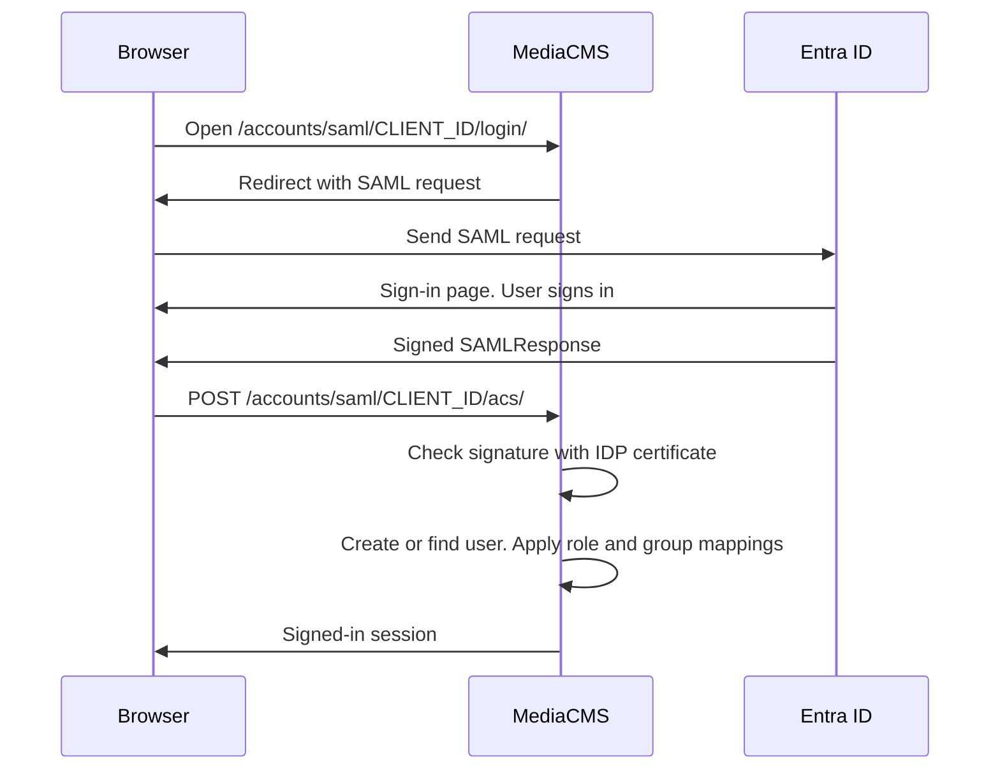

# SAML and identity providers

Use this page to add single sign-on to MediaCMS with SAML 2.0. The example uses Microsoft Entra ID (formerly Azure AD). The same steps apply to other SAML identity providers.

MediaCMS is the service provider (SP). Entra ID is the identity provider (IdP). The user's browser carries all messages between them. The MediaCMS server does not need inbound access from the Internet.

The full source guide is [Integrating Microsoft Entra ID with MediaCMS via SAML](https://github.com/mediacms-io/mediacms/blob/main/docs/saml_entraid_setup.md).

## Before you start

- You have admin access to MediaCMS and to Entra ID.
- MediaCMS runs on HTTPS with a valid certificate.
- You have a domain for MediaCMS. This page uses `https://<MyMediaCMS.MyDomain.com>`.
- You chose a **client ID name**. For example, `mediacms_entraid`. You use the same name in both systems. It is part of the sign-in URL.

## Step 1: Turn on the MediaCMS settings

1. Open `local_settings.py` (`deploy/docker/local_settings.py` for Docker Compose).
2. Add these lines.

   ```python
   USE_RBAC = True
   USE_SAML = True
   USE_IDENTITY_PROVIDERS = True

   USE_X_FORWARDED_HOST = True
   SECURE_PROXY_SSL_HEADER = ('HTTP_X_FORWARDED_PROTO', 'https')
   SECURE_SSL_REDIRECT = True
   CSRF_COOKIE_SECURE = True
   SESSION_COOKIE_SECURE = True

   SOCIALACCOUNT_ADAPTER = 'saml_auth.adapter.SAMLAccountAdapter'
   SOCIALACCOUNT_PROVIDERS = {
       "saml": {
           "provider_class": "saml_auth.custom.provider.CustomSAMLProvider",
       }
   }
   ```

3. Restart the services. Do this before the next step.

   ```bash
   docker compose restart web celery_worker celery_beat
   ```

Also set `CSRF_TRUSTED_ORIGINS` to include your HTTPS host. The **Site** > **Health** page checks the proxy and cookie settings. See [Site health and database](site.md).

The **Integrations** group now shows ID providers, login options, user accounts, user logs, and SAML configurations.

## Step 2: Create the application in Entra ID

1. Open the Azure portal. Open **Enterprise Applications**.
2. Select **New Application**.
3. Select **Create your own application**.
4. Enter a name, for example `MediaCMS`.
5. Select **Integrate any other application you don't find in the gallery (Non-gallery)**.
6. Select **Create**.

## Step 3: Set up SAML sign-on in Entra ID

1. Open the application. Under **Manage**, select **Single sign-on**.
2. Select **SAML**.
3. In **Basic SAML Configuration**, enter these values.

| Field | Value |
|-------|-------|
| **Identifier (Entity ID)** | `https://<MyMediaCMS.MyDomain.com>/saml/metadata/` |
| **Reply URL (ACS URL)** | `https://<MyMediaCMS.MyDomain.com>/accounts/saml/<MyClientID>/acs/` |
| **Sign-on URL** | `https://<MyMediaCMS.MyDomain.com>/accounts/saml/<MyClientID>/login/` |
| **Relay State** (optional) | `https://<MyMediaCMS.MyDomain.com>/` |
| **Logout URL** (optional) | `https://<MyMediaCMS.MyDomain.com>/accounts/saml/<MyClientID>/sls/` |

4. Select **Save**.
5. Keep the Entra ID page open. You need values from it.

## Step 4: Set up MediaCMS

### Add a login option

1. Open the admin portal. Open **Integrations** > **Login options**.
2. Select **Add login option**.
3. Enter a **Title**. Users see this title on the sign-in page. For example, `EntraID-SSO`.
4. Enter the **Url**: `https://<MyMediaCMS.MyDomain.com>/accounts/saml/<MyClientID>/login/`.
5. Leave **Ordering** at `0` when you have no other sign-in method.
6. Select **Active**.
7. Select **Save**.

### Add the ID provider

1. Open **Integrations** > **ID Providers**.
2. Select **Add ID Provider**.
3. Enter the values.

| Field | Value |
|-------|-------|
| **Protocol** | `saml` (lowercase) |
| **IDP Config Name** | A unique name. For example, `EntraID` |
| **Provider ID** | The **Microsoft Entra Identifier** URL from Entra ID |
| **Client ID** | Your client ID name. For example, `mediacms_entraid` |
| **Sites** | The sites where this sign-in shows. Select at least one |

4. Select **Save and continue editing**.

### Add the SAML configuration

Each ID provider can have one SAML configuration. Add it in the same form, or in **Integrations** > **SAML configurations**.

| Field | Value |
|-------|-------|
| **SSO URL** | The **Login URL** from Entra ID |
| **SLO URL** | The **Logout URL** from Entra ID |
| **SP Metadata URL** | `https://<MyMediaCMS.MyDomain.com>/saml/metadata/` |
| **IdP ID** | The **Microsoft Entra Identifier** URL. It must be a URL |
| **IDP Certificate** | The Base64 certificate from Entra ID (see below) |
| **SP Certificate** (optional) | Your SP certificate in PEM format. It turns on signed and encrypted messages |
| **SP Private Key** (optional) | Your SP private key in PEM format. Set both SP fields or none |

To get the certificate:

1. In Entra ID, open the **SAML certificates** section.
2. Download the **Base64 Certificate**.
3. Open the file in a text editor.
4. Copy all the text into **IDP Certificate**.

### Set the attribute mappings

Fill **every** attribute field. Enter `NA` where there is no value. A blank field causes a 500 error with Entra ID.

| Field | Value |
|-------|-------|
| **Uid** | `http://schemas.microsoft.com/identity/claims/objectidentifier` |
| **Name** | `http://schemas.microsoft.com/identity/claims/displayname` |
| **Email** | `http://schemas.xmlsoap.org/ws/2005/05/identity/claims/emailaddress` |
| **Groups** | `NA` |
| **First name** | `http://schemas.xmlsoap.org/ws/2005/05/identity/claims/givenname` |
| **Last name** | `http://schemas.xmlsoap.org/ws/2005/05/identity/claims/surname` |
| **User logo** | `NA` |
| **Role** | `NA` |

1. Select **Verified email**. Entra ID verifies the user.
2. Select **Save SAML response logs** while you set up.
3. Select **Save**.

You can change the Groups and Role claims in Entra ID under **Attributes and Claims**.

### Other options

| Option | Effect |
|--------|--------|
| **Remove from groups** | Removes a user from a group at sign-in when the IdP no longer lists that group |
| **Email authentication** | Uses email for authentication too |
| **Global Role Mapping** | Maps the role value of the SAML response to a MediaCMS role: advanced user, editor, manager, or admin |
| **Group Role Mapping** | Maps the role value to a role in the groups that the user joins |
| **Group Mapping** | Creates RBAC groups for this IdP. Group IDs from SAML map to MediaCMS groups |
| **Category Mapping** | Maps a group ID from SAML to a category |
| **Bulk group mappings** | Upload a CSV file with the headers `group_id` and `name` to add many groups |

The role mapping needs the **Role** attribute. The group mapping needs the **Groups** attribute.

## Step 5: Allow users in Entra ID

1. Open the application in Entra ID. Under **Manage**, select **Users and Groups**.
2. Add the users or groups that can sign in. To allow all users, add the **All Users** group.

!!! warning
    Nested groups do not work. Assign users directly to the group that has permission.

## Step 6: Test

1. Open the MediaCMS sign-in page in a private window.
2. Select the login option. The browser goes to Microsoft.
3. Sign in.
4. Check that you return to MediaCMS signed in.
5. Open **Integrations** > **User logs**. Read the SAML response log.
6. Open **Site** > **Health**. Check the identity provider and SAML checks.

## Troubleshooting

### Read the SAML response

1. Open the sign-in page. The browser goes to Microsoft.
2. Before you sign in, press **F12**. Open the **Network** tab. Turn on **Persistent Logging**.
3. Finish the sign-in.
4. Find the POST request to `https://<MyMediaCMS.MyDomain.com>/accounts/saml/<MyClientID>/acs/`.
5. Copy the `SAMLResponse` form value.
6. Decode it with a **From Base64** tool. Format the XML.

### Read the SP metadata

Open `https://<MyMediaCMS.MyDomain.com>/saml/metadata/` in a private window. Check that the XML has the values that you expect.

### Endless redirect loop

This happens when `GLOBAL_LOGIN_REQUIRED` is on and local sign-in is off. Django sends the user to the local sign-in page. That page is not available, so the user returns to the home page and the loop starts again.

1. Open `local_settings.py`.
2. Set `LOGIN_URL` to the SAML sign-in path.

   ```python
   LOGIN_URL = "/accounts/saml/mediacms_entraid/login/"
   ```

3. Restart the services.

### Health checks

The **Integrations** page warns when:

- `USE_IDENTITY_PROVIDERS` is on and there is no ID provider.
- `USE_IDENTITY_PROVIDERS` is on and no login option is active.
- `USE_SAML` is on and there is no SAML configuration.

See [Integrations](integrations.md).

## MediaCMS Architecture

The browser carries the messages. MediaCMS and the IdP never connect to each other.


