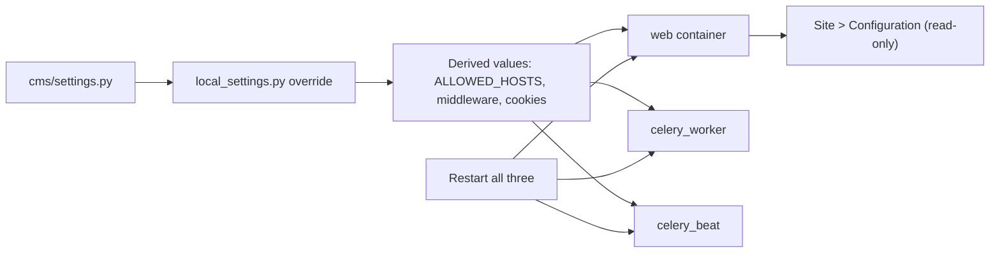

# Settings catalog

Use this page to find the setting that controls a portal behavior. The source of truth is `cms/settings.py`.

## Change a setting

Never edit `cms/settings.py` for a deployment. Put your values in a local file.

| Install | File |
|---------|------|
| Standard install | `cms/local_settings.py` |
| Docker Compose install | `deploy/docker/local_settings.py` |

1. Open the local settings file.
2. Add the setting with the new value. Use Python syntax.
3. Save the file.
4. Restart the services.

   ```bash
   docker compose restart web celery_worker celery_beat
   ```

5. Open **Site** > **Configuration**. Check the new value.

!!! warning
    Every settings change needs a restart. The **Configuration** page shows a small part of the settings only.

MediaCMS reads `local_settings.py` after `settings.py`. A few values are changed after that file is read. These are listed in [Settings that other settings change](#settings-that-other-settings-change).

## Portal workflow and access

| Setting | Default | Values and effect |
|---------|---------|-------------------|
| `PORTAL_WORKFLOW` | `public` | State of new uploads. `public`: media can show in listings. `private`: only the owner, editors, managers, and superusers see it. `unlisted`: reachable by URL, not listed |
| `MEDIA_IS_REVIEWED` | `True` | `False`: each new media must be reviewed before it shows in listings. The sidebar then shows **Needs review** |
| `CAN_ADD_MEDIA` | `all` | Who can add media. `all`, `email_verified`, or `advancedUser` |
| `CAN_COMMENT` | `all` | Who can comment. `all`, `email_verified`, or `advancedUser` |
| `GLOBAL_LOGIN_REQUIRED` | `False` | `True`: only signed-in users see the portal. API calls from anonymous users get an authentication error |
| `USERS_NEEDS_TO_BE_APPROVED` | `False` | `True`: a new non-superuser must be approved. A pending user can sign in and browse. Upload and edit are refused |
| `ALLOW_ANONYMOUS_ACTIONS` | `["report", "like", "dislike", "watch"]` | Actions that an anonymous user can do. Must be a list |
| `TIME_TO_ACTION_ANONYMOUS` | `600` | Seconds. Per-IP wait for anonymous like, dislike, and report |
| `MASK_IPS_FOR_ACTIONS` | `True` | Masks IP addresses in action records |
| `REPORTED_TIMES_THRESHOLD` | `10` | Number of reports that sets media to private |
| `ALLOW_ANONYMOUS_USER_LISTING` | `True` | `False`: only signed-in users can list users |
| `CAN_SEE_MEMBERS_PAGE` | `all` | Who sees the members page. `anonymous` (anyone), `all` (signed-in), `editors`, or `admins`. For anonymous members, keep `ALLOW_ANONYMOUS_USER_LISTING = True` |
| `USER_SEARCH_FIELD` | `name_username` | `name_username` or `name_username_email`. The second also searches and shows email |

## Sign-in and registration

| Setting | Default | Values and effect |
|---------|---------|-------------------|
| `LOGIN_ALLOWED` | `True` | `False` hides the sign-in button only. The sign-in page still works |
| `REGISTER_ALLOWED` | `True` | `False` hides the register button only |
| `USERS_CAN_SELF_REGISTER` | `True` | `False` closes sign-up on the server |
| `ALLOWED_DOMAINS_FOR_USER_REGISTRATION` | `[]` | Only these email domains can register. Empty: no check |
| `RESTRICTED_DOMAINS_FOR_USER_REGISTRATION` | `["xxx.com", "emaildomainwhatever.com"]` | These email domains cannot register |
| `ACCOUNT_EMAIL_VERIFICATION` | `optional` | `optional`, `mandatory`, or `none` |
| `ACCOUNT_USERNAME_MIN_LENGTH` | `4` | Minimum user name length |
| `ACCOUNT_EMAIL_CONFIRMATION_EXPIRE_DAYS` | `1` | Days that a confirmation link is valid |
| `ACCOUNT_LOGIN_BY_CODE_ENABLED` | `False` | `True`: email a one-time sign-in code. The sign-in page then shows the link |
| `ACCOUNT_LOGIN_METHODS` | `{"username", "email"}` | Sign-in with user name or email |
| `LOGIN_REDIRECT_URL` | `/` | Where users go after sign-in |

## Features and buttons

| Setting | Default | Effect |
|---------|---------|--------|
| `UPLOAD_MEDIA_ALLOWED` | `True` | `False` hides the upload button only |
| `CAN_LIKE_MEDIA` | `True` | Shows the like button |
| `CAN_DISLIKE_MEDIA` | `True` | Shows the dislike button |
| `CAN_REPORT_MEDIA` | `True` | Shows the report button |
| `CAN_SHARE_MEDIA` | `True` | Shows the share button |
| `ALLOW_RATINGS` | `False` | Experimental. Does not work |
| `ALLOW_RATINGS_CONFIRMED_EMAIL_ONLY` | `True` | For ratings |
| `ALLOW_VIDEO_TRIMMER` | `True` | `False` turns trim off |
| `ALLOW_CUSTOM_MEDIA_URLS` | `False` | `True`: a user can edit the media URL |
| `ALLOW_MEDIA_REPLACEMENT` | `False` | `True`: a user can replace a media file |
| `ALLOW_MENTION_IN_COMMENTS` | `False` | `True`: `@` mentions in comments |
| `TIMESTAMP_IN_TIMEBAR` | `False` | `True`: shows timestamped comments in the time bar |
| `MAX_CHARS_FOR_COMMENT` | `10000` | Maximum comment length |
| `MAX_MEDIA_PER_PLAYLIST` | `70` | Maximum media in one playlist |
| `RELATED_MEDIA_STRATEGY` | `content` | `content` or `author` |
| `GENERATE_SITEMAP` | `False` | `True` makes `/sitemap.xml` |
| `INCLUDE_LISTING_NUMBERS` | `True` | `False` hides counts on `/categories` and `/tags` |
| `SLIDESHOW_ITEMS` | `30` | Items in the image slideshow |
| `SHOW_ORIGINAL_MEDIA` | `True` | `True`: the API returns the URL of the original file |

## Uploads

| Setting | Default | Effect |
|---------|---------|--------|
| `UPLOAD_MAX_SIZE` | about 4 GB | Maximum file size in bytes |
| `UPLOAD_MAX_FILES_NUMBER` | `100` | Files in one upload |
| `CONCURRENT_UPLOADS` | `True` | Uploads in parallel |
| `NUMBER_OF_MEDIA_USER_CAN_UPLOAD` | `100` | Media one user may own |
| `ALLOWED_MEDIA_UPLOAD_TYPES` | `["video", "audio", "image", "pdf"]` | Allowed types. `all` turns the check off |
| `CANNOT_ADD_MEDIA_MESSAGE` | Text | Message when a user cannot add media |
| `PRE_UPLOAD_MEDIA_MESSAGE` | Empty | Message under the upload form |
| `POST_UPLOAD_AUTHOR_MESSAGE_UNLISTED_NO_COMMENTARY` | Empty | Message to the author with unlisted workflow and no commentary |

## Processing

See [Processing](processing.md) for use.

| Setting | Default |
|---------|---------|
| `FFMPEG_COMMAND`, `FFPROBE_COMMAND` | `ffmpeg`, `ffprobe` |
| `FFMPEG_DEFAULT_PRESET` | `medium` |
| `DO_NOT_TRANSCODE_VIDEO` | `False` |
| `CHUNKIZE_VIDEO_DURATION`, `VIDEO_CHUNKS_DURATION` | `300`, `240` |
| `MINIMUM_RESOLUTIONS_TO_ENCODE` | `[144, 240]` |
| `MP4HLS_COMMAND` | Path to Bento4 `mp4hls` |
| `RUNNING_STATE_STALE` | `7200` |
| `SPRITE_NUM_SECS` | `10` |
| `USE_WHISPER_TRANSCRIBE` | `False` |
| `USER_CAN_TRANSCRIBE_VIDEO` | `True` |
| `WHISPER_MODEL` | `base` |

## Appearance

See [Custom pages and appearance](pages-appearance.md).

| Setting | Default | Effect |
|---------|---------|--------|
| `PORTAL_NAME` | `MediaCMS` | Portal title. Also used in emails |
| `PORTAL_DESCRIPTION` | Empty | Portal description |
| `DEFAULT_THEME` | `light` | `light` or `dark` |
| `PORTAL_LOGO_DARK_SVG`, `PORTAL_LOGO_DARK_PNG` | `/static/images/logo_dark.*` | Logo for the light theme |
| `PORTAL_LOGO_LIGHT_SVG`, `PORTAL_LOGO_LIGHT_PNG` | `/static/images/logo_light.svg`, `/static/images/logo_dark.png` | Logo for the dark theme |
| `EXTRA_CSS_PATHS` | `[]` | Extra CSS files, for example `/static/css/custom.css` |
| `LOAD_FROM_CDN` | `False` | `True` loads fonts, CSS, and JS from a CDN |
| `USE_ROUNDED_CORNERS` | `True` | Rounded corners on the player and media items |
| `VIDEO_PLAYER_FEATURED_VIDEO_ON_INDEX_PAGE` | `False` | `True` shows a featured video with a player on the index page |
| `SIDEBAR_FOOTER_TEXT` | Empty | Text in the sidebar footer |
| `LANGUAGE_CODE` | `en` | Default language |
| `LANGUAGES` | 22 languages | Languages that users can select |
| `TIME_ZONE` | `Europe/London` | Time zone |

## Email and notifications

| Setting | Default | Effect |
|---------|---------|--------|
| `DEFAULT_FROM_EMAIL` | `info@mediacms.io` | Sender address |
| `SERVER_EMAIL` | Same as `DEFAULT_FROM_EMAIL` | Sender for errors |
| `EMAIL_HOST`, `EMAIL_PORT` | `mediacms.io`, `587` | Mail server |
| `EMAIL_HOST_USER`, `EMAIL_HOST_PASSWORD` | Example values | Mail credentials |
| `EMAIL_USE_TLS` | `True` | Mutually exclusive with `EMAIL_USE_SSL` (STARTTLS, typical port 587) |
| `EMAIL_USE_SSL` | `False` | Mutually exclusive with `EMAIL_USE_TLS` (implicit SSL, typical port 465) |
| `EMAIL_TIMEOUT` | `10` | Seconds for SMTP connect/send on interactive mail (contact form, auth mail) |
| `ADMIN_EMAIL_LIST` | `["info@mediacms.io"]` | Addresses for admin notices |
| `USERS_NOTIFICATIONS` | `MEDIA_ADDED`, `MEDIA_REPORTED` on | Notices to users |
| `ADMINS_NOTIFICATIONS` | `NEW_USER`, `MEDIA_ADDED`, `MEDIA_REPORTED` on | Notices to admins |

Change `DEFAULT_FROM_EMAIL` and the mail credentials before production. The **Health** page warns when `DEFAULT_FROM_EMAIL` is empty and fails when `EMAIL_USE_TLS` and `EMAIL_USE_SSL` are both on. Contact and profile contact forms, and django-allauth mail, send synchronously with `EMAIL_TIMEOUT` so failures surface to the user instead of failing silently.

## Integrations

| Setting | Default | Effect |
|---------|---------|--------|
| `USE_RBAC` | `False` | Category groups with member, contributor, and manager roles |
| `USE_SAML` | `False` | SAML sign-in. See [SAML and identity providers](saml.md) |
| `USE_IDENTITY_PROVIDERS` | `False` | Identity provider items, login options, user logs |
| `USE_LTI` | `False` | LTI 1.3. See [Moodle and LTI](moodle.md) |
| `MIGRATION_PAGE_SIZE` | `3` | Content migration page size |
| `MIGRATION_API_TIMEOUT` | `60` | Seconds for a source API call |
| `MIGRATION_DOWNLOAD_TIMEOUT` | `1800` | Seconds for a file download |
| `MIGRATION_MAX_RETRIES` | `5` | Retries for a failed item |

## Hosts, security, and storage

| Setting | Default | Effect |
|---------|---------|--------|
| `FRONTEND_HOST` | `http://localhost` | Public URL of the portal. `http://` is added when missing |
| `ALLOWED_HOSTS` | `["*", "mediacms.io", "127.0.0.1", "localhost"]` | The `FRONTEND_HOST` host is added after `local_settings.py` is read |
| `LOCAL_INSTALL` | `False` | `True` marks a local install. Health gaps show as **Info** |
| `DEBUG` | `False` | Keep it off in production |
| `SECRET_KEY` | From the environment or `.secret_key` | Required. MediaCMS stops without it |
| `DJANGO_ADMIN_URL` | `admin/` | Admin portal path. Keep the trailing slash |
| `USE_X_ACCEL_REDIRECT` | `True` | nginx checks access for protected media files |
| `X_ACCEL_PROTECTED_PATHS` | `["encoded", "hls", "original"]` | Folders under `MEDIA_ROOT` that are protected |
| `X_ACCEL_AUTH_CACHE_SECONDS` | `300` | Cache time for the access check |
| `MEDIA_ROOT` | `<BASE_DIR>/media_files/` | Where uploaded and encoded media is stored |
| `TEMP_DIRECTORY` | `/tmp` | Do not set it inside `BASE_DIR` |
| `MEDIA_UPLOAD_DIR`, `MEDIA_ENCODING_DIR`, `HLS_DIR` | `original/`, `encoded/`, `<MEDIA_ROOT>/hls/` | Storage sub-directories |
| `USE_X_FORWARDED_HOST`, `SECURE_PROXY_SSL_HEADER`, `SECURE_SSL_REDIRECT`, `CSRF_COOKIE_SECURE`, `SESSION_COOKIE_SECURE`, `CSRF_TRUSTED_ORIGINS` | Not set in `settings.py` | Set them behind an HTTPS reverse proxy. The **Health** page checks them |
| `TRUSTED_PROXIES` | `[]` | IP addresses or CIDR networks that may set `X-Forwarded-For` / `X-Real-IP`. Empty means proxy headers are not trusted |
| `PROXY_AWARE_MIDDLEWARE_ENABLED` | `bool(TRUSTED_PROXIES)` | When `True`, `ProxyAwareMiddleware` sets `request.client_ip`. Override in `local_settings.py` if needed |
| `SET_REAL_IP_IN_META` | `False` | When `True`, also writes the client IP into `request.META['REMOTE_ADDR']`. Keep `False` unless you need that |
| `ALLAUTH_TRUSTED_PROXY_COUNT` | `1` | Number of proxies in front of the app for django-allauth |

## Logging

Logging is built **after** `local_settings.py` is read, so `DEBUG` and other overrides apply. A change needs a restart of web, celery_worker, and celery_beat.

| Setting | Default | Effect |
|---------|---------|--------|
| `LOGLEVEL` | `ERROR` (or `LOGLEVEL` env) | File log level when `DEBUG` is `False` |
| `ENABLE_SQL_DEBUG_LOGGING` | `False` (or env) | When `DEBUG` is `True` and this is `True`, SQL queries are logged. Otherwise SQL stays quiet |

App loggers (from `MEDIACMS_APP_LOGGERS` in `cms/settings.py`) write to the same file: `files`, `users`, `uploader`, `saml_auth`, `rbac`, `identity_providers`, `actions`, `cms`, `admin_customizations` (admin portal), `lti`, and `migrationservice`. Child modules such as `admin_customizations.views` and `files.tasks` use those parents. Celery (`celery`, `celery.task`) always uses the file handler; the console handler is added when `DEBUG` is `True`.

When `DEBUG` is `True`, the effective file and console log level is `DEBUG`, and a console handler is added.

## Database, cache, and Celery

| Setting | Default | Effect |
|---------|---------|--------|
| `DATABASES` | PostgreSQL on `127.0.0.1:5432` | Connection and pool. The Docker file uses environment variables such as `POSTGRES_HOST` |
| `REDIS_LOCATION` | `redis://127.0.0.1:6379/1` | Redis for cache, sessions, and broker |
| `BROKER_URL` | `REDIS_LOCATION` | Celery broker |
| `CELERY_SOFT_TIME_LIMIT` | 7200 | Seconds |
| `CELERY_BEAT_SCHEDULE` | 3 tasks | Clear sessions weekly. Update popular media and listing thumbnails |

## Settings that other settings change

| If you set | MediaCMS also does |
|------------|--------------------|
| `GLOBAL_LOGIN_REQUIRED = True` | Adds the login-required middleware |
| `USERS_NEEDS_TO_BE_APPROVED = True` | Uses the approval backend and middleware. Superusers are not held |
| `USE_LTI = True` | Sets `SESSION_COOKIE_SAMESITE` and `CSRF_COOKIE_SAMESITE` to `None`, both secure cookies to `True`, `RELATED_MEDIA_STRATEGY` to `no_related`. Sets `LTI_SESSION_TIMEOUT` to 3600 |
| `LOCAL_INSTALL = True` | Sets `SSL_FRONTEND_HOST` to the `https` form of `FRONTEND_HOST` |
| `ALLOW_POPULATE_FAKE_MEDIA = None` | Follows `DEBUG` |
| `TRUSTED_PROXIES` non-empty (and you do not override the flag) | `PROXY_AWARE_MIDDLEWARE_ENABLED` defaults to `True` before `local_settings.py`. Set the flag in `local_settings.py` when you set `TRUSTED_PROXIES` there |
| `DEBUG = True` | Effective log level becomes `DEBUG` and a console handler is added |

## MediaCMS Architecture

Settings are read once when a process starts. The web server, the Celery worker, and Celery beat each read them.


