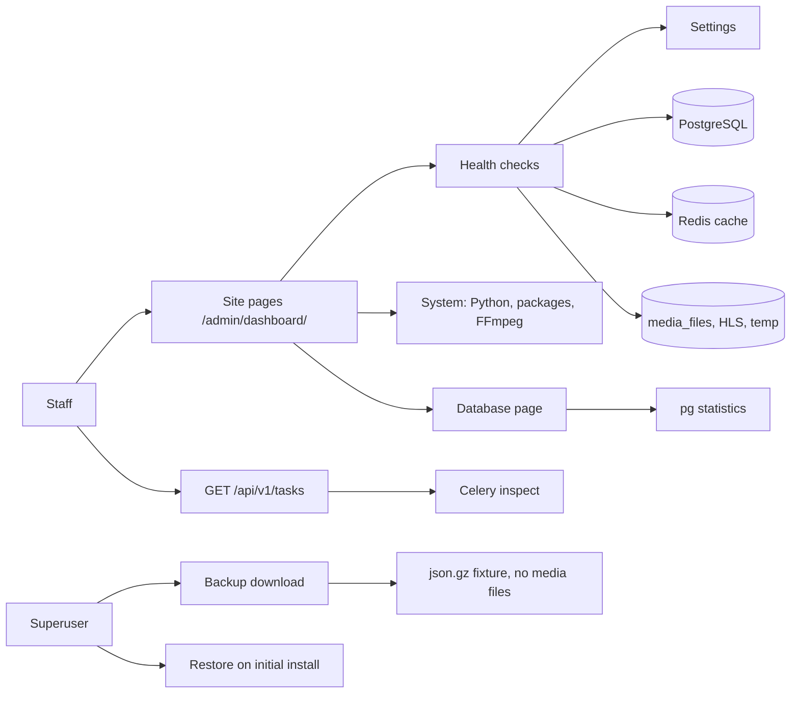

# Site health and database

Use this page to check the health of the portal, read configuration and system facts, back up the database, and read the Celery task list.

The **Site** group has four pages. Each page is a dashboard section.

| Page | URL |
|------|-----|
| **Health** | `/admin/dashboard/health/` |
| **Configuration** | `/admin/dashboard/configuration/` |
| **System** | `/admin/dashboard/system/` |
| **Database** | `/admin/dashboard/database/` |

## Health

The **Health** page shows four counters and one table.

| Counter | Meaning |
|---------|---------|
| **Passing checks** | Checks with status OK |
| **Warnings** | Checks that need attention |
| **Failures** | Checks that must be fixed |
| **Info checks** | Facts. No action needed |

The **Health checks** table has the columns **Status**, **Check**, and **Detail**. A check name with a link opens the list that has the problem.

1. Open **Site** > **Health**.
2. Read the **Failures** counter. Fix failures first.
3. Open the **Health checks** table. Read each warning.
4. Select the check name to open the filtered list.
5. Fix the problem.
6. Select **Refresh stats**. Check that the check now shows OK.

The table shows **Copy** tools. Use them to paste the table into a ticket.

### What the checks cover

| Area | Examples |
|------|----------|
| Site record | Django site record exists. Site name matches `PORTAL_NAME`. Site domain matches `FRONTEND_HOST` |
| Hosts | `ALLOWED_HOSTS` includes the `FRONTEND_HOST` host. `FRONTEND_HOST` uses HTTPS. `DEBUG` is off |
| Services | Cache and Redis are reachable. An active superuser exists |
| Email | `DEFAULT_FROM_EMAIL` is set. `EMAIL_USE_TLS` and `EMAIL_USE_SSL` are not both on |
| Encoding | Active encode profiles exist. Encoding failures. Encode, trim, and caption job failures |
| Integrity | Listable flag mismatch. Video success with no encodings. Queued video with no encoding rows. Stale running encodings. Duplicate md5sum. Duplicate names. Missing media metadata. Recent integrity warnings |
| Reverse proxy | `USE_X_FORWARDED_HOST`, `SECURE_PROXY_SSL_HEADER`, `CSRF_TRUSTED_ORIGINS`, secure cookies, `SECURE_SSL_REDIRECT`, CORS allow-all. For accurate client IPs in auth logs, also set `TRUSTED_PROXIES` |
| Storage | `MEDIA_ROOT`, `HLS_DIR`, and `TEMP_DIRECTORY` can be read and written. The sub-directories for original, encoded, upload, and chunk files can be read and written |
| Workflow | Open reports. Reports above the limit. Media waiting for review. Users waiting for approval. Inactive users |
| Integrations | See [Integrations](integrations.md) |

The reverse-proxy checks apply when `FRONTEND_HOST` starts with `https`. For a local or `DEBUG` install, a gap is shown as **Info**. For a production install, a gap is shown as **Warning**.

A storage check writes and then deletes one small file in the directory. It never creates a directory.

## Configuration

The **Configuration** page lists the main settings as they are now. It is read-only. It shows `PORTAL_NAME`, `FRONTEND_HOST`, `PORTAL_WORKFLOW`, `MEDIA_IS_REVIEWED`, `CAN_ADD_MEDIA`, `CAN_COMMENT`, `USERS_NEEDS_TO_BE_APPROVED`, `GLOBAL_LOGIN_REQUIRED`, `ACCOUNT_EMAIL_VERIFICATION`, the email TLS and SSL switches, the `USE_*` switches, `LOCAL_INSTALL`, and `DEBUG`. It also shows the reverse-proxy and path values.

To change a value, edit `local_settings.py`. See the [Settings catalog](settings.md).

## System

The **System** page shows facts for troubleshooting.

| Group | Examples |
|-------|----------|
| MediaCMS installation | Version, install type, operating system, git branch and commit |
| Python | Executable, version, prefix |
| Packages | Django, Celery, psycopg, redis versions |
| Process | PID, user, working directory, settings module, time zone, `DEBUG` |
| Database | Engine and server version |
| Cache and Celery | Cache backend. Broker URL without user name or password |
| Binaries | FFmpeg and FFprobe path and version |
| Paths | `BASE_DIR`, `MEDIA_ROOT`, `PATH`, `sys.path` |
| Environment | Variable names. Only a short allowlist shows a value. Other variables show `(set)` or `(empty)` |

## Database

The **Database** page shows PostgreSQL facts for the connected database.

| Part | What it shows |
|------|---------------|
| Counters and checks | Connection use, idle sessions, long-running sessions, transaction ID age, cache hit ratio, deadlocks, temporary files, checkpoint balance, replication lag |
| Object totals | Row counts for the main models, with links |
| Database backup | A download button |
| Database restore | An upload form (superuser) |

Check limits:

| Check | Warning | Failure |
|-------|---------|---------|
| Connection use | 70 percent of the maximum | 90 percent |
| Transaction ID age | 200 million | 1.5 billion |
| Cache hit ratio | Under 99 percent | Under 90 percent |
| Replication lag | 30 seconds | 300 seconds |

The cache hit check shows **Info** until 1000 blocks are read.

### Back up the database

Only a superuser can download a backup.

1. Open **Site** > **Database**.
2. Find the **Database backup** card.
3. Select **Download a database backup**.

The file is a gzipped JSON fixture. The name is `mediacms-database-backup-YYYY-MM-DD-HHMM.json.gz`.

!!! warning
    The file does not contain uploaded media files. It has only their stored paths. Back up the `media_files` directory too.

!!! note
    This backup leaves out operational rows: sessions, admin log entries, notifications, identity provider user logs, LTI launch logs, trim requests, and caption requests. It also leaves out likes, dislikes, watches, ratings, and failed encodings. For a full copy of the database, also use `pg_dump`.

To write the same file from a terminal, use `export_database`:

```bash
python manage.py export_database --output /tmp/backup.json.gz
```

| Option | Effect |
|--------|--------|
| `--output PATH` | Required. The file to write |
| `--include-engagement` | Adds likes, dislikes, watches, and ratings |
| `--include-noisy-status` | Adds failed encodings, trim requests, and caption requests |

The backup stores which options were used. Restore reads this.

### Restore a database backup

A restore is possible only on an initial installation. Use it to move data to a new, empty install of the same MediaCMS version.

Before you start, check these conditions. If one is not true, the page shows a list of reasons and turns the restore off:

- There is exactly one user. The user is an active superuser.
- There is at most one channel. It is the default channel.
- The categories and encode profiles are the ones from the first install.
- There is exactly one site record.
- No other model has rows.

1. Sign in as the superuser of the new install.
2. Open **Site** > **Database**.
3. Find the **Database restore** card.
4. Select the file in **Backup file**.
5. Select **Restore database backup**.
6. Confirm the question.
7. Sign in with an account from the backup.

The file size limit is 64 MiB compressed and 256 MiB after unzip. The restore runs in one transaction. A bad file changes nothing.

!!! note
    Permissions and content types stay as created by migrations. Use a backup from the same MediaCMS version. Copy the `media_files` directory to the new install by hand.

For a site upgrade, read [Site upgrade](site-upgrade.md).

## Get Support

Open `/admin/dashboard/support/`. Select **Download support bundle** and then **Download as text** or **Download as Markdown**. Or select **Copy text** or **Copy Markdown**.

The file lists the version, the health warnings and failures, and the system rows. Secrets are omitted or redacted. It is safe to paste into a GitHub issue.

## Task list API

`/api/v1/tasks` lists the Celery tasks that are running or waiting.

| Item | Value |
|------|-------|
| Method | `GET` |
| Path | `/api/v1/tasks` (also `/api/v1/tasks/`) |
| Who | Staff (`IsAdminUser`) |
| Documented in Swagger | No |

The response has these keys:

| Key | Content |
|-----|---------|
| `active` | `tasks`: tasks that a worker runs now |
| `reserved` | `tasks`: tasks that a worker has taken |
| `scheduled` | `tasks`: tasks with a start time |
| `task_ids` | All task IDs |
| `media_profile_pairs` | Pairs of media friendly token and profile ID for `encode_media` tasks |

Each task has `worker`, `task_id`, `args`, `name`, and `time_start`. An `encode_media` task also has `info` with `profile name`, `media title`, and `encoding progress`.

Example with a session cookie or basic authentication:

```bash
curl -u admin:PASSWORD https://portal.example.org/api/v1/tasks
```

!!! warning
    `DELETE /api/v1/tasks/<token>` does not cancel a task. It returns `204` and does nothing. To stop encoding work, stop the worker or use the actions in [Processing](processing.md).

The call asks the workers over Redis. It needs at least one running worker. If no worker answers, the request can fail with a server error.

## MediaCMS Architecture

The Site pages read live data from the application, the database, the cache, and the file system.


