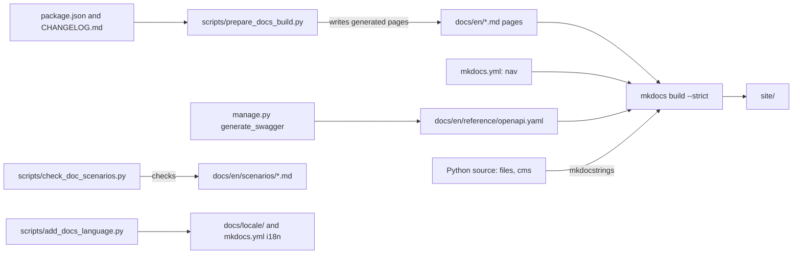
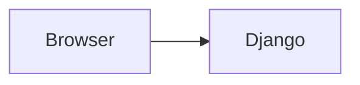

# Add a documentation page

Use this guide to add a page to this documentation site, build the site, and add a language.

## MediaCMS Architecture

The site is built with MkDocs. Source pages are Markdown files in `docs/en/`. Some pages are generated from the repository by scripts. The build puts the result in `site/`.



For the full stack of MediaCMS itself, see [Architecture](architecture.md).

## Install the tools

1. Create a Python virtual environment.
2. Install the documentation tools:

    ```bash
    pip install -r requirements-docs.txt
    ```

## Add a page

1. Choose the folder. Use the section that matches the reader:

    | Folder | Reader |
    |--------|--------|
    | `docs/en/getting-started/` | New installers |
    | `docs/en/roles/` | One role |
    | `docs/en/guides/user/`, `operator/`, `admin/`, `developer/` | One guide set |
    | `docs/en/scenarios/` | One role on one path |
    | `docs/en/reference/` | Reference pages |

2. Create the file, for example `docs/en/guides/developer/my-topic.md`.
3. Start the file with one `#` heading. Use a short title.
4. Write the page. Follow the [Writing guide](../../contributing/writing.md).
5. Add a **MediaCMS Architecture** heading to each task guide and each role page. Add a Mermaid diagram if the task crosses more than one part of the system. Do not repeat this heading in a scenario.
6. Link to other pages with a relative path to the `.md` file, for example `[Tests](tests.md)`.
7. Open `mkdocs.yml`.
8. Add the page under `nav:` in the right section:

    ```yaml
    - Developer:
        - guides/developer/index.md
        - Local development: guides/developer/local-dev.md
        - My topic: guides/developer/my-topic.md
    ```

    The path is relative to `docs/en/`. A path without a label uses the page title.

9. Link the new page from the `index.md` of its folder.
10. Build the site. See [Build the site](#build-the-site).

!!! warning
    A page that is not in `nav:` is built but is not in the menu. `mkdocs build --strict` reports a broken link as an error.

## Write the page

Follow these rules. The [Writing guide](../../contributing/writing.md) has the full list.

- Use simple, short sentences in the active voice.
- Use one word for one thing. Check the [glossary](../../contributing/glossary.md).
- Number the steps. Put one action in each step. Start each step with a verb.
- Put notes and warnings in admonitions (`!!! note`, `!!! warning`).
- Write interface labels in bold, as they appear on the screen.
- Keep setting names, commands, and paths in backticks.
- Use `Manage pages` for `/manage/...` and `admin portal` for `/admin/`. Do not mix them.

Use Mermaid in a fenced block:

````markdown

````

Quote each label that has spaces or punctuation.

## Generated pages

Do not edit these files. `scripts/prepare_docs_build.py` writes them and each file starts with a `generated by` comment.

- `docs/en/reference/this-version.md`
- `docs/en/reference/whats-new.md`
- `docs/en/reference/changelog.md`
- `docs/en/reference/api.md`
- `docs/en/reference/openapi.yaml` (a stub if CI did not export it)
- `docs/en/languages.md`

To change them, change the script or the source data (`package.json`, `CHANGELOG.md`, `docs/languages.yml`).

## Reference pages

- `docs/en/reference/python.md` uses mkdocstrings. Add a line `::: module.path.name` to document a function or class. The setting `paths: [.]` in `mkdocs.yml` lets mkdocstrings find the modules from the repository root.
- `docs/en/reference/node.md` has a manual table of frontend entry points. Update the table when you add a file to `frontend/src/entries/`.

## Prepare the build

Run the prepare script before each build:

```bash
python scripts/prepare_docs_build.py
```

The script does these things:

1. Reads the version from `package.json`.
2. Writes `reference/this-version.md`, `reference/whats-new.md`, and `reference/changelog.md`.
3. Writes `languages.md` from `docs/languages.yml`.
4. Creates `reference/openapi.yaml` as a stub if the file is missing. Then it writes `reference/api.md`.
5. Copies `docs/_shared/stylesheets/` and `docs/_shared/assets/` into each locale folder that builds.

To export the real OpenAPI schema, run this before the prepare script:

```bash
DJANGO_SETTINGS_MODULE=cms.docs_settings SECRET_KEY=docs-build-not-a-secret \
  python manage.py generate_swagger -f yaml -o docs/en/reference/openapi.yaml
```

`cms/docs_settings.py` uses an in-memory SQLite database, so no PostgreSQL is needed.

## Check scenarios

If you add or change a page in `docs/en/scenarios/`, run the scenario check:

```bash
python scripts/check_doc_scenarios.py
```

The script checks each scenario file for:

- Front matter with the keys `id`, `role`, `audience`, and `goal`.
- A `related_tests` list. Each entry must be an existing test file or `file::function`. An empty list needs `coverage: gap`.
- A screenshot placeholder `<figure>` where the `alt` text and the `<figcaption>` text are the same sentence.

Use the [scenario template](../../contributing/scenario-template.md) to start a scenario.

## Build the site

1. Run the prepare script:

    ```bash
    python scripts/prepare_docs_build.py
    ```

2. Run the scenario check:

    ```bash
    python scripts/check_doc_scenarios.py
    ```

3. Build the site. Fix every warning, because `--strict` makes warnings errors:

    ```bash
    mkdocs build --strict
    ```

4. To read the site in a browser, run `mkdocs serve`. Open `http://127.0.0.1:8000`.

The CI workflow `.github/workflows/docs.yml` runs the same steps on each pull request.

## Add a language

1. Open `docs/languages.yml`. Find the locale code. The codes match `LANGUAGES` in `cms/settings.py`.
2. Run the script:

    ```bash
    python scripts/add_docs_language.py fr
    ```

    Replace `fr` with your locale code.

3. Check the result. The script does these things:

    - Sets `build: true` for the locale in `docs/languages.yml`.
    - Creates `docs/<locale>/index.md` if it does not exist.
    - Adds the locale to `plugins.i18n.languages` in `mkdocs.yml`.

4. Copy a page from `docs/en/` to the same path under `docs/<locale>/`.
5. Translate the sentences. Keep UI labels in bold as the English words on the product screen.
6. Run the prepare script and `mkdocs build --strict`.

A page that you did not translate falls back to the English page.

!!! note
    The script stops with `Unknown locale` if the code is not in `docs/languages.yml`. Add the code there first.
