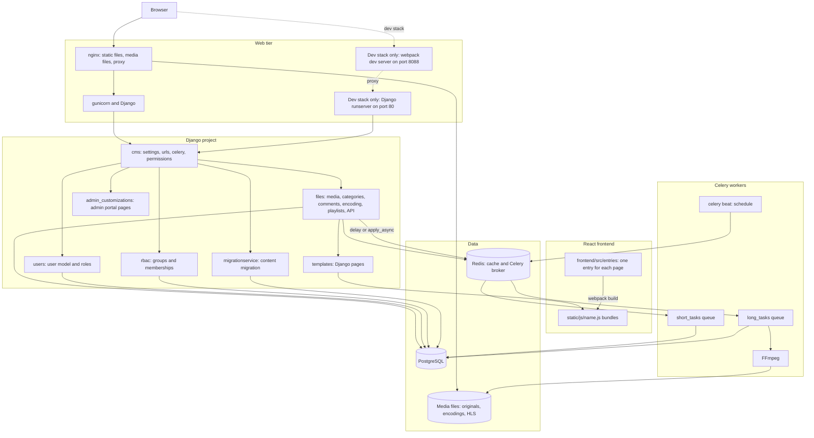
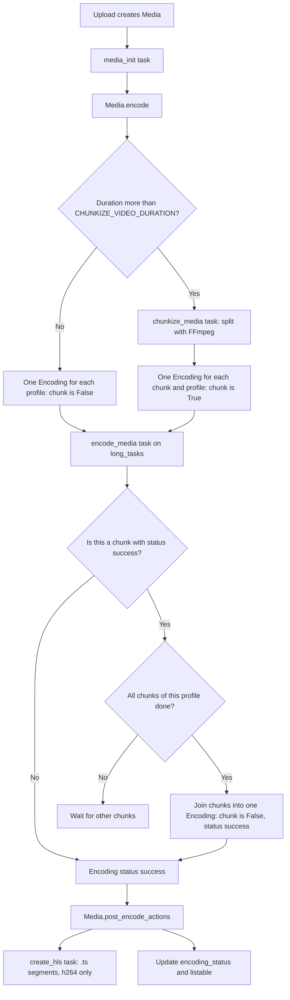

# Architecture

Use this page to learn how the parts of MediaCMS work together. Role pages and task guides link here for the full stack.

## MediaCMS Architecture

This diagram shows the full stack of a production install and the Docker development stack.

## Request path

1. The browser asks nginx for a page.
2. nginx sends page and API requests to gunicorn. nginx serves static files and media files by itself.
3. Django picks a view from `cms/urls.py` and the URL files of each app.
4. The view reads or writes PostgreSQL and Redis.
5. A Django template makes the page. The template loads a React bundle from `static/js/`.
6. React calls the REST API under `/api/v1/` to get data.

In the development stack there is no nginx and no gunicorn. `runserver` serves the pages. The webpack dev server on port 8088 proxies to `runserver`. See [Local development](local-dev.md).

## Django apps

All apps are listed in `INSTALLED_APPS` in `cms/settings.py`.

| App | Folder | What it holds |
|-----|--------|---------------|
| Project | `cms/` | `settings.py`, `urls.py`, `celery.py`, `permissions.py` (REST permission classes), `dev_settings.py`, `test_settings.py`. |
| Files | `files/` | The main app. Models for media, category, comment, encoding, playlist, subtitle, and page. Views, serializers, forms, Celery tasks (`tasks.py`), helper functions (`methods.py`), management commands, and `frontend_translations/`. |
| Users | `users/` | The `User` model. It has the flags `is_editor` and `is_manager`. It also has the RBAC access methods. |
| RBAC | `rbac/` | `RBACGroup` and `RBACMembership`. Roles are `member`, `contributor`, and `manager`. |
| Migration service | `migrationservice/` | Content migration from other platforms: models, providers, scheduling, Celery tasks, and views. |
| Admin customizations | `admin_customizations/` | Extra pages for the admin portal: health, database stats, processing stats, backup, restore, and the support bundle. |

Other apps in `INSTALLED_APPS` are `actions` (user actions such as watch and like), `identity_providers`, `lti`, `saml_auth`, and `uploader`.

## Data stores

| Store | Use |
|-------|-----|
| PostgreSQL | All records: users, media, encodings, comments, playlists, RBAC groups. |
| Redis | The Django cache and the Celery broker and result backend. |
| Media folder | Original files, encoded files, chunks, HLS files, thumbnails, and previews. |

!!! warning
    All Celery workers and the web server must see the same media folder. Use the same machine or a shared file system such as NFS or EFS.

## Celery tasks and queues

Celery tasks are in `files/tasks.py` and `migrationservice/tasks.py`. Each task goes to one of two queues.

| Queue | Used for | Examples |
|-------|----------|----------|
| `short_tasks` | Quick tasks | `chunkize_media`, `media_init`, `update_search_vector`, `video_trim_task`, state checks |
| `long_tasks` | Slow tasks | `encode_media`, `create_hls`, `whisper_transcribe`, `produce_sprite_from_video` |

`celery beat` runs scheduled tasks. The schedule is `CELERY_BEAT_SCHEDULE` in `cms/settings.py`.

In tests, `TESTING=True` sets `CELERY_TASK_ALWAYS_EAGER`. Tasks then run as plain functions. See [Tests](tests.md).

## Encode pipeline

The pipeline turns an uploaded video into files that users can play. The database model is `Encoding` in `files/models/encoding.py`. Each `Encoding` belongs to one media item and one `EncodeProfile`. Profiles are set in the admin portal at `/admin/files/encodeprofile/`.

Follow these facts when you work on the pipeline:

- A video longer than `CHUNKIZE_VIDEO_DURATION` is split into chunks. The default is 5 minutes (`60 * 5`). Each chunk is about `VIDEO_CHUNKS_DURATION`. The default is 4 minutes (`60 * 4`). `VIDEO_CHUNKS_DURATION` must be smaller than `CHUNKIZE_VIDEO_DURATION`.
- `chunkize_media` creates one `Encoding` for each chunk and each profile. These have `chunk=True`.
- The preview profile is not split. It is encoded from the original file.
- When all chunks of one profile have status `success`, the `post_save` signal in `files/models/encoding.py` joins them into one `Encoding` with `chunk=False` and `status='success'`. It then removes the chunk files.
- Only the joined `Encoding` is served and downloaded.
- A short video skips the chunk step. It gets one `Encoding` for each profile.
- `create_hls` runs after a successful, non-chunk `h264` encoding. It writes HLS segments (`.ts` files) in `HLS_DIR`.
- A profile with a resolution higher than the original video is skipped. The exception is the resolutions in `MINIMUM_RESOLUTIONS_TO_ENCODE`.

!!! note
    Some older notes call the model `Encode`. The class name in the code is `Encoding`.

### Media becomes listable

`Media.save` in `files/models/media.py` sets `listable` each time. The value is true only when all of these are true:

- `state == "public"`
- `encoding_status == "success"`
- `is_reviewed is True`

See [Python reference](../../reference/python.md).

## React frontend

React is a library that Django templates load. It is not a single-page application and it has no router.

| Part | Path | What it does |
|------|------|--------------|
| Entry files | `frontend/src/entries/<name>.js` | One file for each page. It calls `renderPage` with a page component. |
| Pages | `frontend/src/static/js/pages/` | Page components. |
| Components | `frontend/src/static/js/components/` | Shared interface parts. |
| Build | `frontend/webpack.config.js` | Makes `static/js/<name>.js` for each entry. |
| Django templates | `templates/cms/*.html` | Load `static/js/<name>.js` and `static/js/_commons.js`. |

Example: `frontend/src/entries/media.js` becomes `static/js/media.js`. The template `templates/cms/media.html` loads it. See [Node reference](../../reference/node.md) for the full table.

## Admin and Manage surfaces

Two surfaces use this stack in different ways. Do not mix them.

- **Manage pages** (`/manage/media`, `/manage/users`, `/manage/comments`) are React pages. They call the REST API. Editors and managers use them.
- **Admin portal** (`/admin/`) is the Django admin with Jazzmin. `admin_customizations/` adds pages to it. Staff and superusers use it.

## Related pages

- [Local development](local-dev.md)
- [Tests](tests.md)
- [Python reference](../../reference/python.md)
- [Permissions and RBAC](../operator/permissions.md)
- [Processing (admin)](../admin/processing.md)
