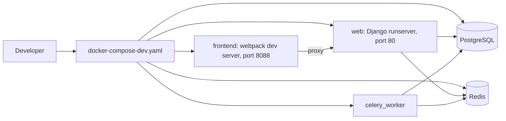

# Developer guides

Use these guides when you change the MediaCMS code. You run MediaCMS on your computer, write code, run tests, and add documentation.

| Task | Guide |
|------|-------|
| Start MediaCMS on your computer with Docker | [Local development](local-dev.md) |
| Learn how the parts of MediaCMS work together | [Architecture](architecture.md) |
| Run the backend and frontend tests | [Tests](tests.md) |
| Add or change a text that users read in the interface | [Translations](translations.md) |
| Add a page to this documentation | [Add a documentation page](add-docs-page.md) |
| Look up Python helpers and permission classes | [Python reference](../../reference/python.md) |
| Look up frontend entry points | [Node reference](../../reference/node.md) |

## MediaCMS Architecture

A developer works on three parts: the Django backend, the React frontend, and the Celery workers. Docker runs all of them for you.

Read [Architecture](architecture.md) for the full stack.

## Before you start

1. Install [Docker](https://docs.docker.com/get-docker/) and Docker Compose.
2. Clone the repository.
3. Read `AGENTS.md` in the repository root. It lists the rules for code style and commits.
4. Read the [Code of Conduct](https://github.com/mediacms-io/mediacms/blob/main/CODE_OF_CONDUCT.md).

## Rules for every change

- Run `pre-commit run --all` before you commit. It runs `black`, `isort`, and `flake8` for Python, plus Prettier, ESLint, and hygiene hooks for the frontend packages.
- Use Conventional Commit messages: `feat`, `fix`, `chore`, `docs`, `style`, `refactor`, `perf`, `test`, `depr`.
- Do not change the version in `package.json`. Releases are automatic.
- Do not edit `CHANGELOG.md`. Releases are automatic.
- Do not edit `cms/settings.py` for a deployment. Put overrides in `cms/local_settings.py`.
- Add every new interface text to `files/frontend_translations/en.py` first. See [Translations](translations.md).

!!! note
    This documentation is for the developer of MediaCMS. To run a production site, read the [Admin guides](../admin/index.md) and the [Deploy guide](../../getting-started/deploy.md).
