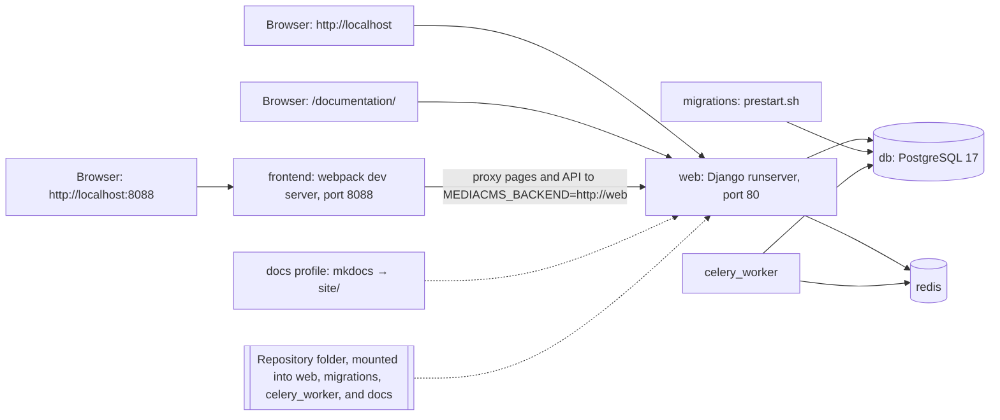

# Local development

Use this guide to run MediaCMS on your computer with Docker. It uses the file `docker-compose-dev.yaml`.

## MediaCMS Architecture

The development stack runs six services by default. The optional `docs` profile adds an MkDocs watcher. The `web` service runs the Django development server. The `frontend` service runs the webpack development server. Both servers use the same repository folder.



For the full stack, see [Architecture](architecture.md).

## Services

| Service | What it does |
|---------|--------------|
| `migrations` | Runs `deploy/docker/prestart.sh`. It runs database migrations and creates the `admin` user. |
| `web` | Runs `python manage.py runserver 0.0.0.0:80`. It reloads when Python files change. |
| `frontend` | Runs `npm install && npm run start` in `frontend/`. It starts the webpack dev server. |
| `db` | PostgreSQL 17. |
| `redis` | Cache and Celery broker. |
| `celery_worker` | Runs Celery tasks, such as video encoding. |
| `docs` (optional profile) | Builds MkDocs into `site/` and rebuilds when files change. Off by default. |

In this stack Django runs in debug mode with Django Debug Toolbar. It does not run gunicorn or nginx. `corsheaders` allows all origins.

## Ports

| URL | What you see |
|-----|--------------|
| `http://localhost` (port 80) | The real Django site. It serves the **built** frontend bundles from `static/`. |
| `http://localhost:8088` | The webpack development server. It proxies all pages and API calls to Django. It serves the **live** frontend bundles. |
| `http://localhost/documentation/` | The MkDocs site (same origin as the portal). Requires the optional `docs` profile. |

Use port 8088 when you edit the frontend. Use port 80 to check what users see.

## Start the stack

1. Install [Docker](https://docs.docker.com/get-docker/) and Docker Compose.
2. Open a terminal in the repository root.
3. Build the images:

    ```bash
    docker compose -f docker-compose-dev.yaml build
    ```

4. Start the services:

    ```bash
    docker compose -f docker-compose-dev.yaml up
    ```

5. Wait a few minutes. The first start installs frontend packages and runs migrations.
6. Open `http://localhost`.
7. Sign in with user `admin` and password `admin`.

## Documentation on the same site

Django serves the built MkDocs site at `http://localhost/documentation/` when `DEVELOPMENT_MODE` is on. The optional `docs` Compose profile builds into `site/` and watches for changes.

1. Start the documentation watcher:

    ```bash
    make docs-up
    ```

2. Wait for the first build to finish. Check the logs with `make docs-logs`.
3. Open `http://localhost/documentation/`.

One-shot build without watching:

```bash
make docs-build
```

Stop the watcher with `make docs-down`. The path `/docs/` stays reserved for ReDoc at `/docs/api/` and for page slugs.

## Change Python code

1. Edit the Python files.
2. Check `http://localhost`. Django reloads by itself.

If Django stops because of an error, such as a `SyntaxError`, fix the error. Then restart the service:

```bash
docker compose -f docker-compose-dev.yaml restart web
```

!!! warning
    A change to a setting needs a restart. Restart all three services that read settings:

    ```bash
    docker compose -f docker-compose-dev.yaml restart web celery_worker
    ```

    The development stack has no `celery_beat` service. Restart `celery_beat` only on a stack that has it.

## Change frontend code

React is a library that Django templates load. It is not a separate single-page application. Django owns the routes, the pages, the data, and the login.

The code is in two places:

- `frontend/src/` holds the React code.
- `templates/` holds the Django templates. All templates extend `templates/root.html`.

Each page has an entry file `frontend/src/entries/<name>.js`. The template for the page loads `static/js/<name>.js` and `static/js/_commons.js`. See [Node reference](../../reference/node.md) for the list of entries.

1. Edit the files in `frontend/src/`.
2. Open `http://localhost:8088`. The page reloads when you save.
3. Build the bundles for port 80:

    ```bash
    make build-frontend
    ```

4. Open `http://localhost`. Check the change.
5. Commit the changes in `static/` together with the changes in `frontend/src/`.

`make build-frontend` runs these commands:

```bash
docker compose -f docker-compose-dev.yaml exec frontend npm run dist
cp -r frontend/dist/static/* static/
docker compose -f docker-compose-dev.yaml restart web
```

!!! note
    Port 80 does not show frontend changes until you build. Port 8088 and port 80 can look different. This is normal.

### Styles

- Put styles for more than one page in `static/css/_commons.css`.
- Put styles for one page in `static/css/<name>.css`. The template of that page must link the file.

The webpack build is set in `frontend/webpack.config.js`. It makes one bundle for each file in `frontend/src/entries/`.

## Run commands in a container

Open a shell in the `web` container:

```bash
docker compose -f docker-compose-dev.yaml exec web /bin/bash
```

Then run Django commands in the shell:

```bash
python manage.py shell
```

The shortcut `make admin-shell` does the same. It needs the `web` container.

!!! warning
    The `admin-shell` target in the `Makefile` runs `docker compose ps -q web` without `-f docker-compose-dev.yaml`. If you start the stack with `-f docker-compose-dev.yaml`, the shortcut can report `Web container not found`. Use the `docker compose -f docker-compose-dev.yaml exec web /bin/bash` command above.

## Make targets

Run these from the repository root. The development stack must be running.

| Target | What it runs |
|--------|--------------|
| `make build-frontend` | Builds the frontend, copies it to `static/`, restarts `web`. |
| `make test` | Backend tests with `pytest -n auto` and `TESTING=True`. |
| `make test-coverage` | Backend tests with coverage. |
| `make test-frontend` | Frontend Jest tests in CI mode. |
| `make test-frontend-coverage` | Frontend Jest tests with coverage. |
| `make admin-shell` | Shell in the `web` container. |

See [Tests](tests.md) for the test commands.

## Check the code style

1. Install the hook once: `pre-commit install`.
2. Run all checks: `pre-commit run --all`.
3. Fix every problem the checks report.

Python uses `black`, `isort` (profile `black`), and `flake8`. The frontend uses Prettier. The Prettier settings are in `.prettierrc`.

## Fake media for development

The `web` service sets `ALLOW_POPULATE_FAKE_MEDIA` to `True`. This allows the management command `populate_fake_media`.

## Stop the stack

1. Press `Ctrl+C` in the terminal that runs `up`.
2. Remove the containers when you no longer need them:

    ```bash
    docker compose -f docker-compose-dev.yaml down
    ```

!!! note
    The database files are in `../postgres_data`, next to the repository folder. `down` does not delete them.
