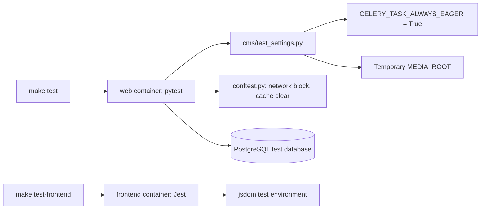

# Tests

Use this guide to run the backend tests (pytest) and the frontend tests (Jest).

## MediaCMS Architecture

Backend tests run inside the `web` container. They use `cms/test_settings.py`. Frontend tests run inside the `frontend` container.



For the full stack, see [Architecture](architecture.md).

## Before you start

1. Start the development stack. See [Local development](local-dev.md).
2. Wait until the `web` and `db` services are ready.

## Backend tests

!!! warning
    Always set `TESTING=True`. Without it, Celery tasks go to a broker that does not run in tests. `TESTING=True` makes Celery run tasks as plain functions.

### Run all tests in parallel

```bash
make test
```

This runs:

```bash
docker compose -f docker-compose-dev.yaml exec --env TESTING=True -T web pytest -n auto
```

`-n auto` uses `pytest-xdist` to run tests on all CPU cores.

### Run all tests in one process

```bash
docker compose -f docker-compose-dev.yaml exec --env TESTING=True -T web pytest
```

Use this when you debug a failing test. It prints output in order.

### Run one file or one test

```bash
docker compose -f docker-compose-dev.yaml exec --env TESTING=True -T web pytest tests/test_fixtures.py
docker compose -f docker-compose-dev.yaml exec --env TESTING=True -T web pytest tests/api/test_api_permissions.py -k upload
```

### Run with coverage

```bash
make test-coverage
```

This runs `pytest -n auto --cov --cov-report=term --cov-report=html`. The settings for coverage are in `.coveragerc`. Migrations, tests, and the frontend are not counted.

## Test settings

`pytest.ini` sets `DJANGO_SETTINGS_MODULE = cms.test_settings`. This file does these things:

- Sets `TESTING` to `True` if it is not set.
- Sets `CELERY_TASK_ALWAYS_EAGER = True`.
- Uses a temporary `MEDIA_ROOT` and a temporary `HLS_DIR`.
- Uses a local memory cache and a fast password hasher.
- Sets `MEDIA_IS_REVIEWED = True`, `USERS_NEEDS_TO_BE_APPROVED = False`, and `USE_IDENTITY_PROVIDERS = False`.
- Uses the test database `test_mediacms`.

The `norecursedirs` setting in `pytest.ini` skips `frontend`, `static`, `media_files`, `logs`, and `docs`.

## conftest.py

`conftest.py` in the repository root does these things:

- **Blocks network access.** It replaces `socket.getaddrinfo`. A test can only reach `localhost`, `127.0.0.1`, `::1`, `0.0.0.0`, the database host, the Redis host, and the broker host. Any other host raises `socket.gaierror`.
- **Cleans up.** After the run it deletes the temporary media folder.
- **Clears the cache.** An automatic fixture clears the cache before each test.

Do not write a test that calls an outside service. Replace the call with a mock.

## Test folders

| Folder | What it tests |
|--------|---------------|
| `tests/api/` | REST API: media, categories, comments, playlists, permissions, search, login |
| `tests/models/` | Models: media, playlists, comments, subtitles |
| `tests/pipeline/` | Upload, encoding, tasks, trim, and commands |
| `tests/rbac/` | RBAC access |
| `tests/saml/`, `tests/lti/` | SAML and LTI integrations |
| `tests/admin/`, `tests/pages/`, `tests/forms/` | Admin portal, pages, forms |
| `tests/users/`, `tests/notifications/` | Users and notifications |
| `tests/management/`, `tests/upgrade/` | Management commands and site upgrade |

Some tests carry the marker `slow`. Skip them with `-m "not slow"`.

## Frontend tests

Frontend tests use Jest with the `jsdom` environment. The files are in `frontend/tests/`. The settings are in `frontend/jest.config.js`.

```bash
make test-frontend
```

This runs:

```bash
docker compose -f docker-compose-dev.yaml exec -T frontend npm run test -- --ci
```

Run with coverage:

```bash
make test-frontend-coverage
```

Run one test file:

```bash
docker compose -f docker-compose-dev.yaml exec -T frontend npm run test -- --ci tests/utils/settings/member.test.ts
```

## Check the result

1. Read the last line of the pytest output. It must show `passed` and no `failed`.
2. Read the Jest summary. It must show `Tests:` with no failures.
3. Run `pre-commit run --all` before you commit.

## Add a test

1. Put the file in the folder that matches the code. Name it `test_<topic>.py`.
2. Do not call an outside host.
3. Do not start real Celery workers. Eager mode runs the tasks.
4. Run the new test alone, then run `make test`.
