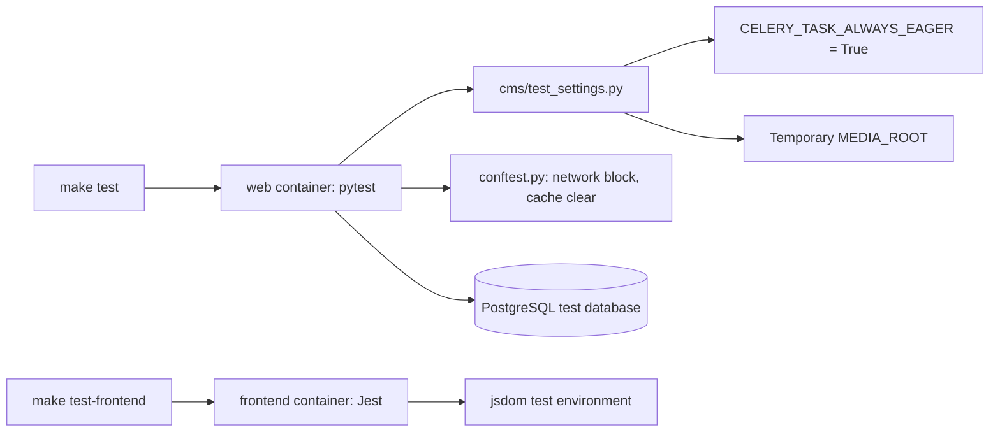

# Tests

Use this guide to run the backend tests (pytest) and the frontend tests (Jest).

## MediaCMS Architecture

Backend tests run inside the `web` container. They use `cms/test_settings.py`. Frontend tests run inside the `frontend` container.



For the full stack, see [Architecture](architecture.md).

## Before you start

1. Start the development stack. See [Local development](local-dev.md).
2. Wait until the `web` and `db` services are ready.

## Backend tests

!!! warning
    Always set `TESTING=True`. Without it, Celery tasks go to a broker that does not run in tests. `TESTING=True` makes Celery run tasks as plain functions.

### Run all tests in parallel

```bash
make test
```

This runs:

```bash
docker compose -f docker-compose-dev.yaml exec --env TESTING=True -T web pytest -n auto
```

`-n auto` uses `pytest-xdist` to run tests on all CPU cores.

### Run all tests in one process

```bash
docker compose -f docker-compose-dev.yaml exec --env TESTING=True -T web pytest
```

Use this when you debug a failing test. It prints output in order.

### Run one file or one test

```bash
docker compose -f docker-compose-dev.yaml exec --env TESTING=True -T web pytest tests/test_fixtures.py
docker compose -f docker-compose-dev.yaml exec --env TESTING=True -T web pytest tests/api/test_api_permissions.py -k upload
```

### Run with coverage

```bash
make test-coverage
```

This runs `pytest -n auto --cov --cov-report=term --cov-report=html`. The settings for coverage are in `.coveragerc`. Migrations, tests, and the frontend are not counted.

## Test settings

`pytest.ini` sets `DJANGO_SETTINGS_MODULE = cms.test_settings`. This file does these things:

- Sets `TESTING` to `True` if it is not set.
- Sets `CELERY_TASK_ALWAYS_EAGER = True`.
- Uses a temporary `MEDIA_ROOT` and a temporary `HLS_DIR`.
- Uses a local memory cache and a fast password hasher.
- Sets `MEDIA_IS_REVIEWED = True`, `USERS_NEEDS_TO_BE_APPROVED = False`, and `USE_IDENTITY_PROVIDERS = False`.
- Resets feature flags and auth that `deploy/docker/local_settings.py` may enable (`USE_LTI`, `USE_RBAC`, `USE_SAML`, `RELATED_MEDIA_STRATEGY`, session cookie secure flags, `AUTHENTICATION_BACKENDS`) so tests start from repository defaults.
- Uses the test database `test_mediacms`.

The `norecursedirs` setting in `pytest.ini` skips `frontend`, `static`, `media_files`, `logs`, and `docs`.

## conftest.py

`conftest.py` in the repository root does these things:

- **Blocks network access.** It replaces `socket.getaddrinfo`. A test can only reach `localhost`, `127.0.0.1`, `::1`, `0.0.0.0`, the database host, the Redis host, and the broker host. Any other host raises `socket.gaierror`.
- **Cleans up.** After the run it deletes the temporary media folder.
- **Clears the cache.** An automatic fixture clears the cache before each test.
- **Summarizes unimplemented cases.** After the run it prints warn-mode `@unimplemented` / xfail cases so they stay visible next to pass/fail counts.

Do not write a test that calls an outside service. Replace the call with a mock.

## Test folders

| Folder | What it tests |
|--------|---------------|
| `tests/api/` | REST API: media, categories, comments, playlists, permissions, search, login |
| `tests/models/` | Models: media, playlists, comments, subtitles |
| `tests/pipeline/` | Upload, encoding, tasks, trim, and commands |
| `tests/rbac/` | RBAC access |
| `tests/saml/`, `tests/lti/` | SAML and LTI integrations |
| `tests/admin/`, `tests/pages/`, `tests/forms/` | Admin portal, pages, forms |
| `tests/users/`, `tests/notifications/` | Users and notifications |
| `tests/management/`, `tests/upgrade/` | Management commands and site upgrade |
| `tests/settings/` | Portal workflow, roles, `MEDIA_IS_REVIEWED` gate |
| `tests/unimplemented/` | Warn-mode catalog for stubbed product features |
| `migrationservice/tests/` | Content migration providers, orchestrator, and migration APIs |

Pytest discovers every `test_*.py` under the repo root except paths listed in `norecursedirs` (so `migrationservice/tests/` is included). Some tests carry the marker `slow`. Skip them with `-m "not slow"`.

Real HLS packaging needs a working `MP4HLS_COMMAND` (bento4 `mp4hls`). Tests that require it call `tests._support.bento.mp4hls_is_usable` and **skip** when the binary is missing or cannot run (for example a broken Rosetta ELF under Docker Desktop on Apple Silicon). Encoding and mocked HLS tests still run.

## Coverage matrix (primary workflows)

| Workflow / surface | Owning tests |
|--------------------|--------------|
| Upload (API + Fine Uploader) | `tests/api/test_api_media_upload_search.py`, `tests/pipeline/test_pipeline_upload.py` |
| Encode / HLS / sprites / trim | `tests/pipeline/test_pipeline_encoding.py`, `test_pipeline_trim.py`, `test_pipeline_tasks.py` |
| Media detail / share / chapters / password | `tests/api/test_api_media_detail.py`, `test_api_media_actions.py`, `test_media_password.py` |
| Playlist membership (Save popup) | `tests/api/test_api_media_playlist_membership.py`, `test_api_playlists.py` |
| Bulk user media actions | `tests/api/test_api_media_bulk.py` |
| Comments | `tests/api/test_api_comments.py` |
| Manage / operator APIs and pages | `tests/api/test_api_manage.py`, `tests/pages/test_pages_manage.py` |
| Review gate (`MEDIA_IS_REVIEWED`) | `tests/settings/test_media_is_reviewed.py` |
| Portal workflows / roles | `tests/settings/test_portal_workflow.py`, `test_user_roles_settings.py` |
| Application states (public/private/encoding/password) | `tests/pages/test_workflow_states.py` |
| Admin portal + media object/bulk actions | `tests/admin/` (especially `test_admin_files.py`, `test_admin_media_actions.py`, `test_admin_object_actions.py`) |
| RBAC / SAML / LTI | `tests/rbac/`, `tests/saml/`, `tests/lti/` |
| Content migration | `migrationservice/tests/` |

### Unimplemented features (backend)

When a product feature is expected but the code is stubbed or missing, add a warn-mode case with `@unimplemented("...")` from `tests/_support/unimplemented.py`. Pytest reports these as xfailed (they do not fail CI). The terminal summary prints an **unimplemented feature(s) (warn-mode)** section. Use this only for stubbed/absent behavior — not for tests you have not written yet. See `tests/unimplemented/test_stubbed_features.py`.

```python
from tests._support.unimplemented import unimplemented

@unimplemented("API uploads should reject files larger than UPLOAD_MAX_SIZE")
def test_api_upload_respects_upload_max_size():
    pass
```

List only unimplemented cases:

```bash
docker compose -f docker-compose-dev.yaml exec --env TESTING=True -T web pytest -m unimplemented
```

## Frontend tests

Frontend tests use Jest with the `jsdom` environment. The files are in `frontend/tests/`. The settings are in `frontend/jest.config.js`.

```bash
make test-frontend
```

This runs:

```bash
docker compose -f docker-compose-dev.yaml exec -T frontend npm run test -- --ci
```

Run with coverage:

```bash
make test-frontend-coverage
```

Run one test file:

```bash
docker compose -f docker-compose-dev.yaml exec -T frontend npm run test -- --ci tests/utils/settings/member.test.ts
```

### Add a frontend test

1. Mirror the source path under `frontend/tests/` (for example `src/static/js/utils/helpers/foo.js` → `tests/utils/helpers/foo.test.ts`).
2. Import `tests/_support/setupMediaCMS` when the code reads `window.MediaCMS`.
3. Render with `renderIntoContainer` / `renderHook` from `tests/_support/render.ts` (the suite does not use React Testing Library).
4. Use `compD_storeMocks`, `compD_dom`, and related helpers under `tests/_support/` for Flux stores and DOM events.
5. Do not call outside hosts; mock `axios` or `utils/helpers/requests` instead.

### Unimplemented features (`testUnimplemented`)

When a product feature is expected but the code is stubbed or missing, add a warn-mode case with `testUnimplemented` from `tests/_support/unimplemented.ts`. Jest reports these as TODO (they do not fail CI). Use this only for stubbed/absent behavior — not for tests you have not written yet. See `tests/unimplemented/stubbedFeatures.test.ts` for examples.

## Check the result

1. Read the last line of the pytest output. It must show `passed` and no `failed`. Xfailed unimplemented cases are warnings, not failures.
2. Read the Jest summary. It must show `Tests:` with no failures. TODO items from `testUnimplemented` are warnings, not failures.
3. Run `pre-commit run --all` before you commit.

## Add a backend test

1. Put the file in the folder that matches the code. Name it `test_<topic>.py`.
2. Do not call an outside host.
3. Do not start real Celery workers. Eager mode runs the tasks.
4. For stubbed product behavior, use `@unimplemented` instead of a failing assertion.
5. Run the new test alone, then run `make test`.
