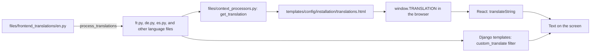

# Translations

Use this guide to add a text that users read in the interface, and to translate it. Follow the steps in order.

!!! warning
    A pull request is not accepted if it skips these steps. Add the English text to `files/frontend_translations/en.py` first.

## MediaCMS Architecture

Translation files are Python modules in `files/frontend_translations/`. Django reads them. Django templates use them in two ways. React pages get them from the `window.TRANSLATION` object.



For the full stack, see [Architecture](architecture.md).

## Files

| File | Purpose |
|------|---------|
| `files/frontend_translations/en.py` | Source of every text. It has `translation_strings` and `replacement_strings`. |
| `files/frontend_translations/<lang>.py` | One file for each language. Language codes with a hyphen use an underscore: `zh_hans.py`, `zh_hant.py`. |
| `files/management/commands/process_translations.py` | Copies missing keys from `en.py` into all other files and sorts them. |

`translation_strings` holds texts. `replacement_strings` holds small words that are replaced inside a longer text, for example month names and `days ago`.

## Add a text

1. Mark the text as translatable in the code.

    - In a React file, call `translateString`:

        ```js
        import { translateString } from '../../utils/helpers/';

        const label = translateString('Upload media');
        ```

    - In a Django template, use the `custom_translate` filter. See `templates/cms/about.html` for an example:

        ```django
        {{ "About" | custom_translate:LANGUAGE_CODE }}
        ```

2. Open `files/frontend_translations/en.py`.
3. Add the text as a key in `translation_strings`. Use the exact English text as the key. Set the value to the same English text, or to an empty string.

    ```python
    translation_strings = {
        # ...
        "My new label": "My new label",
    }
    ```

4. Run the command that copies the new key to all language files:

    ```bash
    docker compose -f docker-compose-dev.yaml exec -T web python manage.py process_translations
    ```

5. Check the output. It must end with `Successfully processed translation files`.
6. Open the file of your language, for example `files/frontend_translations/fr.py`.
7. Find the key. Replace the English value with your translation.
8. Commit `en.py` and every language file that changed.

!!! note
    The command copies the English value into each language file. The site loads only non-empty values. An empty value means "not translated". The page then shows the English key.

## Translate an existing text

1. Open `files/frontend_translations/<lang>.py`.
2. Find the key.
3. Set the value to the translation.
4. Keep placeholders such as `{extra}` and `{link}` unchanged.

## See the change

| Where you added the text | What you must do |
|--------------------------|------------------|
| Django template | Reload the page. The template does not need a frontend rebuild. |
| React file | Rebuild the frontend with `make build-frontend`. |
| Python file only (`en.py` or a language file) | Wait for Django to reload. If it does not, restart `web`: `docker compose -f docker-compose-dev.yaml restart web`. |

!!! note
    The webpack dev server on port 8088 shows React changes at once. Port 80 shows them only after `make build-frontend`. See [Local development](local-dev.md).

## Rules for texts

- Use one key for one text. Do not build a sentence from parts.
- Keep the key short and clear.
- Do not change a key that already exists. The change breaks all existing translations of it.
- Keep UI labels the same as on the screen.

## Documentation translations

Documentation pages are not part of this workflow. To add a language to the documentation site, see [Add a documentation page](add-docs-page.md).
