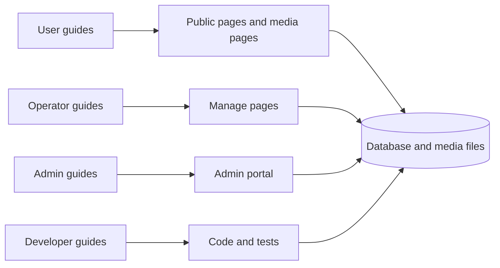

# Guides

Use these guides to do tasks in MediaCMS. Pick the guide set that matches your job.

| Guide set | Who reads it | What it covers |
|-----------|--------------|----------------|
| [User](user/index.md) | Anyone who watches, uploads, or shares media | Browse, search, upload, edit, captions, comments, playlists, share, trim, profile, download |
| [Operator](operator/index.md) | Editors and managers | Manage pages, review, categories, permissions, users |
| [Admin](admin/index.md) | Staff and superusers | The admin portal, processing, integrations, settings, site upgrade |
| [Developer](developer/index.md) | People who change MediaCMS code | Local development, architecture, tests, translations |

## MediaCMS Architecture

All four guide sets use the same system. The guide sets differ in which part of the system they use.

- **User** guides use the public pages. These pages show media that is *listable* or that you can access.
- **Operator** guides use the **Manage pages**: `/manage/media`, `/manage/comments`, and `/manage/users`.
- **Admin** guides use the **admin portal** at `/admin/`.
- **Developer** guides describe the code that runs all of the above.

!!! note
    Do not mix the two surfaces. Editors and managers use **Manage pages**. Staff and superusers use the **admin portal**. See the [glossary](../contributing/glossary.md).

## Where to start

1. Read the [User guides](user/index.md) if you only watch or upload media.
2. Read the [Operator guides](operator/index.md) if you review media or manage people.
3. Read the [Admin guides](admin/index.md) if you configure the portal.
4. Read the [Developer guides](developer/index.md) if you change the code.
