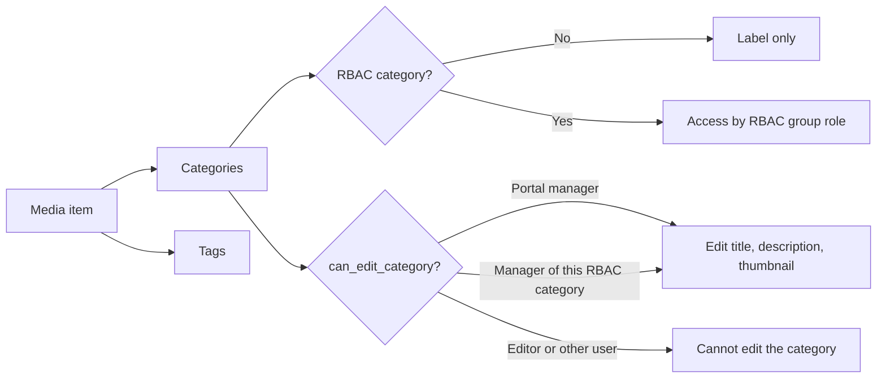

# Categories and tags

Use this guide to organize media with categories and tags, and to edit a category.

## MediaCMS Architecture

A category and a tag are labels on media. They are stored once and linked to many media items. A category can also be an RBAC category, which controls access.

| Label | Who creates it | How it is used |
|-------|----------------|----------------|
| **Category** | An administrator, in the admin portal | A fixed group of media. One media item can be in many categories. |
| **Tag** | Any user who can edit the media | A free keyword. A user enters a new keyword and it is created. |

## Put media in a category

1. Open the media page.
2. Select **EDIT**, then open the **Publish** tab.
3. Select **Category**. Choose one or more categories.
4. Select **Publish Media**.

An editor or a manager can choose any category. A user who is not an editor can choose only categories that are not RBAC categories, and the RBAC categories where that user is a **contributor** or **manager**. This applies when the portal uses RBAC.

!!! note
    Adding media to an RBAC category gives the members of that group access to the media. Clear **Shared** and the RBAC categories are removed from the media. See [Permissions and RBAC](permissions.md).

## Change categories or tags for many of your own media items

**Bulk Actions** work only on media that you own.

1. Select **My media** in the menu.
2. Select the check boxes of the media items.
3. Select **Bulk Actions**.
4. Select **Add / Remove from Categories**, or select **Add / Remove Tags**.
5. Choose the labels and confirm.

## Tag media

1. Open the media page.
2. Select **EDIT**, then open the **Metadata** tab.
3. Enter **Tags** as a comma separated list.
4. Select **Update Media**.

## Edit a category

You can edit a category when `can_edit_category` is true for you. This is true when:

- You are a portal manager or a superuser. You can edit any category.
- You are a manager of the RBAC group of an RBAC category. You can edit only that category.

An **editor** cannot edit a category. A **contributor** of an RBAC group can put media in the category but cannot rename it.

1. Select **Categories** in the menu.
2. Select the category.
3. Select **EDIT**. If you do not see **EDIT**, you cannot edit this category.
4. Change **Title**, **Description**, or **Thumbnail**. The thumbnail file must be 5 MB or smaller.
5. Select **Update category**.

!!! note
    The link to a category does not change when you change the title. The link uses an identifier that stays fixed.

## Create, delete, or make RBAC categories

You cannot do these tasks on the Manage pages. A staff user or a superuser does them in the admin portal. See the [Admin guides](../admin/index.md).
