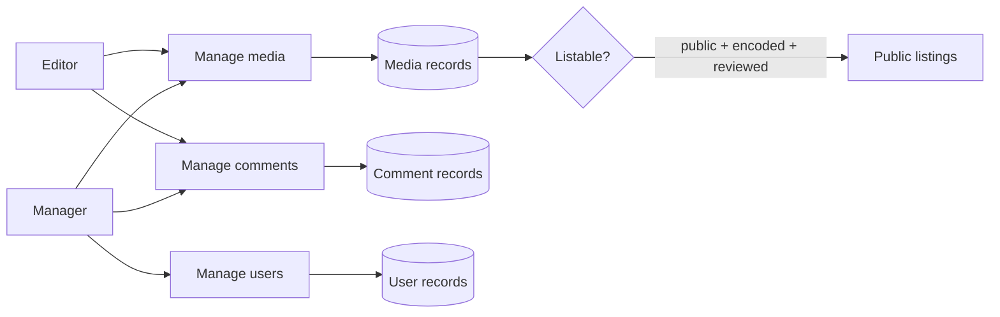

# Operator guides

Use these guides when you are a portal **editor** or a portal **manager**. You run the library and the people of the portal. You do not change server settings.

| Task | Guide | Needs |
|------|-------|-------|
| Find, filter, and delete media and comments | [Manage media and comments](manage-media.md) | Editor |
| Decide what appears in public listings | [Review and publish](review.md) | Editor |
| Organize media with categories and tags | [Categories and tags](categories.md) | Editor to assign, manager to edit a category |
| Understand who can see and edit media | [Permissions and RBAC](permissions.md) | Editor |
| Add users, approve users, and give roles | [Manage users](manage-users.md) | Manager |

## MediaCMS Architecture

Operators work on the **Manage pages**. These pages read and change the same media and user records that the public pages use. Operators do not use the admin portal.

Two checks decide what you can open:

- `is_mediacms_editor` is true for **editors**, **managers**, and **superusers**. It opens **Manage media** and **Manage comments**.
- `is_mediacms_manager` is true for **managers** and **superusers**. It opens **Manage users** and the manager actions.

A **manager** can do everything that an **editor** can do.

!!! note
    The editor and manager roles are not the same as the RBAC roles (member, contributor, manager of a category group). Portal roles apply to the whole portal. RBAC roles apply to the categories of one group. See [Permissions and RBAC](permissions.md).

## Check your role

1. Sign in.
2. Open the menu on the left side of the page.
3. Look for **Manage media**, **Manage comments**, and **Manage users**.

You see **Manage users** only when you are a manager or a superuser. If you see no **Manage** links, you are not an editor.

!!! warning
    The **admin portal** at `/admin/` is a separate surface for staff and superusers. A manager is not staff by default and cannot open it. See the [Admin guides](../admin/index.md).
