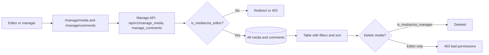

# Manage media and comments

Use this guide to find media, check its status, and remove media or comments. You need the editor role to open **Manage media** and **Manage comments**.

## MediaCMS Architecture

The **Manage pages** read every media item and every comment. They do not apply the listing rule. You see media that is private, unlisted, not reviewed, and not encoded.

- `is_mediacms_editor` opens both pages. It is true for editors, managers, and superusers.
- Deleting media from the Manage pages needs `is_mediacms_manager`. Deleting a comment needs only the editor role.

## Open the Manage pages

1. Sign in as an editor or a manager.
2. Open the menu on the left side of the page.
3. Select **Manage media** or **Manage comments**.

If you do not see these links, your account is not an editor. Ask a manager. See [Manage users](manage-users.md).

## Find media

1. Open **Manage media**.
2. Enter a title in the search field. To search by owner, change the field to **Owner** and enter a name or a user name.
3. Select **Filters** to narrow the list.
4. Select a column heading, such as **Title** or the date, to sort.

The filters are:

| Filter | Values |
|--------|--------|
| **STATE** | **All**, **Public**, **Private**, **Unlisted** |
| **MEDIA TYPE** | **All**, **Video**, **Audio**, **Image**, **Pdf** |
| **ENCODING STATUS** | **All**, **Success**, **Running**, **Pending**, **Fail** |
| **REVIEWED** | **All**, **Yes**, **No** |
| **FEATURED** | **All**, **Yes**, **No** |
| **CATEGORY** | **All**, or one category |

Each row shows **Author**, **Media type**, **Encoding status**, **State**, **Reviewed**, **Featured**, and **Reported**.

## Common searches

| You want to find | Set |
|------------------|-----|
| Media that waits for review | **REVIEWED**: **No** |
| Media that failed to encode | **ENCODING STATUS**: **Fail** |
| Media that is still processing | **ENCODING STATUS**: **Running** or **Pending** |
| Media that is not listable although it is reviewed | **STATE**: not **Public**, or **ENCODING STATUS**: not **Success** |

## Change media

1. Select the title of a media item. The media page opens.
2. Select **EDIT**.
3. Change the metadata, or open the **Publish** tab to change the state, **Featured**, or **Is reviewed**.

See [Review and publish](review.md).

## Delete media

1. Open **Manage media**.
2. Select **Delete** in the row of the item. Or select the check boxes of several items, select **Bulk actions**, select **Delete selected**, and select **Apply**.
3. Select **PROCEED**.

!!! warning
    Deleting media removes the media record and its files. You cannot undo it.

!!! note
    Only managers can delete media on the Manage pages. If an editor selects **Delete**, the portal answers "bad permissions". A bulk delete handles up to 50 items for each request.

An editor can still delete a media item from its own media page. Select **More options**, then **Delete**.

## Moderate comments

1. Open **Manage comments**.
2. Select **View media** in a row to read the comment in context.
3. Select **Delete** in the row to remove a comment. Or select several rows, select **Bulk actions**, select **Delete selected**, and select **Apply**.
4. Select **PROCEED**.

The list shows the newest comments first. Select a column heading to sort.

!!! note
    To turn comments off for one media item, clear **Enable comments** on its **Metadata** tab.
