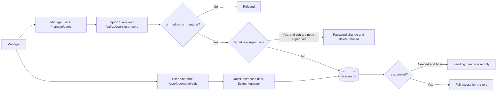

# Manage users

Use this guide to create users, approve users, and give roles. You need the manager role (`is_mediacms_manager`). Editors cannot open **Manage users**.

## MediaCMS Architecture

User management crosses two screens and one API. The **Manage users** page lists, creates, approves, and deletes users. The user edit form gives roles.

- A **manager** opens **Manage users**, creates users, approves users, gives the roles **Editor** and **Manager**, changes passwords, and deletes users.
- A manager is not staff by default. A manager cannot open the **admin portal** at `/admin/`.
- A manager cannot change the password of a superuser. A manager cannot delete a superuser. The portal refuses both actions.
- The user edit form has no field to make a user a superuser or to make a user staff. Those flags are set in the admin portal, which a manager cannot open.

!!! note
    The portal checks the manager role again on the server for every action. Hiding a button in the interface is not the only guard.

## Open Manage users

1. Sign in as a manager.
2. Open the menu on the left side of the page.
3. Select **Manage users**.

If you do not see **Manage users**, your account is not a manager. A superuser or another manager must give you the role.

## Find a user

1. Open **Manage users**.
2. Enter a name or a user name in the search field. When the portal owner allows it, you can also search by email.
3. Select **Filters**.
4. Under **ROLE**, select **All**, **Editor**, or **Manager**.
5. When the portal needs approval, select **Yes** or **No** under **APPROVED** to find users that wait for approval.

Each row shows the name, user name, date added, role, and approval state.

## Create a user

1. Open **Manage users**.
2. Select **Add New User**.
3. Enter **Username**, **Password**, **Email**, and **Name**. All four fields are required.
4. Select **SUBMIT**.

The portal refuses the request when the user name or the email is already in use.

!!! note
    A new user has no role and is not approved. When the portal needs approval, approve the user before the user signs in.

## Approve a user

Use this when the portal owner turned on `USERS_NEEDS_TO_BE_APPROVED`. An unapproved user can sign in and browse. The user cannot upload or change media. A pending user sees the page **Account Pending Approval**.

1. Open **Manage users**.
2. Under **APPROVED**, select **No** to list the users that wait.
3. Find the user. Select **Approve** in the row.
4. Select **PROCEED**.

The row now shows the approved mark.

## Assign a role

Roles are check boxes on the user edit form.

1. Open **Manage users**.
2. Select the name of the user. The profile page opens.
3. Select the edit icon (**Edit profile**).
4. Select the roles you want:
    - **MediaCMS Editor** lets the user open **Manage media** and **Manage comments**.
    - **MediaCMS Manager** lets the user also manage users.
    - **advanced user** marks the user for features that the portal owner limits to advanced users.
5. Select **Is approved** if the portal needs approval and the user is ready.
6. Select **Update Profile**.

Give the lowest role that does the job. An editor does not need the manager role.

!!! warning
    A **MediaCMS Manager** can create users, give roles, and delete users and media. Give this role to few people.

## Change a password

1. Open **Manage users**.
2. Select **Change password** in the row of the user.
3. Enter **New Password**.
4. Select **SUBMIT**.

The portal checks the password rules. If you try this on a superuser, the portal answers that you do not have permission.

## Delete users

1. Open **Manage users**.
2. Select **Delete** in the row. Or select the check boxes of several users, select **Bulk actions**, select **Delete selected**, and select **Apply**.
3. Select **PROCEED**.

!!! warning
    Deleting a user also deletes the media of that user. You cannot undo it. The portal refuses to delete a superuser.

## What a manager cannot do

| Task | Who can do it |
|------|---------------|
| Open the admin portal (`/admin/`) | Staff and superusers |
| Make a user a superuser or staff | People who have access to the admin portal |
| Change the password of a superuser | A superuser |
| Delete a superuser | A superuser |
| Create RBAC groups and memberships | Staff and superusers, in the admin portal |

See the [Manager role](../../roles/manager.md) and the [Admin guides](../admin/index.md).
