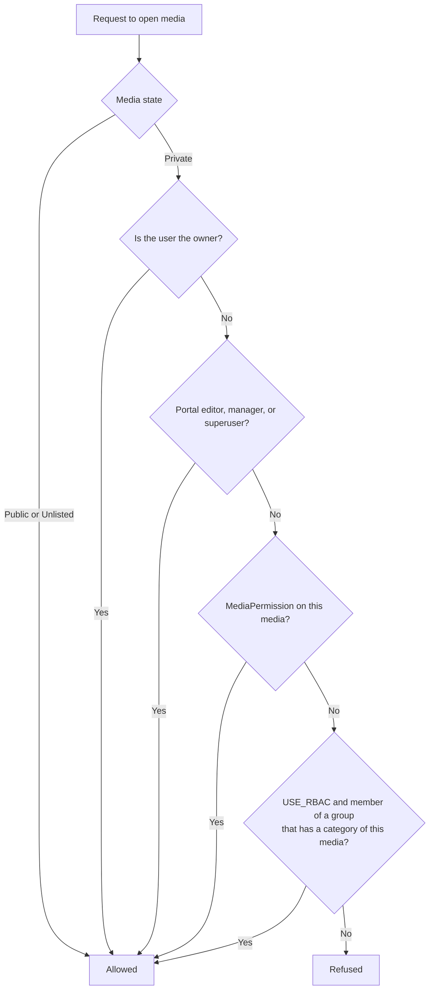

# Permissions and RBAC

Use this guide to understand who can see and edit a media item. Read it before you share media or change roles.

## MediaCMS Architecture

Four layers decide access. The server checks them in this order for a private media item.

## Layer 1: Media state

Each media item has one state.

| State | In listings | Opens for |
|-------|-------------|-----------|
| **Public** | Yes, when the media is listable | Everyone |
| **Unlisted** | No | Anyone who has the link |
| **Private** | No | The owner, people with access, editors |

Listable media is public, encoded, and reviewed. See [Review and publish](review.md).

## Layer 2: MediaPermission (direct share)

A **MediaPermission** gives one user access to one media item. The owner of the media or a user with the **owner** permission creates it.

| Permission | Can open | Can edit metadata | Can delete or share further |
|------------|----------|-------------------|-----------------------------|
| **Viewer** | Yes | No | No |
| **Editor** | Yes | Yes | No |
| **Owner** | Yes | Yes | Yes |

In the interface these are **Co-Viewer**, **Co-Editor**, and **Co-Owner**. See [Share and embed](../user/share.md).

## Layer 3: RBAC (category groups)

When the portal owner sets `USE_RBAC`, a category can be an **RBAC category**. An **RBAC group** holds users and links to RBAC categories. Each user has one role in the group.

| RBAC role | In the RBAC category |
|-----------|----------------------|
| **Member** | Can see the media. |
| **Contributor** | Can see and edit the media, and can add media to the category. |
| **Manager** | Full control of the media. Can also edit the category. |

A media item gets RBAC access through its categories. A user who belongs to a group with that category gets the access of the role.

!!! note
    A staff user or a superuser creates RBAC groups and memberships in the admin portal. Single sign-on can also assign groups. See the [Admin guides](../admin/index.md).

## Layer 4: Portal roles

Portal roles apply to the whole portal. They are separate from RBAC roles.

| Portal role | Check | Powers |
|-------------|-------|--------|
| **Editor** (**MediaCMS Editor**) | `is_mediacms_editor` | Opens **Manage media** and **Manage comments**. Opens every media item. Sets any state. Changes **Is reviewed**, **Featured**, and **Reported times**. Uploads without the usual limits. |
| **Manager** (**MediaCMS Manager**) | `is_mediacms_manager` | All editor powers. Opens **Manage users**. Creates, approves, and deletes users. Deletes media on the Manage pages. Edits any category. |
| **Superuser** | `is_superuser` | Everything. Counts as manager and editor. |

`is_mediacms_editor` is true for editors, managers, and superusers. `is_mediacms_manager` is true for managers and superusers.

!!! warning
    Do not confuse the two kinds of roles. A **manager** of an RBAC group has power only in the categories of that group. A **MediaCMS Manager** has power over the whole portal. The names are the same. The powers are not.

| Question | Portal role | RBAC role |
|----------|-------------|-----------|
| Where is it set? | The user edit form, by a manager | The admin portal, or single sign-on |
| What does it cover? | The whole portal | The categories of one group |
| Can it open **Manage media**? | Yes, for editor or higher | No |
| Can it edit a category? | Manager, yes. Editor, no. | Manager of that category, yes |

## Related user flags

- **advanced user** is a flag that the portal owner can use to decide who can upload or comment. It is not an editor power.
- **Is approved** applies when the portal needs approval for new users. A user who is not approved can browse but cannot upload or change anything. See [Manage users](manage-users.md).

## Check access for a media item

1. Open **Manage media** and find the media.
2. Open the media page.
3. Select **More options**, then **Status info**, to read the state.
4. Check the categories on the **Publish** tab.
5. Check **Shared by me** on the profile of the owner for direct shares.
