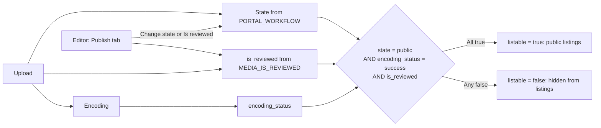

# Review and publish

Use this guide to control what appears in public listings. You need the editor role to mark media as reviewed.

## MediaCMS Architecture

A media item appears in public listings only when it is **listable**. The server recomputes this value each time the media is saved.

**Listable rule:** media is listable when the state is **public** AND the encoding status is **success** AND the media is reviewed. If one condition is false, the media is not listable.

Media that is not listable still opens for the owner, for people with direct access, for RBAC members, and for editors. It does not appear in public listings.

## Settings that set the starting values

The portal owner sets these in `cms/local_settings.py`. A change needs a restart.

| Setting | Values | Effect on new media |
|---------|--------|---------------------|
| `PORTAL_WORKFLOW` | `public` | State starts as **public**. |
| | `unlisted` | State starts as **unlisted**. |
| | `private` | State starts as **private**. |
| | `private_verified` | State starts as **unlisted** for advanced users and **private** for other users. |
| `MEDIA_IS_REVIEWED` | `True` (default) | New media is reviewed at once. |
| | `False` | New media is not reviewed. An editor must review it. |

!!! note
    These settings set only the starting values of new media. A change does not alter media that exists.

Examples:

- With `PORTAL_WORKFLOW = "public"` and `MEDIA_IS_REVIEWED = True`, new media becomes listable when encoding succeeds.
- With `MEDIA_IS_REVIEWED = False`, new media waits for you. It does not become listable until you mark it as reviewed.
- With `PORTAL_WORKFLOW = "private"`, new media is private. An editor must set it to **public**.

Users who are not editors have limits on the state. When the workflow is not public, a user can pick only **Private** or **Unlisted**. An editor can set any state.

## Find media that needs review

1. Open **Manage media**.
2. Select **Filters**.
3. Under **REVIEWED**, select **No**.

Add **ENCODING STATUS**: **Success** to see only media that is ready.

## Mark media as reviewed

1. Open the media page.
2. Select **EDIT**.
3. Open the **Publish** tab.
4. Select **Is reviewed**.
5. Check **State**. For public listings, select **Public**.
6. Select **Publish Media**.

To remove media from public listings, clear **Is reviewed**, or change the state. Then select **Publish Media**.

## Set or clear a media password

1. Open the media page.
2. Select **EDIT**.
3. Open the **Publish** tab.
4. Under **Password protection**, enter a password, or select **Remove password protection** when one is already set.
5. Select **Publish Media**.

Use a password with **Unlisted** when you share a link and want an extra check. Leave the field blank for no password.

!!! note
    Only editors and managers can change **Is reviewed**, **Featured**, and **Reported times**. For other users these fields are read-only.

## Check why media is not listable

1. Open the media page.
2. Select **More options**, then **Status info**.
3. Read each line.

!!! note
    **Status info** appears for video only. For other media types, read the columns **Encoding status**, **State**, and **Reviewed** on **Manage media**. Image, PDF, and audio items have the encoding status **success** at once.

| Line | What you need |
|------|---------------|
| **State** | **public** |
| **Encoding Status** | **success** |
| **Review state** | **Is reviewed** |

| Result | Action |
|--------|--------|
| **State** is not public | Set **Public** on the **Publish** tab. |
| **Review state** is **Pending review** | Select **Is reviewed** on the **Publish** tab. |
| **Encoding Status** is **pending** or **running** | Wait. The worker is still encoding. |
| **Encoding Status** is **fail** | Ask an administrator to check the processing queue. |

!!! warning
    Reported media can become private automatically. The portal sets the media to **private** when the number of reports reaches the limit that the portal owner set (`REPORTED_TIMES_THRESHOLD`, 10 by default). Check the **Reported** column on **Manage media**.
