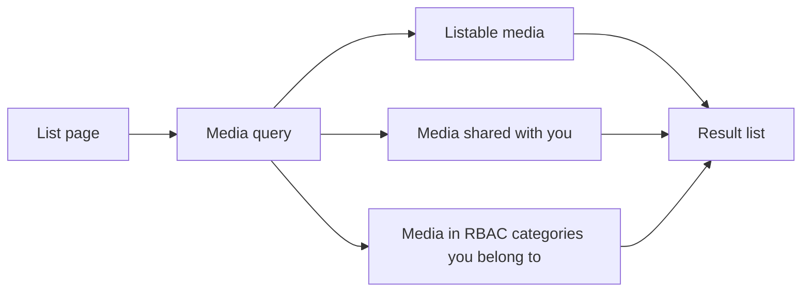

# Browse and play

Use this guide to find media in the lists and to play it.

## MediaCMS Architecture

Each list page asks the server for media. The server returns only the media that you may see.

- **Listable media** is public, encoded, and reviewed.
- **Shared media** is media where another user gave you access.
- **RBAC media** appears only when the portal uses RBAC and you belong to a matching category group.

## Browse the lists

1. Open the portal home page.
2. Open the menu on the left side of the page.
3. Select a list: **Home**, **Featured**, **Recommended**, **Latest**, **Categories**, **Tags**, **Members**, **History**, or **Liked media**.
4. Select a media item to open its page.

!!! note
    You see **My media** and **My playlists** only after you sign in. You see **Members** only when the portal owner allows it.

## Browse by category or tag

1. Select **Categories** in the menu.
2. Select a category. The page lists the media in that category.
3. Select **Tags** to browse by tag in the same way.

## Play media

1. Open a media page.
2. Select the play button on the player.
3. Use the player controls to pause, change the volume, change the video quality, or go to full screen.
4. Turn on **AUTOPLAY** to play the next related item when the current item ends.

## Act on media

Under the player you can select:

- **LIKE** or the dislike icon, to rate the media.
- **SHARE**, to send a link. See [Share and embed](share.md).
- **SAVE**, to add the media to a playlist. See [Playlists](playlists.md).
- **DOWNLOAD**, when the owner allows it. See [Download](download.md).
- **More options**, then **Report**, to report media that breaks the rules.

!!! note
    The portal owner can turn each of these controls on or off. Some actions need you to sign in.

## Media that does not play yet

A video can show a message that encoding has not started or is still running. The page then tries to play the original video file. Playback can be slow or can fail. Wait until encoding finishes, then open the page again. See [Upload](upload.md).
