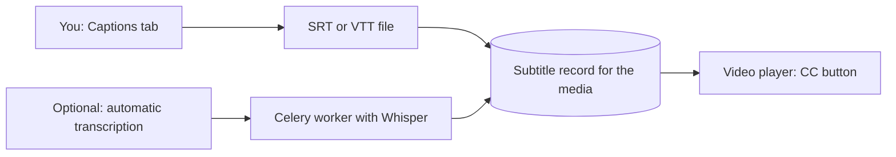

# Captions

Use this guide to add, edit, and delete captions (subtitles) for a video or audio item.

## MediaCMS Architecture

Captions are separate files that belong to one media item. The player loads them next to the video. A caption file does not change the video or its encodes.

- You upload a **SubRip (.srt)** file or a **WebVTT (.vtt)** file. You choose one language for each file.
- Automatic transcription works only when the portal owner turns on Whisper. The portal then shows an extra section on the **Captions** tab.

## Add a caption file

1. Open the media page.
2. Select **EDIT**, then select the **Captions** tab.
3. Under **Upload Caption File**, select the file.
4. Select the **Language** of the file.
5. Select **Submit**.

The new language appears in the list **Edit existing Captions**.

## Request automatic transcription

1. Open the **Captions** tab.
2. Find the section **Request Automatic Transcription and Translation**. If you do not see it, the portal does not offer it to you.
3. Select **Transcription**. Select **English Translation** if you also need an English version.
4. Select **Submit** in that section.

!!! note
    You cannot clear **Transcription** or **English Translation** after the server accepts the request. The worker needs time to finish the job.

## Edit a caption file

1. Open the **Captions** tab.
2. Under **Edit existing Captions**, select a language.
3. Change the text in the editor.
4. Select **SAVE**.

Select **DOWNLOAD** to save the caption file to your computer.

## Delete a caption file

1. Open the **Captions** tab.
2. Select the language under **Edit existing Captions**.
3. Select **DELETE**.
4. Select **DELETE SUBTITLE** to confirm.

## Show captions in the player

1. Play the video.
2. Select the **CC** button on the player.
3. Select a language, or select the off option.
