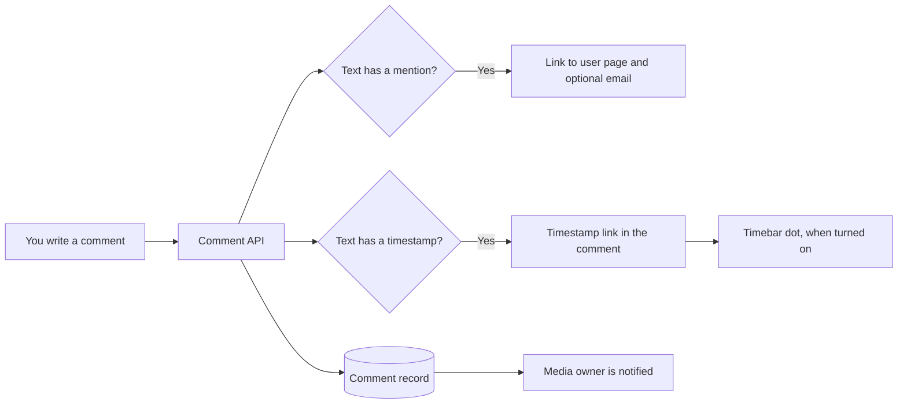

# Comments and mentions

Use this guide to add comments, mention other users, and link to a time in a video.

## MediaCMS Architecture

A comment is a text record that belongs to one media item and one user. The server reads the text when you post it. It finds mentions and timestamps and turns them into links.

## Add a comment

1. Sign in.
2. Open a media page.
3. Select the field **Add a comment...**.
4. Enter your text.
5. Select **SUBMIT**.

Use **Newest first** or **Oldest first** to change the order of the list.

!!! note
    You cannot comment when you see **Comments are disabled**. The media owner turned comments off, or the portal owner limits who can comment.

## Mention a user

When the portal owner turns on mentions, you can mention other users.

1. Type `@` in the comment field. A list of user names opens.
2. Continue to type to narrow the list.
3. Select a user from the list.
4. Select **SUBMIT**.

The comment shows a link to the page of that user. The portal can also send an email to the user.

!!! note
    A mention is one block. If you edit the mention text, the field removes the whole mention. Select the user again.

## Link to a time in the video

1. Write a time in your comment. Use the format `MM:SS` or `HH:MM:SS`. For example, `02:15`.
2. Select **SUBMIT**.

The server turns the time into a link. When a viewer selects the link, the player jumps to that time.

## Show comments in the timebar

When the portal owner turns on this feature, a comment that contains a valid timestamp also shows as a colored dot on the timebar of the video.

1. Play a video that has timestamped comments.
2. Move the pointer over a dot to preview the comment.
3. Play to the time of the dot. The comment shows on top of the video.

Only the formats `MM:SS` and `HH:MM:SS` create a dot.

## Link to a time without a comment

1. Pause the video at the time that you want.
2. Select **SHARE**.
3. Select the **Start at** check box.
4. Copy the link.

See [Share and embed](share.md).

## Delete a comment

You can delete a comment when one of these is true:

- You wrote the comment.
- You own the media.
- You are a portal editor, manager, or superuser.

1. Find the comment.
2. Select **DELETE COMMENT**.
3. Confirm.

Editors can also delete many comments at once. See [Manage media and comments](../operator/manage-media.md).
