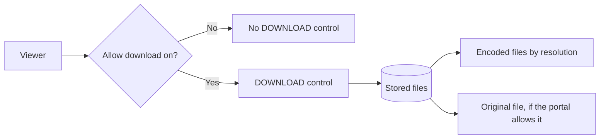

# Download

Use this guide to save a copy of media, and to turn downloads on or off for your own media.

## MediaCMS Architecture

The download control reads two things: the **Allow download** setting of the media, and the files that the server stores. A video has one file for each encode and the original file.

## Download media

1. Open the media page.
2. Select **DOWNLOAD** under the player. On a small screen, select **More options**, then **Download**.
3. For a video, choose a version. Choose an encoded file, or choose **Original file**.
4. Save the file when your browser asks.

For an image, audio, or PDF item, **DOWNLOAD** saves the file at once.

!!! note
    You do not see **DOWNLOAD** when the owner turned downloads off or when the portal owner turned off the control. The portal owner can also hide the original file.

## Turn downloads on or off for your media

1. Open the media page.
2. Select **EDIT**, then open the **Publish** tab.
3. Select **Allow download** to turn downloads on. Clear it to turn them off.
4. Select **Publish Media**.

Downloads are on by default.

## Turn downloads on or off for many items

1. Select **My media** in the menu.
2. Select the check boxes of the media items.
3. Select **Bulk Actions**, then **Settings**, then **Enable Download** or **Disable Download**.
4. Confirm.
