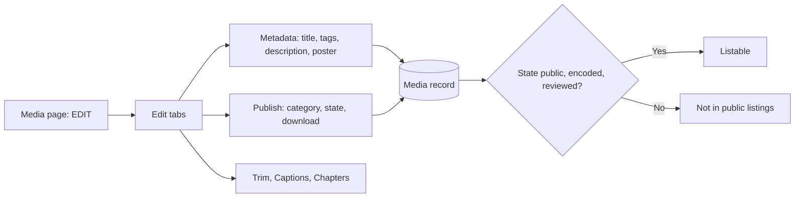

# Edit your media

Use this guide to change the title, tags, description, state, and other settings of media that you own.

## MediaCMS Architecture

The edit page has tabs. Each tab changes a different part of the media record. The **Publish** tab changes who can see the media.

You can edit media when you are the owner. You can also edit media when an owner gave you the **editor** permission, when you are a **contributor** in a matching RBAC category, or when you are a portal editor or manager.

## Open the edit page

1. Open the media page.
2. Select **EDIT**.
3. Select a tab: **Metadata**, **Trim**, **Captions**, **Chapters**, **Publish**, or **Replace**.

!!! note
    **Trim**, **Captions**, and **Chapters** appear for video and audio only. **Replace** appears only when the portal owner turns it on.

## Change the metadata

1. Open the **Metadata** tab.
2. Change **Title**.
3. Enter **Tags** as a comma separated list.
4. Enter the **Description**.
5. Clear **Enable comments** to turn comments off for this media.
6. For a video, enter **Thumbnail Time (seconds)** to choose the thumbnail frame.
7. For video and audio, select a file for **Poster Image** to use your own image. The file must be 5 MB or smaller.
8. Select **Update Media**.

!!! note
    The **Slug** field appears only when the portal owner allows custom media URLs. The slug can contain letters, numbers, hyphens, and underscores.

## Change the state and the category

1. Open the **Publish** tab.
2. Select **Category** and choose one or more categories.
3. Under **State**, select **Private**, **Unlisted**, or **Public**.
4. Select or clear **Allow download**.
5. Select **Publish Media**.

| State | Who can find the media | Who can open it |
|-------|------------------------|-----------------|
| **Public** | Everyone, in listings, when the media is listable | Everyone |
| **Unlisted** | Nobody in listings | Anyone who has the link |
| **Private** | Nobody in listings | You and people you gave access to |

!!! note
    The portal owner can limit the states that you can pick. When the portal workflow is not public, you can pick only **Private** and **Unlisted**. An editor can pick **Public** for you.

The fields **Featured**, **Reported times**, and **Is reviewed** are read-only for you. Only editors and managers can change them. See [Review and publish](../operator/review.md).

## Add captions, trim, or replace

- Select **Captions** to add subtitles. See [Captions](captions.md).
- Select **Trim** to cut the video. See [Trim](trim.md).
- Select **Replace** to upload a new file for the same media.

## Delete media

1. Open the media page.
2. Select **More options**, then **Delete**.
3. Confirm.

!!! warning
    Delete removes the media and its files. You cannot undo it.
