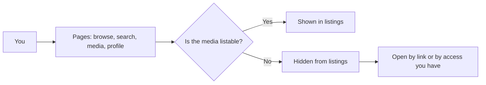

# User guides

Use these guides to watch, upload, and share media in MediaCMS. You do not need special powers for most tasks.

| Task | Guide |
|------|-------|
| Find and play media | [Browse and play](browse.md) |
| Find media by text, type, or date | [Search](search.md) |
| Add a video, audio, image, or PDF file | [Upload](upload.md) |
| Change title, description, tags, and state | [Edit your media](edit.md) |
| Add subtitles to a video | [Captions](captions.md) |
| Add comments, mentions, and timestamps | [Comments and mentions](comments.md) |
| Group media in a list | [Playlists](playlists.md) |
| Send a link or embed media | [Share and embed](share.md) |
| Cut a video | [Trim](trim.md) |
| Change your picture and details | [Profile](profile.md) |
| Save a copy of media | [Download](download.md) |

## MediaCMS Architecture

You use the public pages of MediaCMS. These pages read media records from the database. They play files that the server stores.

Media is **listable** when all three conditions are true:

- The media state is **public**.
- Encoding succeeded.
- The media is reviewed. On many portals new media is reviewed at upload. On other portals an editor must mark it as reviewed first.

Media that is not listable does not appear in public listings. You can still open your own media. You can also open media that other people shared with you.

!!! note
    The portal owner sets some rules. For example, the portal owner decides who can upload, who can comment, and whether new media is public. If a control is missing, ask the portal owner.

## Before you start

- Sign in to upload, comment, make playlists, or edit a profile. You can browse without an account when the portal allows it.
- If your account needs approval, you can browse but you cannot change anything. A manager must approve your account first.
