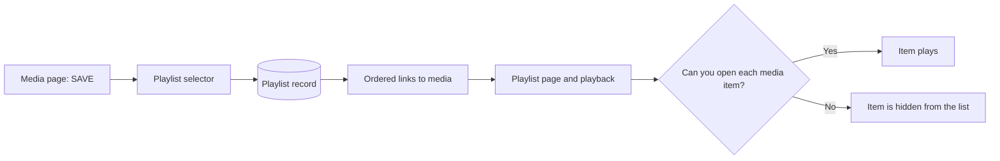

# Playlists

Use this guide to group media in an ordered list and to play the list.

## MediaCMS Architecture

A playlist is a list that belongs to one user. It holds links to media. It does not copy the media files.

The playlist page hides items that the viewer cannot open. Adding a private item to a playlist does not make the item public.

## Create a playlist and add media

1. Sign in.
2. Open a media page.
3. Select **SAVE**.
4. Select **Create a new playlist**.
5. Enter the playlist title. Enter a description if you want.
6. Select **CREATE**.

The media is now in the playlist.

## Add media to an existing playlist

1. Open a media page.
2. Select **SAVE**. The window **Save to...** opens.
3. Select the check box of the playlist.

Clear the check box to remove the media from the playlist.

## Find your playlists

1. Select **My playlists** in the menu.
2. Select a playlist to open it.

You can also open your profile and select **Playlists**.

## Play a playlist

1. Open a playlist.
2. Select a media item. The player plays the items in order.

## Edit a playlist

1. Open the playlist. You must be the owner.
2. Select **EDIT**. The window **Edit playlist** opens.
3. Change the title or the description.
4. Select **UPDATE**.

!!! note
    The portal owner sets the maximum number of media items in one playlist. If you cannot add more items, the playlist is full.

## Delete a playlist

1. Open the playlist. You must be the owner.
2. Open the playlist options and select **Delete**.
3. Select **PROCEED**.

!!! warning
    Deleting a playlist does not delete the media. It removes only the list.
