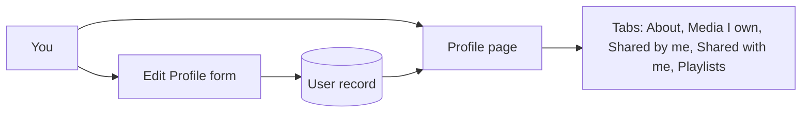

# Profile

Use this guide to change your profile, to find your media, and to delete your account.

## MediaCMS Architecture

Your profile is a user record with a page for each list: media, playlists, and about. Only you and managers can edit the profile.

## Open your profile

1. Select your picture at the top of the page to open the user menu.
2. Select the link to your profile.

## Edit your profile

1. Open your profile.
2. Select the edit icon (**Edit profile**) on your profile page.
3. Change **full name**, **About me**, or the logo.
4. Select or clear the notification option. When it is selected, you receive an email when someone comments on your media.
5. Select **Update Profile**.

!!! note
    The logo file must be 2 MB or smaller. If you signed in through an identity provider, you cannot change your name here.

## Use the profile tabs

- **About** shows your description.
- **Media I own** lists your media. You can filter it by sharing, tag, and sort order.
- **Shared by me** lists media that you shared with other users.
- **Shared with me** lists media that other users shared with you.
- **Playlists** lists your playlists. See [Playlists](playlists.md).

## Delete your account

1. Open **Edit Profile**.
2. Go to **Danger Zone**.
3. Select **Delete Account**.
4. Confirm.

!!! warning
    This removes all your data, including your media and playlists. You cannot undo it.

## Change your role or approval

You cannot change your own role or approval. A manager does that. See [Manage users](../operator/manage-users.md).
