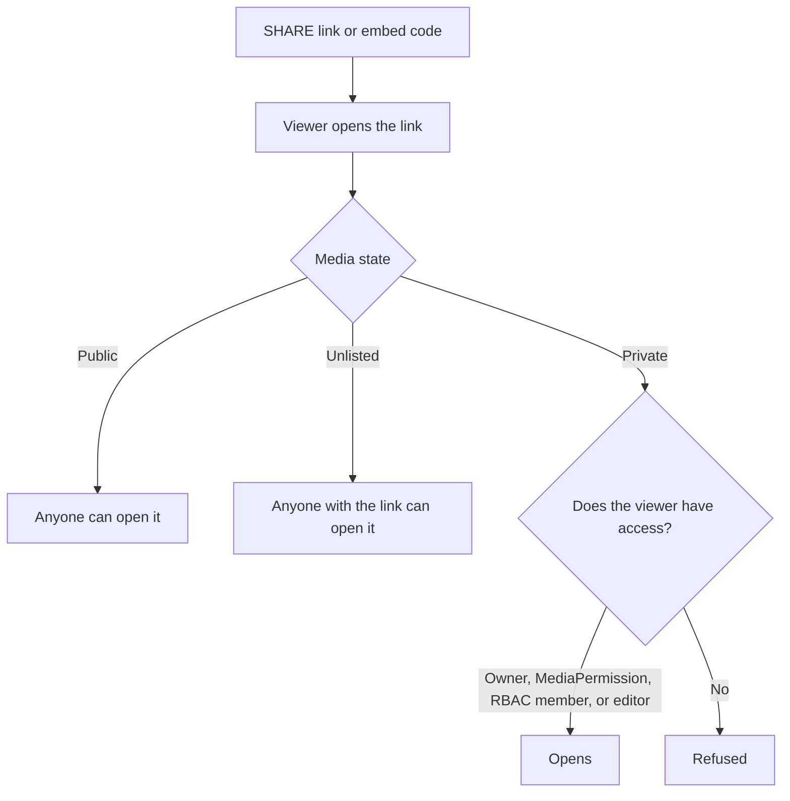

# Share and embed

Use this guide to send a link to media, to start the link at a time, to embed media in another page, and to share private media with named users.

## MediaCMS Architecture

A link does not give access by itself. The media state and the permissions on the media decide who can open it.

- **Public** and **Unlisted** media open for anyone who has the link. **Public** media also appears in listings when it is listable.
- **Private** media opens only for the owner, for people with a direct share (**MediaPermission**), for members of a matching RBAC category, and for editors.

## Copy a link

1. Open the media page.
2. Select **SHARE**. The window **Share media** opens.
3. Select **COPY**.
4. Paste the link where you need it.

## Start the link at a time

1. Play the video and pause at the time that you want.
2. Select **SHARE**.
3. Select the check box **Start at** *time*.
4. Select **COPY**.

The link has the parameter `t` with the time in seconds. You can add `&t=90` to a media link by hand to start at 90 seconds.

## Send the link by email or social site

1. Select **SHARE**.
2. Select **Email** or a social site in the list.

## Embed media in another page

1. Select **SHARE**.
2. Select **Embed**. The page **Embed Video** opens.
3. Open **Embed options**. Set the **Dimensions** and the **Aspect Ratio**. Set the title options if you want.
4. Copy the embed code.
5. Paste the code in the HTML of the other page.

!!! note
    The viewer must be able to open the media. An embed of private media shows nothing to a viewer who has no access.

## Share private media with named users

1. Open the media page and select **EDIT**, then open the **Publish** tab.
2. Select the state **Private** or **Unlisted**.
3. Select the check box **Shared**. Select **Publish Media**.
4. Select **My media** in the menu.
5. Select the check box of the media item.
6. Select **Bulk Actions**, then **Share with Co-Viewers**, **Share with Co-Editors**, or **Share with Co-Owners**.
7. Search for the users and confirm.

| Choice | What the other user can do |
|--------|----------------------------|
| **Co-Viewer** | Open the media. |
| **Co-Editor** | Open the media and change its metadata. |
| **Co-Owner** | Full control, including deletion. |

Open **Shared by me** and **Shared with me** on a profile to see your shares.

!!! warning
    If you clear **Shared** or change the state to **Private**, the portal removes all direct sharing. The page asks you to confirm.

!!! note
    The portal owner can turn **SHARE** off. If you do not see it, ask the portal owner.
