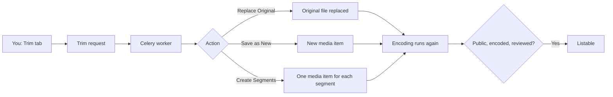

# Trim

Use this guide to cut a video or audio file. You can replace the original, save the cut as new media, or make separate media from segments.

## MediaCMS Architecture

A trim is a request that a Celery worker runs in the background. The trim does not re-encode the file. The worker cuts the file at the times that you set.

- Each new or changed file goes through encoding again. Until encoding succeeds, the media is not listable.
- Only one trim request can run for a video at a time.

## Trim a video

1. Open the media page.
2. Select **EDIT**, then select the **Trim** tab.
3. Play the video. Use the timeline controls of the editor to choose the part to keep.
4. Add more segments if you need them.
5. Choose the action: **Replace Original**, **Save as New**, or **Create Segments**.
6. Confirm the action.

The page shows a message that the video is processing. You see the result at once. The server finishes the work in the background.

| Action | Result |
|--------|--------|
| **Replace Original** | The cut replaces the original file of this media. |
| **Save as New** | The cut becomes a new media item. The original stays. |
| **Create Segments** | Each segment becomes a separate media item. |

!!! warning
    **Replace Original** changes the file of the media. You cannot go back to the earlier file.

!!! note
    The **Trim** tab appears for video and audio only. The portal owner can turn trimming off. If the tab is missing or the page shows **Video Trimmer is not enabled**, ask the portal owner.

## Speed

- If encoding is finished for all resolutions, the trim runs fast.
- If you upload a video and trim it at once, the trim starts the processing. It takes more time.
