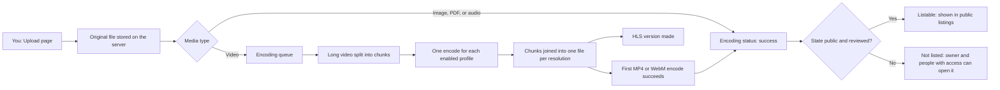

# Upload

Use this guide to add a video, audio, image, or PDF file to MediaCMS.

## MediaCMS Architecture

An upload crosses three stages: the upload, encoding, and the listing. The media appears in public listings only after all three succeed.

- The server stores your original file first.
- A Celery worker encodes video. It makes one encode for each enabled encode profile (for example, 240p, 480p, and 720p).
- Image, PDF, and audio files do not need encoding. Their encoding status is **success** at once.
- For video, the encoding status becomes **success** when at least one MP4 or WebM encode finishes. Other resolutions and the HLS version can finish later.
- If the server cannot read the file, the encoding status is **fail**.
- The media is **listable** when the state is **public**, the encoding status is **success**, and the media is reviewed.

## Upload a file

1. Sign in.
2. Select **Upload media** at the top of the page.
3. Select **Browse your files**, or drag a file into the drop area.
4. Select the file in the file dialog.
5. Wait for the progress bar to complete.
6. Select **View media** to open the media page.

If you cannot select **Upload media**, the portal does not allow you to upload. Read the message on the page.

!!! note
    You can select **Pause** and **Continue** to stop and restart a large upload. Select **Cancel** to stop an upload. Select **Retry** after an error.

## Add information while the file encodes

1. Open the media page.
2. Select **EDIT**.
3. Enter the title, the description, and the tags.
4. Select **Update Media**.

See [Edit your media](edit.md) for all fields.

## What state does the media get?

The portal owner sets the state of new media. A new item can be **public**, **unlisted**, or **private**. Open the **Publish** tab on the edit page to see the state. Change it there if the portal allows you.

!!! warning
    New media can be hidden from public listings for three reasons: the state is not public, encoding is not finished, or the media is not reviewed. You can open the media yourself. Other people cannot find it in listings.

## Check the encoding status

1. Open the media page.
2. Select **More options**, then **Status info**.
3. Read **Encoding Status**. The values are **pending**, **running**, **success**, and **fail**.

If the status is **fail**, ask an editor or an administrator to check the media.

## Limits

- Allowed file types are set by the portal owner. The default types are video, audio, image, and PDF.
- The portal owner sets the maximum file size and the number of files you can upload.
- On some portals, only approved users, users with a verified email, or advanced users can upload.
