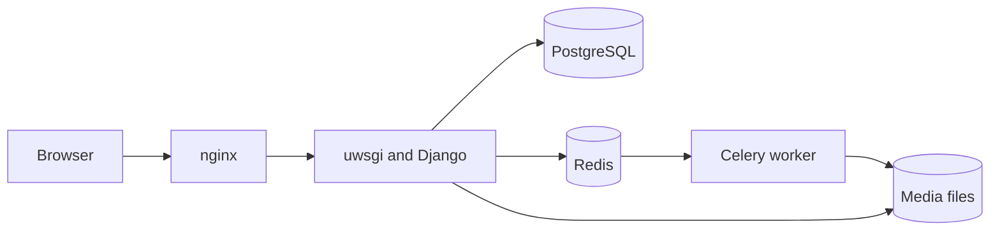

# MediaCMS Documentation

MediaCMS is an open source video and media content management system. It runs on Django and React. It has a REST API.

MediaCMS stores video, audio, image, and PDF files. It encodes video into several resolutions. It can create subtitles with Whisper. It supports roles, categories, playlists, comments, and sharing.

Use this documentation to install MediaCMS, understand each role, and complete common tasks.

## Where to start

| Section | Use it to |
|---------|-----------|
| [Getting started](getting-started/index.md) | Install, deploy, and sign in for the first time. Learn the main concepts. |
| [Roles](roles/index.md) | See what each of the six roles can do. Compare the roles. |
| [Guides](guides/index.md) | Follow step-by-step instructions for users, operators, administrators, and developers. |
| [Scenarios](scenarios/index.md) | Follow one role through one path. Use scenarios as a script for a recording or a test. |
| [This version](reference/this-version.md) | Check which MediaCMS version this documentation describes. |
| [What's new](reference/whats-new.md) | Read the changes in recent releases. |
| [Languages](languages.md) | Find the languages that this documentation supports. |

## MediaCMS Architecture

All pages in this documentation use the same system. A browser talks to the web server. The web server talks to Django. Django stores data in PostgreSQL. Celery workers encode video in the background.

## How to read this documentation

1. Read [Concepts](getting-started/concepts.md) to learn the terms.
2. Open the page for your [role](roles/index.md).
3. Open the guide for your task.

The [writing guide](contributing/writing.md) and the [glossary](contributing/glossary.md) explain the words and style that this documentation uses.
