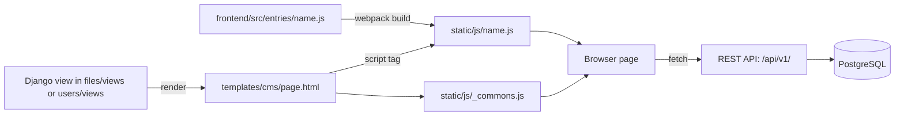

# Node

Reference for the MediaCMS frontend code in `frontend/`.

## The frontend is an application, not an HTTP API

The frontend is a set of React bundles. It does not serve HTTP requests and it has no routes of its own. Django owns the routes, the pages, the data, and the login. Each Django template loads one bundle. The bundle then calls the Django REST API.

For the HTTP API, read the [REST API](api.md) page. This page does not describe any HTTP endpoints.

## MediaCMS Architecture



For the full stack, see [Architecture](../guides/developer/architecture.md). To run and build the frontend, see [Local development](../guides/developer/local-dev.md).

## Entry points

webpack makes one bundle for each `*.js` file in `frontend/src/entries/`. The file name, without `.js`, is the bundle name. The build writes the bundle to `static/js/<name>.js`. The settings are in `frontend/webpack.config.js`.

- A Django template loads `static/js/<name>.js` and `static/js/_commons.js`.
- The shared code of all bundles is in `_commons.js`. The shared styles are in `_commons.css`.
- Most entries call `renderPage('page-<name>', <PageComponent>)`. The page component is in `frontend/src/static/js/pages/`.
- The entry `embed` calls `renderEmbedPage`.
- The entries `add-media` and `base` call `renderPage()` without a page component.

### Known entries

The table lists the entries in `frontend/src/entries/` at the time of writing. Templates are in `templates/`.

| Entry file | Bundle | Page component | Django template | Django page |
|------------|--------|----------------|-----------------|-------------|
| `add-media.js` | `static/js/add-media.js` | None | `cms/add-media.html` | `/upload` |
| `base.js` | `static/js/base.js` | None | `base.html` | Pages that extend `base.html` |
| `categories.js` | `static/js/categories.js` | `CategoriesPage` | `cms/categories.html` | `/categories` |
| `embed.js` | `static/js/embed.js` | `EmbedPage` | `cms/embed.html` | `/embed` |
| `featured.js` | `static/js/featured.js` | `FeaturedMediaPage` | `cms/featured-media.html` | `/featured` |
| `history.js` | `static/js/history.js` | `HistoryPage` | `cms/history.html` | `/history` |
| `index.js` | `static/js/index.js` | `HomePage` | `cms/index.html` | `/` |
| `latest.js` | `static/js/latest.js` | `LatestMediaPage` | `cms/latest-media.html` | `/latest` |
| `liked.js` | `static/js/liked.js` | `LikedMediaPage` | `cms/liked_media.html` | `/liked` |
| `manage-comments.js` | `static/js/manage-comments.js` | `ManageCommentsPage` | `cms/manage_comments.html` | `/manage/comments` |
| `manage-media.js` | `static/js/manage-media.js` | `ManageMediaPage` | `cms/manage_media.html` | `/manage/media` |
| `manage-users.js` | `static/js/manage-users.js` | `ManageUsersPage` | `cms/manage_users.html` | `/manage/users` |
| `media.js` | `static/js/media.js` | `MediaPage` | `cms/media.html` | `/view?m=<token>` |
| `members.js` | `static/js/members.js` | `MembersPage` | `cms/members.html` | `/members` |
| `migration-detail.js` | `static/js/migration-detail.js` | `MigrationDetailPage` | `cms/migration_detail.html` | `/migrations/<id>` |
| `migration-edit.js` | `static/js/migration-edit.js` | `MigrationEditPage` | `cms/migration_edit.html` | `/migrations/<id>/edit` |
| `migration-new.js` | `static/js/migration-new.js` | `MigrationNewPage` | `cms/migration_new.html` | `/migrations/new` |
| `migrations.js` | `static/js/migrations.js` | `MigrationsPage` | `cms/migrations.html` | `/migrations` |
| `playlist.js` | `static/js/playlist.js` | `PlaylistPage` | `cms/playlist.html` | `/playlists/<token>` |
| `profile-about.js` | `static/js/profile-about.js` | `ProfileAboutPage` | `cms/user_about.html` | `/user/<username>/about` |
| `profile-media.js` | `static/js/profile-media.js` | `ProfileMediaPage` | `cms/user.html` | `/user/<username>` |
| `profile-playlists.js` | `static/js/profile-playlists.js` | `ProfilePlaylistsPage` | `cms/user_playlists.html` | `/user/<username>/playlists` |
| `profile-shared-by-me.js` | `static/js/profile-shared-by-me.js` | `ProfileSharedByMePage` | `cms/user_shared_by_me.html` | `/user/<username>/shared_by_me` |
| `profile-shared-with-me.js` | `static/js/profile-shared-with-me.js` | `ProfileSharedWithMePage` | `cms/user_shared_with_me.html` | `/user/<username>/shared_with_me` |
| `recommended.js` | `static/js/recommended.js` | `RecommendedMediaPage` | `cms/recommended-media.html` | `/recommended` |
| `search.js` | `static/js/search.js` | `SearchPage` | `cms/search.html` | `/search` |
| `tags.js` | `static/js/tags.js` | `TagsPage` | `cms/tags.html` | `/tags` |

!!! note
    The table is written by hand. List the folder to check it: `ls frontend/src/entries`. Update the table when you add or remove an entry.

### Add an entry

1. Create `frontend/src/entries/<name>.js`. Call `renderPage('page-<name>', <PageComponent>)`.
2. Create the page component in `frontend/src/static/js/pages/`.
3. Make the Django template load `static/js/<name>.js` and `static/js/_commons.js`.
4. Add the row to the table above.
5. Build with `make build-frontend`.

## Source folders

| Path | Content |
|------|---------|
| `frontend/src/entries/` | Entry files. One for each page. |
| `frontend/src/static/js/pages/` | Page components. |
| `frontend/src/static/js/components/` | Interface components. |
| `frontend/src/static/js/utils/` | Helpers, stores, contexts, and settings. |
| `frontend/tests/` | Jest tests. See [Tests](../guides/developer/tests.md). |

## API documentation with TypeDoc

The repository does not include TypeDoc yet. You can generate a code reference with TypeDoc later in CI or on your computer. This documentation does not need TypeDoc to build.

When TypeDoc is added, follow these rules:

- Start each entry file with a file-level JSDoc comment. Name the Django page and the template that loads the bundle, for example:

    ```js
    /**
     * Entry point for the media page (`/view?m=<token>`).
     * Loaded by `templates/cms/media.html` as `static/js/media.js`.
     */
    ```

- Keep the entry table on this page. TypeDoc output does not replace it.
- Do not add the TypeDoc package to `frontend/package.json` without agreement from the maintainers.
