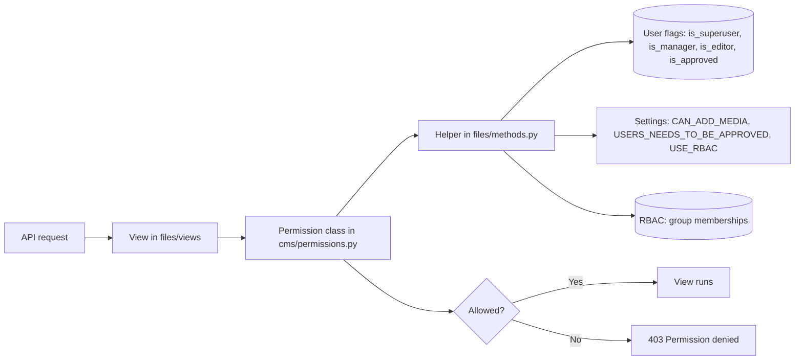

# Python

Reference for the Python helpers that decide who can do what in MediaCMS. The text on this page comes from the docstrings in the source code.

## MediaCMS Architecture

The helpers are in `files/methods.py`. The REST permission classes in `cms/permissions.py` call them. Views and serializers use the permission classes.

For the full stack, see [Architecture](../guides/developer/architecture.md).

## Role helpers

These helpers answer one question about one user. They do not read the request.

### `is_mediacms_editor`

True for **editors**, **managers**, and **superusers**.

::: files.methods.is_mediacms_editor
    options:
      heading_level: 4
      show_root_heading: true

### `is_mediacms_manager`

True for **managers** and **superusers**. An editor is not a manager.

::: files.methods.is_mediacms_manager
    options:
      heading_level: 4
      show_root_heading: true

### `user_is_pending_approval`

True when the setting `USERS_NEEDS_TO_BE_APPROVED` is on, the user is signed in, is not a superuser, and is not approved.

::: files.methods.user_is_pending_approval
    options:
      heading_level: 4
      show_root_heading: true

### `user_allowed_to_upload`

Takes the request. It checks these rules in this order:

1. An anonymous user cannot upload.
2. A pending user cannot upload.
3. An editor, manager, or superuser can upload.
4. A user who has reached `NUMBER_OF_MEDIA_USER_CAN_UPLOAD` cannot upload.
5. The setting `CAN_ADD_MEDIA` decides: `all`, `email_verified`, or `advancedUser`.

::: files.methods.user_allowed_to_upload
    options:
      heading_level: 4
      show_root_heading: true

### `can_edit_category`

A portal manager can always edit a category. When `USE_RBAC` is on and the category is an RBAC category, a manager of that category can also edit it. A contributor cannot rename a category.

::: files.methods.can_edit_category
    options:
      heading_level: 4
      show_root_heading: true

## REST permission classes

The module `cms.permissions` holds the permission classes for the REST API. Each class is a Django REST Framework `BasePermission`.

| Class | Rule |
|-------|------|
| `IsAuthorizedToAdd` | A write request needs `user_allowed_to_upload`. A read request is allowed. |
| `IsAuthorizedToAddComment` | A write request needs `user_allowed_to_comment`. A read request is allowed. |
| `IsUserOrManager` | A write request is allowed for the owner, a manager, or a superuser. |
| `IsUserOrEditor` | A write request is allowed for the owner, an editor, a manager, or a superuser. |
| `IsMediaContributorOrEditor` | A read of a private media item needs member access or editor rights. A `PUT` or `PATCH` is also allowed for an RBAC contributor of the media. |

::: cms.permissions
    options:
      heading_level: 4
      show_root_heading: true
      show_if_no_docstring: true
      members:
        - IsAuthorizedToAdd
        - IsAuthorizedToAddComment
        - IsUserOrManager
        - IsUserOrEditor
        - IsMediaContributorOrEditor
        - user_allowed_to_comment

## The listable rule

A media item appears in public listings only when its field `listable` is true. `Media.save()` in `files/models/media.py` sets `listable` on each save. The value is true when **all** of these are true:

| Condition | Meaning |
|-----------|---------|
| `state == "public"` | The media is public. Private and unlisted media never appear in listings. |
| `encoding_status == "success"` | Encoding finished without error. |
| `is_reviewed is True` | An editor or manager reviewed the media. When `MEDIA_IS_REVIEWED` is `True`, new media starts as reviewed. |

Otherwise `listable` is false. A listable media item is not the same as an accessible media item. A user can open an unlisted media item by its URL even though it is not listable.

## RBAC role names

The `rbac` app has three role names. They are in `RBACRole` in `rbac/models.py`. A role belongs to one user in one `RBACGroup`. Categories link to groups. The setting `USE_RBAC` turns the feature on.

| Role name | Value | What it allows in the categories of the group |
|-----------|-------|-----------------------------------------------|
| Member | `member` | See the media in the categories. |
| Contributor | `contributor` | See the media. Add media to the categories. Edit media. A contributor cannot rename a category. |
| Manager | `manager` | Do what a contributor does. Edit the category title, description, and thumbnail. |

!!! warning
    The RBAC role **manager** is not the portal role **manager**. The portal role is the user flag `is_manager`. It applies to the whole portal. The RBAC role applies to the categories of one group. Use `is_mediacms_manager` for the portal role and `user.has_manager_access_to_category(category)` for the RBAC role.

See [Permissions and RBAC](../guides/operator/permissions.md) for the operator view.
