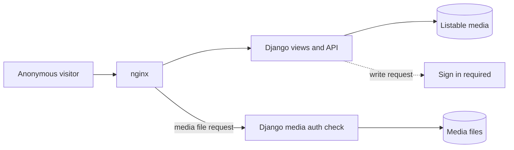

# Anonymous

An anonymous user is a visitor who is not signed in.

## What an anonymous user can do

- Browse listable media on the home page, in categories, and in search results.
- Play public media.
- Open an unlisted media item when the user has the URL.
- Read comments on public media.

## What an anonymous user cannot do

- Upload media.
- Write comments.
- Create playlists.
- Open private media.
- Open Manage pages or the admin portal.

Each write action asks the visitor to sign in. Select **Sign in** to continue.

!!! note
    If `GLOBAL_LOGIN_REQUIRED` is `True`, the portal asks every visitor to sign in first.

## Browse as an anonymous user

1. Open the portal address in a browser.
2. Look at the media on the home page.
3. Select a media item to play it.
4. Enter a word in the search field. Press **Enter**.

See [Browse and play](../guides/user/browse.md) and [Search](../guides/user/search.md).

## MediaCMS Architecture

An anonymous request reaches only the read paths. Django returns only listable media in listings. Writes return an authentication error. nginx asks Django before it serves a protected media file.

## Scenarios

- [Anonymous browse](../scenarios/anonymous-browse.md)
- [Anonymous sign-in required](../scenarios/anonymous-signin-required.md)
