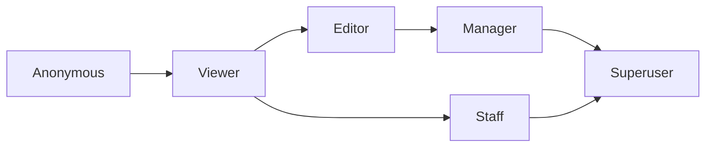

# Compare roles

Use this table to compare the six roles. The section **Pending users** below the table describes the pending state.

| Power | Anonymous | Viewer | Editor | Manager | Staff | Superuser |
|-------|-----------|--------|--------|---------|-------|-----------|
| Browse listable media | Yes | Yes | Yes | Yes | Yes | Yes |
| Upload media | No | Yes¹ | Yes¹ | Yes¹ | Yes¹ | Yes |
| Private media | No | Own media and shared media | All media | All media | Own media and shared media² | All media |
| Manage pages | No | No | Media and comments | Media, comments, and users | No³ | Yes |
| Admin portal | No | No | No | No | Yes | Yes |
| Approve users | No | No | No | Yes | Yes⁴ | Yes |
| Content migration | No | No | No | No | No | Yes |
| Site upgrade | No | No | No | No | No | Yes |

1. The setting `CAN_ADD_MEDIA` can limit upload to users with verified email or to advanced users.
2. A staff user sees all media in the admin portal, if an administrator granted the model permission.
3. A staff user opens the Manage pages only when the user is also an editor, a manager, or a superuser.
4. A staff user approves users in the admin portal, if an administrator granted the model permission.

## Pending users

A pending user is a signed-in user who is not approved. The setting `USERS_NEEDS_TO_BE_APPROVED` must be `True`. A pending user has the same powers as an anonymous user for reading. A pending user cannot upload, edit, or open Manage pages. Superusers are never pending.

## How the roles build on each other

- A manager has all editor powers.
- A superuser has all manager and editor powers.
- A staff user has the viewer powers and the admin portal. A staff user has no editor or manager powers unless an administrator also sets those flags.

## MediaCMS Architecture

An arrow means the next role adds powers to the previous role.

## Next step

Read the page for your role from [Roles](index.md).
