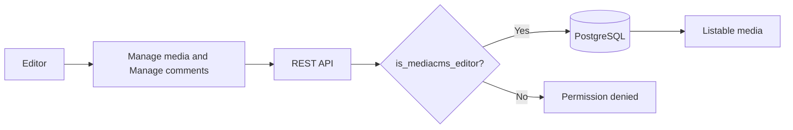

# Editor

An editor is a user with the flag `is_editor`. An editor has all viewer powers.

## What an editor can do

- Open **Manage media** and **Manage comments**.
- Open and edit the media of other users, including private media.
- Mark media as reviewed.
- Change the state of media to public, private, or unlisted.
- Delete comments.
- Clear reports on media.

## What an editor cannot do

- Open **Manage users**. Only managers and superusers can open it.
- Approve users.
- Open the admin portal, unless the user is also staff.

## Review media

Review applies when `MEDIA_IS_REVIEWED` is `False`. Media is not listable until a reviewer marks it as reviewed.

1. Open **Manage media**.
2. Select the **Needs review** filter.
3. Open a media item. Check the title, the description, and the file.
4. Select the media item. Select **Mark as reviewed**.
5. Check that the media shows in public listings. The state must be public and the encoding status must be `success`.

See [Manage media and comments](../guides/operator/manage-media.md) and [Review and publish](../guides/operator/review.md).

## MediaCMS Architecture

Manage pages call the same REST API as the rest of the portal. The helper `is_mediacms_editor` allows editors, managers, and superusers.

## Scenarios

- [Editor review](../scenarios/editor-review.md)
- [Editor moderate comment](../scenarios/editor-moderate-comment.md)
